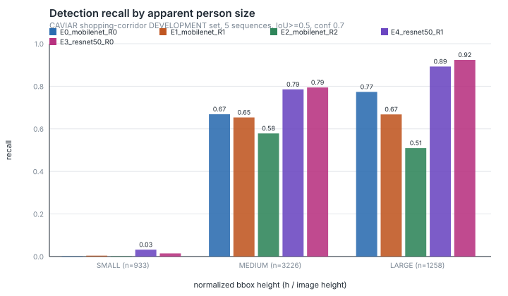
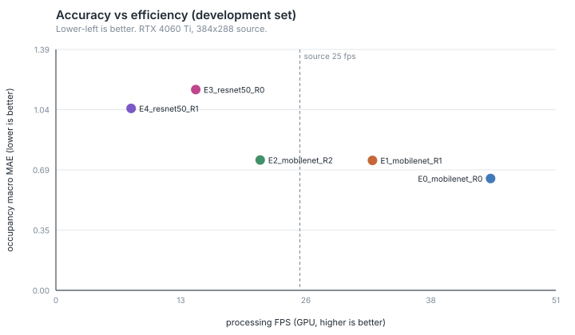
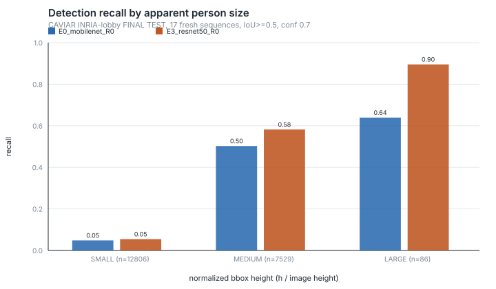

# A5 — Small-Person Robustness

*밥플래너 AI-1. A4(`reports/cctv_a4_cross_video.md`)에 이어지는 문서.*

작성 시점: 2026-08-28
상태: **fresh test 1회 완료. 급식소 검증 아님. fine-tuning 없음**

> 이 문서의 데이터는 **EC Funded CAVIAR project / IST 2001 37540**
> (<http://homepages.inf.ed.ac.uk/rbf/CAVIAR/>)에서 왔다. 라이선스는
> Creative Commons BY-SA다. 라이선스가 요구하는 출처 표기다.

---

## 1. Motivation

A4에서 두 가지가 남았다.

```
  occupancy   오차의 절반가량이 사람을 못 본 것에서 나왔다
  entry       통과 계수 recall이 0.4대까지 떨어졌고, 그 직접 원인도 누락이었다
```

누락이라는 것까지는 알았지만 **왜** 누락인지는 몰랐다. 가장 그럴듯한 설명은
"화면에서 작게 보이는 사람을 못 본다"였다. CAVIAR은 384x288이고, 복도 끝에
선 사람은 세로 20픽셀 남짓이다.

그렇다면 해상도를 올리거나 더 큰 모델을 쓰면 회복되어야 한다. 이 단계는 그
가정을 검증한다.

**A4의 한 문장을 먼저 고쳤다.** A4 보고서는 "추적이 occupancy를 돕지 않는다는
것이 여러 영상에서 확인되었다"고 적었다. 이것은 관찰이 아니라 **코드의 구조적
항등**이었다.

```python
    # tracking.py — 확정되었고 이번 프레임에 갱신된 track만 내보낸다
    if track.state is TrackState.CONFIRMED and track.time_since_update == 0
```

`min_hits=1`이고 검출 임계값이 tracker의 `high_threshold`보다 높으면, 모든
검출이 첫 프레임에 확정되고 갱신되지 않은 track은 빠진다. 즉 occupancy가
검출 수와 **항상** 같아진다. 여러 영상에서 같은 값이 나온 것은 증거가 아니라
같은 항등식을 여러 번 쓴 것이다. 임계값을 0.3(< high_threshold 0.5)으로
낮추자 즉시 어긋났다 — `frame 0: detections 2 -> occupancy 1`. A4 문서와
`research/cctv_counting/README.md`를 고쳤다.

**A4 TEST set은 이 단계부터 ANALYSIS set이다.** 결과를 이미 보았으므로 더
이상 "손대지 않은 test set"이 아니다. A4 당시 one-shot TEST였다는 사실 자체는
그대로 남긴다.

## 2. Research Questions

**RQ-A5-1.** 검출 누락이 화면상 작은 사람에 몰려 있는가?
**RQ-A5-2.** 실효 해상도를 올리면 작은 사람 recall이 회복되는가?
**RQ-A5-3.** 모델 용량을 키우면 회복되는가? 계산 비용은 얼마인가?
**RQ-A5-4.** 처음 보는 장소에서도 같은 결론이 유지되는가?

사전에 기록한 가설:

| | |
|---|---|
| **H1** (A4에서 이어짐, 재검증) | 오탐 상당수는 한 자리에 계속 머무는 구조물이다. 해상도를 올리면 줄어드는가 늘어나는가? |
| **H4** (A5 신규) | 통과 계수 누락의 상당 부분은 **작은 화면 크기에서 생긴 검출 실패**로 설명된다. |

## 3. Dataset Split

같은 시퀀스의 이웃 프레임은 서로 거의 같다. 그것을 나누어 "다른 데이터"라고
부르지 않는다. **분할 단위는 시퀀스다.**

| 역할 | 장소 | 시퀀스 | 용도 |
|---|---|---|---|
| DEVELOPMENT | CAVIAR 쇼핑센터 복도 | 5 | 후보 비교, 선택 |
| ANALYSIS | CAVIAR 쇼핑센터 복도 | 8 | 원인 분석 (A4의 옛 TEST) |
| **FINAL TEST** | **CAVIAR INRIA 로비** | **17** | **한 번만. 선택 이후.** |

FINAL은 **다른 장소, 다른 카메라**다. A4까지 한 번도 추론한 적이 없다.
시퀀스를 고르지 않았다 — 계열별 규칙으로 자격 있는 계열을 전부 넣었다
(`final_sequences.json`). 유리한 것만 고르면 test가 아니다.

두 집합의 사람 크기 분포가 크게 다르다. 이것이 이 단계 결과의 핵심 배경이다.

| | SMALL (h<0.10) | MEDIUM | LARGE (h>=0.20) | 합계 |
|---|---|---|---|---|
| DEVELOPMENT | 933 (17.2%) | 3,226 (59.6%) | 1,258 (23.2%) | 5,417 |
| **FINAL TEST** | **12,806 (62.7%)** | 7,529 (36.9%) | 86 (0.4%) | 20,421 |

로비 세트는 사람이 대부분 멀리 있다. 즉 **FINAL은 DEV보다 본질적으로 훨씬
어려운 집합**이다. 이것을 알고도 바꾸지 않았다. 쉬운 쪽으로 갈아타면 test의
의미가 없어진다.

### 채점 프레임을 맞췄다

로비 시퀀스는 GT XML이 영상보다 짧다(`Rest_WiggleOnFloor`는 107프레임 차이).
GT에 없는 프레임을 "0명"으로 채점하면 그 프레임의 검출이 전부 오탐이 되어
오탐률이 부풀려진다. 그래서 **검출 프레임과 GT 프레임의 교집합만** 채점한다.

```python
    scored = sorted(set(detections) & set(gt_frames))
```

이 수정은 FINAL 실행 전에 들어갔고 DEV 집계는 그 이전 코드로 만들어져 있었다.
두 숫자를 나란히 놓으려면 같은 코드에서 나와야 하므로, 캐시된 검출 상자로
DEV를 다시 집계했다. **다섯 후보 모두 소수점 아래 9자리까지 동일했고**
(쇼핑센터 시퀀스에는 어긋남이 없었다) 동결된 선택 규칙을 다시 적용해도 같은
후보가 나왔다. 기록은 `development_reproduction_check.json`이다.

## 4. Apparent Person Size Definition

**결과를 보기 전에 고정했다.** 나중에 경계를 옮기면 어떤 분포든 원하는
이야기로 만들 수 있다.

```
  주 변수   normalized_bbox_height = bbox_height / image_height
  보조      normalized_bbox_area   = bbox_area / (image_width * image_height)

  SMALL    h/H <  0.10          CAVIAR 288px 기준 약 29px 미만
  MEDIUM   0.10 <= h/H < 0.20   약 29 ~ 58px
  LARGE    h/H >= 0.20          약 58px 이상
```

높이를 주 변수로 쓴다. 서 있는 사람에서 높이가 거리와 가장 곧게 대응하고,
넓이는 자세와 가림에 더 흔들리기 때문이다. 경계값은 위쪽 구간에 넣는다
(0.10은 MEDIUM, 0.20은 LARGE).

정답과 검출의 대응은 **IoU >= 0.5, greedy 내림차순, 1:1**이다. 한 검출이 두
정답에 붙으면 recall과 precision이 동시에 부풀려지므로 금지한다. Hungarian
대신 greedy를 쓴 것은 IoU 0.5 이상에서 경합이 드물기 때문이고, 이 선택을
여기 적어 둔다.

**가려진(occluded) 정답 상자는 검출 recall의 분모에서 뺀다.** 보이지 않는
사람을 못 찾은 것을 detector의 실패로 세면 안 된다. occupancy 정답에는
넣는다 — 그 사람은 여전히 그 공간에 있다.

## 5. Detector Transform Audit

**이 절이 이 단계에서 가장 값이 있었다.** 해상도 실험을 시작하기 전에,
torchvision detector가 입력을 어떻게 바꾸는지 확인했다.

`GeneralizedRCNNTransform`은 입력을 받아 짧은 변을 `min_size`에 맞추고, 그
과정에서 긴 변이 `max_size`를 넘으면 다시 줄인다. 즉 **384x288을 밖에서
2배로 키워서 넣어도 아무 일도 일어나지 않는다.** 모델이 어차피 자기 크기로
다시 맞추기 때문이다. 이것을 모르고 외부 resize를 실험했다면 "해상도를 올려도
효과가 없다"는 틀린 결론을 냈을 것이다.

실제로 모델의 transform에 직접 물어서 확인했다.

| profile | min_size / max_size | 384x288이 실제로 들어가는 크기 | 배율 |
|---|---|---|---|
| R0 (기본) | 800 / 1333 | **800 x 1066** | 2.78x |
| R1 | 1200 / 2000 | **1200 x 1600** | 4.17x |
| R2 | 1600 / 2666 | **1600 x 2133** | 5.56x |

`max_size`를 함께 올리지 않으면 의도한 해상도가 나오지 않는다. `min_size=1200,
max_size=1333`으로 두면 긴 변이 먼저 1333에 걸려 **짧은 변은 999밖에 되지
않는다.** 그래서 코드가 이 조합을 거부한다.

```python
    # 설정 검증은 torch를 부르기 전에 끝낸다.
    if self.min_size is not None and self.max_size is None:
        raise DetectorLoadError(
            "min_size를 바꾸면 max_size도 함께 지정해야 합니다. "
            "긴 변이 max_size에 걸려 의도한 해상도가 나오지 않습니다."
        )
```

기본값 R0조차 이미 2.78배 확대라는 점을 기억할 필요가 있다. "원본이 작으니
키우면 좋아질 것"이라는 직관은 이미 한 번 적용된 뒤였다.

## 6. Candidate Models

**결과를 보기 전에 고정했다.** 완전 조합을 돌리지 않는다 — 축 하나씩만
움직인다. detector 계열은 2개, 해상도 profile은 3개로 제한했다.

| 태그 | 모델 | 해상도 profile |
|---|---|---|
| E0 | fasterrcnn_mobilenet_v3_large_fpn | R0 (기본) |
| E1 | fasterrcnn_mobilenet_v3_large_fpn | R1 |
| E2 | fasterrcnn_mobilenet_v3_large_fpn | R2 |
| E3 | fasterrcnn_resnet50_fpn_v2 | R0 (기본) |
| E4 | fasterrcnn_resnet50_fpn_v2 | R1 |

가중치는 둘 다 torchvision 배포 COCO_V1이다. **fine-tuning 없음.** 검출
임계값은 A4에서 정한 0.7로 고정했다 — 이 단계의 축은 해상도와 모델이다.

환경은 `metadata.json`에 있다. torch 2.13.0+cu130, torchvision 0.28.0+cu130,
CUDA 13.0, RTX 4060 Ti 16GB.

## 7. Development Results

쇼핑센터 5 시퀀스, GT 상자 5,417개, 검출 임계값 0.7.

| 후보 | 입력 크기 | recall | SMALL | MEDIUM | LARGE | 오탐/frame | occ MAE | bias | fps | VRAM |
|---|---|---|---|---|---|---|---|---|---|---|
| **E0** mobilenet R0 | 800x1066 | 0.578 | **0.000** | 0.669 | 0.773 | 0.588 | **0.644** | −0.08 | **40.7** | **270 MB** |
| E1 mobilenet R1 | 1200x1600 | 0.545 | 0.004 | 0.654 | 0.668 | 0.540 | 0.748 | −0.17 | 32.1 | 493 MB |
| E2 mobilenet R2 | 1600x2133 | 0.463 | 0.000 | 0.578 | 0.510 | 0.632 | 0.751 | −0.16 | 21.1 | 806 MB |
| E3 resnet50 R0 | 800x1066 | **0.690** | 0.015 | **0.794** | **0.924** | 1.401 | 1.156 | +0.95 | 14.3 | 577 MB |
| E4 resnet50 R1 | 1200x1600 | 0.681 | **0.032** | 0.785 | 0.893 | 1.109 | 1.048 | +0.62 | 7.8 | 1059 MB |





**RQ-A5-2 (해상도)의 답: 아니다.** 해상도를 올리면 recall이 **떨어졌다**
(0.578 → 0.545 → 0.463). SMALL recall은 0.000에서 0.004로 갔다가 다시 0.000이
되었다. 실효 입력이 2.78배에서 5.56배로 커졌는데도다.

이것이 반직관적으로 보이지만 이유가 있다. COCO로 학습된 detector는 학습
당시의 객체 크기 분포에 맞춰져 있다. 입력을 더 키우면 사람은 픽셀로는 커지지만
**모델이 기대하는 크기 범위 밖으로 나가고**, 동시에 원본에 없던 보간 흐림이
확대된다. 없는 정보는 확대해도 생기지 않는다.

**RQ-A5-3 (용량)의 답: 검출은 개선, 계수는 악화.** resnet50은 recall을
0.578에서 0.690으로 올렸다. 그런데 occupancy MAE는 0.644에서 1.156으로 **나빠졌다.**
오탐이 0.588에서 1.401로 늘었기 때문이다. 더 많이 찾았지만 더 많이 헛봤다.

**SMALL recall은 어느 조건에서도 사실상 0이다** (최대 0.032). 933개의 작은
정답 상자에 대해 다섯 조건 모두 실패했다. 이 단계에서 시험한 어떤 축으로도
작은 사람 문제는 풀리지 않았다.

## 8. Candidate Selection

**FINAL 결과를 보기 전에 규칙과 후보를 동결했다.**
(`final_test_freeze.json`, sha256 `fa32b378dd68f4d2…`)

```
  1) DEVELOPMENT occupancy macro MAE 최소
  2) MAE 차이가 0.1명 이내이면 small-person recall 높은 쪽
  3) 그래도 동률이면 crossing recall 평균 높은 쪽
  4) 그래도 동률이면 FPS 높은 / 단순한 쪽
```

0.10명이라는 여유폭은 DEV 평균 인원이 1.2~1.6명이라 그 6~8% 수준이라는
근거로, **결과를 보기 전에** 정했다.

규칙 1에서 E0(0.644)이 단독 최소였다. 두 번째로 좋은 E1이 0.748이므로 0.10
여유폭 안에 드는 후보가 없었다. **선택: E0 = 기본 mobilenet, 기본 해상도.**

즉 이 단계에서 시험한 어떤 변경도 채택되지 않았다. 그래도 이것은 헛수고가
아니다 — "해상도를 올리면 된다"와 "큰 모델을 쓰면 된다"를 **둘 다 배제한 것**이
결과다.

**대조군으로 E3(resnet50 R0)도 FINAL에서 함께 돌렸다.** DEV에서 recall이 가장
높았던 조건이다. **선택에 쓰지 않았다.** FINAL 결과를 보고 후보를 바꾸지 않는다.

## 9. Fresh Test Results

**한 번만 돌렸다.** 로비 17 시퀀스, 채점 프레임 15,693, GT 상자 20,421.

| | E0 (선택) | E3 (대조) |
|---|---|---|
| recall (micro / macro) | 0.218 / 0.235 | **0.253 / 0.276** |
| SMALL recall (n=12,806) | 0.048 | **0.055** |
| MEDIUM recall (n=7,529) | 0.503 | **0.582** |
| LARGE recall (n=86) | 0.640 | **0.895** |
| 오탐 / frame | 0.951 | **0.065** |
| occupancy macro MAE | **0.820** | 1.252 |
| occupancy bias | **−0.415** | −1.252 |
| 시퀀스 간 MAE 표준편차 | 0.401 | 0.563 |
| 통과 IN (P / R / F1) | 0.917 / 0.579 / 0.710 | 0.867 / **0.684** / **0.765** |
| 통과 OUT (P / R / F1) | 0.846 / 0.423 / 0.564 | 0.895 / **0.654** / **0.756** |
| 속도 / VRAM | **45.1 fps / 270 MB** | 13.8 fps / 581 MB |



**recall이 0.578에서 0.218로 무너졌다.** 장소가 바뀌자 검출의 4/5를 놓친다.
이유는 3절의 표에 있다 — 로비 GT의 62.7%가 SMALL이고, SMALL recall은 0.048이다.
새로운 실패가 아니라 **DEV에서 이미 보인 실패가 지배적인 조건으로 옮겨간 것**이다.

**동결된 선택은 지켜졌다.** E0의 occupancy MAE(0.820)가 E3(1.252)보다 낮다.
선택 기준으로 삼은 지표에서 선택한 후보가 이겼다.

**그런데 그 승리는 실력이 아니었다.** 다음 절에서 분해한다.

한 가지 DEV 기반 추론을 정정한다. DEV에서 E0이 맞힌 상자의 최소 높이가
0.115여서 "검출 한계선"처럼 보였다. FINAL에서는 0.052까지 맞혔다. 그
바닥은 **detector의 한계가 아니라 DEV 데이터의 바닥**이었다.

놓친 상자와 맞힌 상자의 크기 분포도 이 절의 진단을 뒷받침한다.

```
              놓친 상자 중앙   맞힌 상자 중앙   놓친 것 중 h<0.10
  E0            0.069            0.132              76.3%
  E3            0.066            0.132              79.3%
```

두 모델 모두 **맞히는 것은 0.132 근처, 놓치는 것은 0.069 근처**다. 검출
실패는 크기와 뚜렷하게 얽혀 있다 — 적어도 프레임 단위 검출에서는 그렇다.
10절에서 보듯 통과 사건 단위로 가면 이 관계가 사라진다.

## 10. Crossing Analysis

### H4 판정: **지지되지 않는다**

H4는 "통과 누락의 상당 부분이 작은 화면 크기의 검출 실패로 설명된다"였다.
단순히 대조군의 통과 recall이 올랐다고 지지라고 하지 않는다. 세 단계가
모두 이어져야 한다. ANALYSIS set(쇼핑센터 8 시퀀스, 정답 통과 41건)에서 확인했다.

**1단계 — 놓친 통과가 작은 사람에 몰려 있는가? 사실상 아니다.**

```
  E0이 맞힌 사건   n=18   중앙 높이 0.2101   범위 0.181 ~ 0.444
  E0이 놓친 사건   n=23   중앙 높이 0.1979   범위 0.056 ~ 0.424
```

중앙값 차이는 0.012(6%)에 불과하고 분포가 거의 겹친다. 순위합 검정으로는
작은 쪽으로 약간 치우치지만(z = −2.11), 표본이 41건이고 사전에 검정통계량을
등록하지 않았으므로 **탐색적 관찰로만 취급한다.**

결정적인 것은 크기 구간별 분포다.

| | 정답 통과 | E0 맞힘 | E3 맞힘 |
|---|---|---|---|
| SMALL | **2** | 0 | 0 |
| MEDIUM | 18 | 6 | 10 |
| LARGE | 21 | 12 | 16 |

**통과 사건 41건 중 SMALL은 2건뿐이다.** 선을 넘는 사람은 카메라 앞을 지나므로
대부분 크게 보인다. E0은 LARGE 통과조차 21건 중 9건을 놓쳤다. 즉 통과 누락은
작은 사람의 문제가 아니다.

**2단계 — 대조 detector가 그 사람들의 검출을 회복하는가? 그렇다.**

E0이 놓친 23건 전부에서 해당 인물의 검출 recall이 올랐다.

```
  그 사람의 프레임별 검출 recall 중앙값   E0 0.381  ->  E3 0.609
  검출이 개선된 사건                       23 / 23
```

**3단계 — 회복된 검출이 통과 사건까지 회복시키는가? 절반도 안 된다.**

```
  E0이 놓친 통과 23건 중 E3가 회복한 것   10건 (43.5%)
```

검출이 **전부** 개선되었는데도 통과 사건은 43%만 살아났다. 나머지 13건은
사람을 더 잘 보게 되었는데도 여전히 통과로 세어지지 않았다.

**결론.** 사슬이 1단계에서 끊기고 3단계에서 다시 끊긴다. H4는 지지되지 않는다.
정확한 진술은 이렇다 — 통과 누락은 검출 실패와 관련이 있지만 **작은 크기와는
관련이 약하고**, 검출을 고쳐도 절반 이상이 남는다. 남은 절반은 검출 문제가
아니라 **궤적이 끊겨 선을 넘는 순간을 하나의 연속된 통과로 잇지 못하는 문제**를
가리킨다. 이것이 다음 단계에서 볼 지점이다.

### 통과 계수는 대조군이 확실히 낫다

ANALYSIS와 FINAL 양쪽에서 방향이 같다.

```
  ANALYSIS   E0 recall 0.439 (18/41)   E3 recall 0.634 (26/41)
  FINAL      E0 IN 0.579 / OUT 0.423   E3 IN 0.684 / OUT 0.654
```

즉 **dual path의 두 갈래가 서로 다른 detector를 원한다.** occupancy 기준으로
고른 E0은 통과 계수에서 더 나쁘다. 선택 규칙이 occupancy MAE 하나였기
때문에 이 사실이 선택에 반영되지 않았다. 규칙을 어기고 지금 바꾸지는 않는다.
다음 단계의 사전 등록 사항으로 남긴다.

## 11. Runtime Trade-off

RTX 4060 Ti, 384x288 원본, 원본 프레임률 25 fps.

속도는 다섯 후보를 같은 조건에서 비교하려고 **DEVELOPMENT set 기준**으로
적는다. FINAL에서 잰 값은 E0 45.1 fps, E3 13.8 fps로 비율이 거의 같다.

| 후보 | 처리 fps (DEV) | 실시간 대비 | 최대 VRAM | FINAL recall | FINAL occ MAE |
|---|---|---|---|---|---|
| E0 mobilenet R0 | 40.7 | 1.63x | 270 MB | 0.218 | 0.820 |
| E1 mobilenet R1 | 32.1 | 1.28x | 493 MB | — | — |
| E2 mobilenet R2 | 21.1 | 0.84x | 806 MB | — | — |
| E3 resnet50 R0 | 14.3 | 0.57x | 577 MB | 0.253 | 1.252 |
| E4 resnet50 R1 | 7.8 | 0.31x | 1059 MB | — | — |

E2, E3, E4는 25 fps 원본을 실시간으로 따라가지 못한다. E3로 갈아타면 검출
recall이 0.218에서 0.253으로 오르는 대신 **속도가 2.8배 느려지고 실시간 아래로
떨어진다.** recall 3.5%p를 위해 지불하기에는 큰 값이다. 통과 계수만 놓고 보면
그 값을 지불할 이유가 생기는데, 그 판단은 다음 단계로 넘긴다.

## 12. Failure Cases

### H1 재검증: 해상도를 올리면 구조적 오탐이 **늘어난다**

A4의 H1은 "오탐 상당수가 한 자리에 계속 머무는 구조물"이었다. 총 오탐 수만
비교하면 답이 나오지 않는다 — 한 자리에 200프레임 머무는 오탐과 여기저기
튀는 오탐 200개는 총계가 같지만 원인이 다르다. 그래서 프레임을 16x12 격자로
나누고(결과를 보기 전에 정했다), 한 칸에서 전체 프레임의 20% 이상 나타난
오탐을 **구조적**이라고 불렀다.

DEVELOPMENT set:

| 후보 | 총 오탐 | 구조적 | 산발적 | 구조적 비율 | SMALL 오탐 |
|---|---|---|---|---|---|
| E0 mobilenet R0 | 2,319 | 897 | 1,422 | 0.387 | 2 |
| E1 mobilenet R1 | 2,130 | 1,540 | 590 | 0.723 | 32 |
| E2 mobilenet R2 | 2,495 | **2,327** | **168** | **0.933** | 31 |
| E3 resnet50 R0 | 5,528 | 5,205 | 323 | 0.942 | 146 |
| E4 resnet50 R1 | 4,380 | 3,328 | 1,052 | 0.760 | **623** |

**총계는 거의 변하지 않는데(2,319 → 2,130 → 2,495) 구성이 완전히 뒤집힌다.**
해상도를 올리면 산발적 오탐은 1,422에서 168로 무너지고, 구조적 오탐은 897에서
2,327로 2.6배가 된다. 그리고 SMALL 오탐이 2건에서 31건으로 늘었다.

읽는 방법은 이렇다. 해상도를 올리면 잡음 때문에 우연히 생기던 오탐은 사라진다.
대신 **고정된 물체를 사람이라고 더 확신하게 되고, 매 프레임 같은 자리에서 같은
실수를 반복한다.** §42가 우려한 "높은 해상도가 작은 사물을 더 잘 사람으로
오탐하는" 현상도 실제로 나타났다.

### 선택한 모델의 occupancy 성적은 오차 상쇄였다

FINAL set에서 사후 분석한 것이다(선택에 쓰지 않았다).

| | E0 | E3 |
|---|---|---|
| 총 오탐 | 15,378 | 1,568 |
| 구조적 오탐 | **13,267 (86.3%)** | 400 (25.5%) |
| 그중 LARGE 크기 | 14,244 | 421 |
| 가장 잦은 격자 칸 | (1,7)에서 **10,105 프레임** | (3,7)에서 400 프레임 |

E0은 로비 화면 왼쪽 아래 한 지점에서, 전체 15,693 프레임 중 **10,105 프레임
동안** 있지도 않은 큰 사람을 보고 있었다. E3는 같은 실수를 하지 않는다.

이것이 occupancy 성적에 무엇을 했는지 분해하면:

```
                              E0        E3
  관측된 bias (예측−정답)   −0.303    −1.153   명/프레임
  구조적 오탐의 기여        +0.845    +0.025
  ----------------------------------------------
  구조적 오탐을 뺀 bias     −1.149    −1.178
```

**구조적 오탐을 걷어내면 두 모델의 과소계수가 사실상 같아진다** (−1.149 대
−1.178). E0의 occupancy MAE 우위(0.820 대 1.252)는 더 정확해서가 아니라,
**고정된 허위 인물 하나가 실제 누락을 상쇄해서** 나온 것이다.

이것은 선택 규칙 자체에 대한 경고다. occupancy MAE는 부호가 반대인 두 오류를
서로 지우게 해서, 상쇄가 잘 되는 모델에 상을 준다. 이번에는 그 상이
"거의 아무도 못 보지만 유령이 하나 있어서 숫자는 맞는" 모델에게 갔다.

### 시퀀스별 최악과 최선 (E0, FINAL)

| 시퀀스 | recall | MAE | bias | 오탐/frame |
|---|---|---|---|---|
| Meet_Crowd | 0.092 | 1.70 | −1.20 | 1.10 |
| Meet_WalkSplit | 0.043 | 1.68 | −1.68 | 1.01 |
| Walk1 | 0.091 | 1.36 | −1.28 | 1.01 |
| … | | | | |
| Rest_FallOnFloor | 0.538 | 0.46 | +0.17 | 0.99 |
| Browse_WhileWaiting1 | 0.157 | 0.44 | −0.38 | 1.01 |

가장 나쁜 세 시퀀스는 recall이 0.04~0.09다. 사실상 아무도 보지 못한다.
사람이 여럿 등장하고 서로 멀리 떨어져 걷는 장면이다. 반대로 `Rest_*` 계열은
사람이 바닥에 눕거나 의자에 앉는 장면이라 카메라에 가깝고 크게 보인다.

`Browse_WhileWaiting1`은 MAE가 0.44로 좋아 보이지만 recall이 0.157이다.
**여기서도 MAE가 실패를 가리고 있다.** 지표를 하나만 보면 안 되는 이유다.

## 13. Threats to Validity

- **공개 감시 데이터셋은 급식소가 아니다.** CAVIAR 쇼핑센터 복도와 INRIA
  로비는 실내 고정 카메라라는 점에서만 비슷하다. 배식대, 식판, 줄서기, 급식소
  조명은 없다. 이 문서의 어떤 수치도 급식소 성능이 아니다.
- **COCO pretrained detector를 그대로 썼다.** fine-tuning이 없으므로, 여기서
  본 것은 "도메인 적응 없이 얼마나 되는가"이지 달성 가능한 상한이 아니다.
- **카메라가 두 대뿐이다.** 장소 두 곳의 결과를 일반화라고 부를 수 없다.
- **크기와 가림이 얽혀 있다.** 멀리 있는 사람은 작게 보이는 동시에 다른 사람과
  겹치기 쉽다. "작아서 못 봤다"와 "가려서 못 봤다"를 이 데이터로 완전히
  분리하지 못했다. 가려짐으로 표시된 상자는 recall 분모에서 뺐지만, 데이터셋이
  표시하지 않은 부분 가림은 남는다.
- **공개 annotation의 품질을 검증하지 않았다.** CVML의 상자와 role을 그대로
  믿었다. 사람이 다시 그리지 않았다.
- **통과 계수 정답은 유도된 것이다.** CAVIAR에는 "선을 넘었다"는 라벨이 없다.
  우리가 정한 선의 위치에서 정답 궤적으로부터 계산했다. 선을 다르게 놓으면
  숫자가 달라진다. 정답 생성기는 예측 코드와 독립으로 작성했지만, 과제
  정의 자체는 우리 것이다.
- **통과 사건 표본이 작다.** ANALYSIS 41건, FINAL 45건이다. 통과 관련 수치의
  신뢰구간은 넓다. 10절의 순위합 z값은 탐색적 관찰이다.
- **detector 후보가 5개뿐이다.** 두 계열, 세 해상도로 제한했다. 다른 구조
  (앵커프리, 트랜스포머 계열, 작은 객체 전용 설계)는 시험하지 않았다.
- **타일링을 하지 않았다.** 작은 객체 검출의 표준 수단 중 하나이고 이번
  단계의 주제가 아니었다. 미시험이지 기각이 아니다.
- **가중치의 상업 배포 조건은 여전히 미해결이다.** torchvision 라이브러리
  코드는 BSD-3-Clause이지만, COCO 학습 가중치의 상업 이용 조건은 별개이고
  아직 확인하지 못했다. 이번 결과는 research/demo 평가다.
- **FINAL은 한 번만 돌렸다.** 이것은 의도한 것이지만, 그래서 이 숫자에는
  분산 추정이 없다. 시퀀스 간 표준편차(E0 0.401)를 함께 적은 이유다.

## 14. Conclusion

**해상도를 올리는 것은 답이 아니었다.** 실효 입력을 2.78배에서 5.56배로
키우자 recall이 0.578에서 0.463으로 떨어졌다. COCO 사전학습 detector는 이미
자체 transform으로 2.78배 확대해서 보고 있었고, 그 위에 더 키우는 것은 없는
정보를 확대하면서 학습 시 크기 분포에서 멀어지는 일이었다. 게다가 해상도를
올리자 **구조적 오탐이 2.6배로 늘었다** — 고정된 사물을 더 확신을 갖고 반복해서
사람이라고 부른다.

**모델을 키우는 것도 답이 아니었다.** resnet50은 검출 recall을 올렸지만
(0.578 → 0.690) occupancy MAE는 나빠졌고(0.644 → 1.156), 속도는 실시간
아래로 떨어졌다. "큰 모델이 낫다"로 끝낼 수 있는 결과가 아니다.

**작은 사람 문제는 이 단계의 어떤 축으로도 풀리지 않았다.** SMALL recall은
다섯 조건 전부에서 0.05 미만이었다. 해상도도 용량도 이 병목을 건드리지
못했다. 남는 후보는 학습 데이터 쪽(도메인 적응, fine-tuning)과 입력 처리
쪽(타일링)이다. 둘 다 이번 단계 범위 밖이었다.

**그리고 통과 계수의 병목은 애초에 크기가 아니었다.** H4를 세 단계로 나눠
검증한 결과, 통과 사건 41건 중 작은 사람은 2건뿐이었고, 검출을 전부 개선해도
놓친 통과의 43%만 회복되었다. 나머지는 궤적 연속성 문제다. **"검출 누락이
원인"이라는 A4의 진단은 절반만 맞았다.**

**가장 값진 결과는 지표가 우리를 속인 방식을 잡아낸 것이다.** 선택한 모델은
FINAL에서 occupancy MAE로 이겼지만, 구조적 오탐을 걷어내자 대조군과 과소계수가
같아졌다(−1.149 대 −1.178). 화면 한 지점에 10,105 프레임 동안 서 있던 유령이
실제 누락을 상쇄하고 있었다. MAE는 recall 0.218이라는 사실을 가릴 수 있다.
`Browse_WhileWaiting1`에서도 같은 일이 있었다 — MAE 0.44, recall 0.157.

다음 단계에서 사전 등록할 것:

```
  1. 선택 지표를 occupancy MAE 하나로 두지 않는다.
     최소한 bias와 recall을 함께 건다. 상쇄로 이기는 것을 막는다.
  2. dual path의 두 갈래가 다른 detector를 원한다는 관찰을 정면으로 시험한다.
  3. 통과 누락의 남은 57%를 궤적 연속성 쪽에서 본다.
  4. 도메인 적응과 타일링을 이번에 배제한 축의 대안으로 놓는다.
```

구조는 A4에서 정한 dual path를 유지한다. detector 후보만 바뀔 수 있었고,
이번에는 바뀌지 않았다.

```
  Detector
    ├─ Occupancy   (검출만. 추적을 쓰지 않는다)
    └─ Tracker → Crossing
```

Spring 연동은 이번에도 하지 않았다. 통과 recall 병목이 먼저다.

---

## 재현

```
  실험 기록   research/cctv_counting/experiments/a5_small_person/
  동결 기록   final_test_freeze.json  (sha256 fa32b378dd68f4d2…)
  환경        metadata.json
  선택 설정   selected_config.yaml
  표          development_metrics.csv, final_test_metrics.csv,
              size_recall.csv, crossing_size_analysis.csv
```

원본 영상, 가중치, 대용량 데이터셋은 저장소에 넣지 않는다. 그림은 집계 수치만
그린 SVG이고 **원본 프레임이나 사람 이미지는 포함하지 않는다** — 개인정보와
재배포 조건 때문이다.
