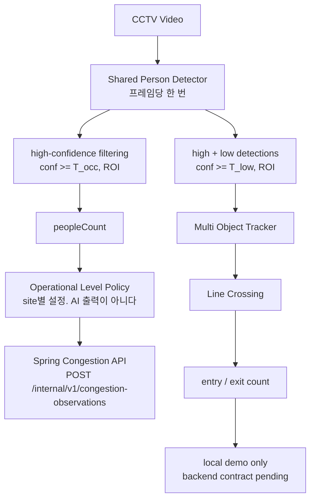

# CCTV Occupancy & Entry Counting — Research Summary (A1–A6)

*밥플래너 AI-1. 단계별 보고서 여섯 편의 요약이다. **여기에 새로운 수치를
만들지 않는다** — 모든 숫자는 아래 문서에서 그대로 가져왔다.*

| 단계 | 문서 |
|---|---|
| A1–A3 | [`cctv_baseline.md`](cctv_baseline.md) |
| A4 | [`cctv_a4_cross_video.md`](cctv_a4_cross_video.md) |
| A5 | [`cctv_a5_small_person.md`](cctv_a5_small_person.md) |
| A6 | [`cctv_a6_trajectory_continuity.md`](cctv_a6_trajectory_continuity.md) |

> 데이터는 **EC Funded CAVIAR project / IST 2001 37540**
> (<http://homepages.inf.ed.ac.uk/rbf/CAVIAR/>), Creative Commons BY-SA.

**연구 트랙은 A6에서 닫혔다.** 이후 변경은 버그 수정, 문서 정오, demo
integration으로 제한한다.

---

## 1. Problem

급식소에 카메라를 달고 두 가지를 센다.

```
  occupancy     지금 몇 명이 있는가        혼잡도 안내에 쓴다
  entry count   몇 명이 들어왔는가        식수 추정의 대리 지표로 쓰려 했다
```

두 값은 다르다. 점심에 300명이 다녀가도 한 순간의 인원은 40명일 수 있다.

**얼굴을 다루지 않는다.** 사람을 영상 밖에서 다시 알아보지 않고 회원 정보와
연결하지 않는다. `track_id`는 영상 한 세션 안에서만 유효한 임시 번호이며
파일로 나가지 않는다. 이 제약이 tracker 선택을 좁혔다 — re-identification
embedding을 쓰는 계열(DeepSORT 등)은 애초에 후보가 아니다.

## 2. Baseline (A1–A3)

torchvision COCO pretrained detector + 저장소 내 구현 tracker + 선 통과
상태 기계. **detector를 torchvision으로 고른 것은 라이선스 때문이다** —
가장 흔한 선택인 Ultralytics YOLO 계열은 AGPL-3.0이고, 제품에 넣으려면
연구 단계의 숫자를 통째로 버려야 한다.

공개 보행자 영상 한 편(79.5초)을 앞 30초(dev) / 뒤 50초(holdout)로 나누고
사람이 직접 센 정답으로 채점했다. holdout은 설정을 고른 뒤 **한 번만** 봤다.

```
  holdout   Occupancy MAE 0.46명   입장 오차 1   퇴장 오차 6   31 fps (RTX 4060 Ti)
```

**표본이 매우 작다.** 영상 한 편의 뒤 구간이고, 이것을 일반화 근거로 쓰지
않는다는 것이 A4를 연 이유다.

## 3. Methodological Audits

숫자보다 이쪽이 이 트랙의 실질이었다. 세 번의 감사가 결론을 바꿨다.

**(1) 추적이 occupancy를 돕는다는 A4의 문장은 관찰이 아니라 코드의 항등식이었다.**

```python
    # tracking.py — 확정되었고 이번 프레임에 갱신된 track만 내보낸다
    if track.state is TrackState.CONFIRMED and track.time_since_update == 0
```

`min_hits=1`이고 검출 임계값이 tracker의 `high_threshold`보다 높으면 occupancy가
검출 수와 **항상** 같아진다. 여러 영상에서 같은 값이 나온 것은 증거가 아니라
같은 항등식을 여러 번 쓴 것이었다. A5에서 발견해 A4 문서를 고쳤다.

**(2) 해상도 실험을 시작하기 전에 detector의 입력 변환을 확인했다.**

`GeneralizedRCNNTransform`은 입력을 자기 크기로 다시 맞춘다. 384×288을 밖에서
2배로 키워 넣어도 아무 일도 일어나지 않는다. 기본 설정조차 이미 2.78배
확대였다. 이것을 모르고 외부 resize를 실험했다면 "해상도를 올려도 효과가
없다"는 **틀린 이유의 옳은 결론**을 낼 뻔했다.

**(3) 낮은 occupancy MAE가 품질이 아니었다.**

```
              recall     오탐/frame    bias       MAE
  E0 (선택)    0.218       0.951       -0.415     0.820
  E3 (대조)    0.253       0.065       -1.252     1.252
```

E0은 더 못 찾고 더 헛봤는데 MAE가 낮다. 누락(음)과 정지 오탐(양)이 프레임
안에서 서로를 지웠다. A6부터 선택 지표를 다목적(주 지표 + recall guardrail)으로
바꿨다.

## 4. Cross-video Evaluation (A4)

CAVIAR 쇼핑센터 front **13편**. 영상 단위로 DEV 5 / TEST 8을 나누고 설정을
고정한 뒤 TEST를 한 번만 평가했다.

**혼잡도에 추적이 필요 없다.** detection-only와 tracking(min_hits=3)의 TEST
macro MAE 차이는 **0.008명**으로 사전 동등 마진 0.25명 안이었다. 그래서
**혼잡도는 검출만, 입장 인원은 추적 + 선 통과**로 갈래를 나눴다.

**집계 bias가 0에 가깝다고 정확한 것이 아니다.** macro bias는 +0.007이지만
밀도별로 보면 단조롭게 갈린다.

| GT 인원 | 표본 | MAE | Bias |
|---|---:|---:|---:|
| 0명 | 184 | 0.799 | **+0.799** |
| 1~2명 | 235 | 0.915 | −0.064 |
| 3명 이상 | 89 | 1.337 | **−1.090** |

**비어 있으면 있다고 하고, 붐비면 적다고 한다.**

**실패 유형이 도메인에 따라 뒤집힌다.**

```
  A3 (실외, 768x576)    recall 1.000, 놓친 통과 0.   오차가 전부 허위 사건
  A4 (실내, 384x288)    precision 1.000, 허위 0.     오차가 전부 누락
```

같은 코드, 같은 규약, 다른 도메인이다. A3만 보고 "선 근처 신원 교환을 막자"는
개선을 했다면 저해상도 현장에서는 아무 효과가 없었을 것이다.

## 5. Domain Shift (A5)

**처음 보는 장소**(CAVIAR INRIA 로비 17편)에서 한 번 평가했다.

```
  검출 recall   0.578 (쇼핑센터)  ->  0.218 (로비)
```

장소가 바뀌자 검출의 4/5를 놓친다. 새로운 실패가 아니라 **DEV에서 이미 보인
실패가 지배적인 조건으로 옮겨간 것**이다 — 로비 정답의 62.7%가 SMALL(높이
0.10 미만)이고 SMALL recall은 0.048이었다.

## 6. Rejected Hypotheses

이 트랙에서 가장 값어치 있는 결과는 배제한 것들이다.

| 가설 | 판정 | 근거 |
|---|---|---|
| **H1** 오탐 상당수는 정지 구조물이다 | 지지, 그리고 **해상도를 올리면 늘어난다** | A5 |
| **H4** 통과 누락은 작은 화면 크기의 검출 실패다 | **기각** | 통과 41건 중 SMALL은 2건뿐. LARGE 통과조차 21건 중 9건을 놓쳤다 |
| 입력 해상도를 올리면 recall이 회복된다 | **기각** | 0.578 → 0.545 → 0.463. 실효 입력이 2.78배에서 5.56배가 되었는데도 |
| 더 큰 detector를 쓰면 된다 | **기각** | recall 0.578 → 0.690, 그러나 occupancy MAE 0.644 → 1.156 |
| 선 판정 규칙(band/hysteresis/cooldown)이 병목이다 | **기각** | A6 원인 분해에서 `LINE_GEOMETRY` **0건** |
| track 소멸 정책이 병목이다 | **기각** | 같은 분해에서 `TRACK_EXPIRY` **0건** |

**A5가 남긴 문장이 A6를 열었다.** 검출을 전부 회복시킨 detector로도 통과
사건은 **43.5%**만 살아났다. 남은 절반은 검출 문제가 아니었다.

## 7. Trajectory Analysis (A6)

놓친 통과에 원인을 붙이는 분류 체계를 만들고, ANALYSIS 86건에서 세었다.

| `DETECTION_GAP` | `ID_SWITCH` | `ASSOCIATION_BREAK` | `TRACK_EXPIRY` | `LINE_GEOMETRY` | `OTHER` |
|---:|---:|---:|---:|---:|---:|
| 33 | 11 | 0 | 0 | 0 | 2 |

**H5(통과 누락은 detector recall보다 통과 순간의 시간적 연속성과 더 강하게
연결된다)는 지지되었다.** 검출이 충분했던 사건만 봐도(n=42) 맞힘과 놓침의
창 연속성 차이가 **0.272**인 반면 검출 coverage 차이는 **0.087**이었다.

겨냥한 개입(`MotionAwareTracker`: 초 단위 소멸 + 시간 비례 외삽 + 전역 할당,
Kalman도 re-id도 없음)은 `ID_SWITCH`로 분류된 실패 **13건 중 11건(85%)**을
회복시켰다.

**그런데 처음 보는 카메라에서는 채택되지 않았다.** CAVIAR 쇼핑센터 corridor
12편(첫 cross-camera 평가)에서 동결한 주 지표인 통과 계수 오차가
**0.83 → 0.83**으로 개선되지 않았다. 사전에 정한 채택 조건을 통과하지
못했으므로 기존 tracker를 기본값으로 유지했다.

```
  precision   0.967 -> 1.000        나빠진 지표는 없었다
  F1          0.746 -> 0.774
  frag/track  12.16 -> 11.29
  계수 오차    0.83  -> 0.83         <- 동결한 주 지표. 개선 없음
```

이유는 개입의 실패가 아니었다. **그 원인이 그 카메라에서 드물었다** —
놓친 통과 중 `ID_SWITCH`가 front에서는 43%, corridor에서는 10%였다. 그리고
FINAL 실패의 **23%는 tracker와 무관**했다: 카메라가 바뀌었는데 ROI와 통과
창을 그대로 썼기 때문이다.

**다음에 고칠 곳은 tracker가 아니라 카메라별 기하 설정이다.**

## 8. Final Architecture



**추론은 프레임당 한 번이고, 갈라지는 것은 필터 정책뿐이다.** 두 과제가
싫어하는 오차가 다르기 때문이다 — occupancy는 오탐 하나가 그 프레임 인원을
부풀리고, entry는 궤적이 한 번 끊기면 사건 자체가 사라진다.

추적의 계산 비용은 사실상 없다. A6에서 잰 추가 tracker 비용은 프레임당
**0.027 ms**로 25 fps 예산의 0.07%다. 병목은 detector다.

## 9. Limitations

1. **급식소에서 검증되지 않았다.** 공개 감시 영상(쇼핑센터, 사무실 로비)이다.
   배식 줄의 밀집도, 쟁반을 든 자세, 조명, 카메라 높이가 모두 다르다.
2. **cross-site 일반화가 확인되지 않았다.** 장소가 바뀌면 검출 recall이
   0.578에서 0.218로 무너진다. 이 문제는 풀리지 않았다.
3. **occupancy가 덜 센다.** A6 FINAL에서 bias가 프레임당 −1.3명이었다.
4. **통과 계수 recall이 0.6~0.8이다.** 보정 없이 식수로 쓰면 안 된다.
5. **사건 대조가 시각과 방향만 본다.** 누가 넘었는지 보지 않으므로 비슷한
   시각의 다른 통과가 짝지어질 수 있다. 절대값은 낙관적일 수 있다.
6. **fine-tuning을 하지 않았다.** COCO pretrained 그대로다. CC BY-SA
   share-alike 때문에 이 데이터로 학습한 모델을 제품에 넣는 판단은 따로 해야 한다.
7. **혼잡도 단계 임계값은 연구 결과가 아니다.** 인원수를 단계로 바꾸는
   규칙은 측정된 적이 없고, 지금은 시연용 값이다.

## 10. 이 결과를 어떻게 부를 것인가

정확한 범위는 이렇다.

```
  공개 감시 데이터셋(CAVIAR)에서
  cross-sequence 평가 6단계 + cross-site 1회 + cross-camera 1회,
  매 단계 사전 동결 + 1회 채점,
  그리고 백엔드까지 잇는 demo integration.
```

**이렇게 부르지 않는다** — state-of-the-art, production-ready, highly
accurate, cafeteria-validated. 어느 것도 이 데이터로 뒷받침되지 않는다.

이 트랙의 성과는 높은 성능이 아니라 **무엇이 원인이 아닌지를 하나씩 배제하고,
남은 원인에 이름을 붙이고, 겨냥한 개입이 그 원인을 실제로 고쳤는지까지
확인한 것**이다. 그리고 개선이 새 카메라에서 유지되지 않았을 때, 사전에
정한 규칙대로 **채택하지 않았다.**
