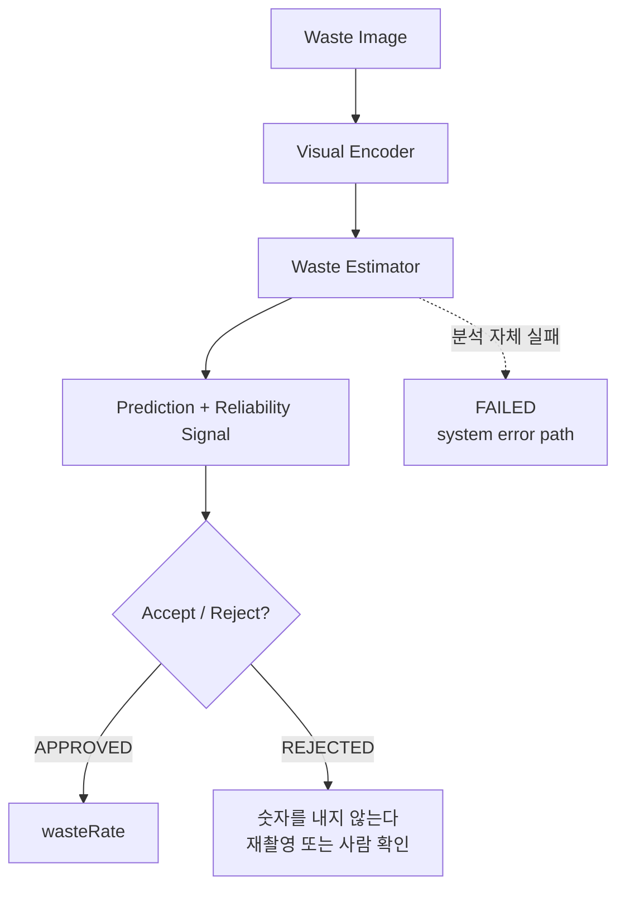

# W1 — Food Waste Estimation: Problem Definition

*밥플래너 AI-2. CCTV 트랙(A1~A6, D1~D2) 종료 후 시작하는 두 번째 연구 트랙의
첫 단계.*

작성 시점: 2026-08-28
상태: **문제 정의 단계. 모델 학습 없음. 실제 학습 데이터 0건**

> 이 문서는 "무엇을 만들 것인가"를 정한다. 성능 수치가 하나도 없는 것이
> 정상이다.

---

## 1. Problem

식판 사진 한 장을 받아 **얼마나 남겼는지**와 **그 판단을 믿어도 되는지**를
낸다.

```
image → waste estimator → wasteRate + confidence → APPROVE / REJECT
```

마지막 단계가 이 문제의 핵심이다. 이 값으로 사용자에게 포인트가 나가므로,
**틀린 값을 자신 있게 내보내는 것이 값을 안 내보내는 것보다 나쁘다.**

## 2. Existing Production Contract

**이번 단계에서 계약을 바꾸지 않았다.** 이미 서 있는 것을 정확히 적는다.

```
POST /internal/v1/ai/waste/analyze          (X-Service-Token 필요)
  multipart/form-data
    requestId : str
    menuId    : int
    image     : file

200 AIWasteResponse
    requestId   : str
    decision    : APPROVED | REJECTED
    wasteRate   : float | null    (0 <= x <= 1)
    confidence  : float | null    (0 <= x <= 1)
    modelVersion: str
```

| 응답 | 언제 | 서비스 백엔드의 처리 |
|---|---|---|
| `200 APPROVED` | 분석이 끝났고 입력을 승인했다 | 결과 저장 |
| `200 REJECTED` | 분석이 끝났고 입력을 승인하지 않았다 | 거절로 저장 |
| `422` | 이미지를 열 수 없다 | 실패 |
| `503` | 분석기를 쓸 수 없다 | **FAILED** |

**세 상태의 뜻을 섞지 않는다.**

- **APPROVED** — 이 사진에 대해 믿을 만한 분석 결과를 낼 수 있었다.
- **REJECTED** — 분석은 정상적으로 수행되었으나 **이 입력으로는 신뢰할 만한
  값을 낼 수 없다**고 판단했다. **"잔반이 많다"가 아니다.**
- **FAILED** — 모델 판정이 아니다. 서비스·네트워크·시스템 장애다. 코드에도
  이 경계가 있다(`WasteEstimateError` → 503, `REJECTED`와 다른 경로).

현재 구현은 fixture다. `FixtureWasteEstimator`는 이미지를 판독하지 않고 늘
`APPROVED / wasteRate 0.15 / confidence 0.92 /
modelVersion "fastapi-fixture-waste-v1"`을 돌려준다. **그 값은 분석 결과가
아니다.** 운영 환경에서 fixture가 선택되면 기동에 실패하도록 설정이 막는다.

`menuId`는 받지만 **메뉴 메타데이터(음식 이름, 구성, 표준 제공량)는 AI로
넘어오지 않는다.** 숫자 하나뿐이다. 이 사실이 6절과 15절에 영향을 준다.

## 3. Actual Data Audit

**학습에 쓸 수 있는 실제 표본은 0건이다.**

| | 파일럿 수집 | 저장소 fixture |
|---|---:|---:|
| 이미지 | **0** | 16 (합성) |
| 정답 있는 표본 | **0** | 13 (합성) |
| served / leftover mass | **0** | 13 (합성) |
| before/after 짝 | **0** | 0 |
| 학습 가능 | **아니오** | **아니오** |

`data/` 에는 `README.md` 하나만 있다. `private/`, `raw/`, `processed/`는
만들어진 적이 없다. `docs/pilot0_waste_collection_report.md`는 첫 줄이
"**상태: 아직 수행하지 않음**"이고 표가 전부 비어 있다.

저장소의 16장은 Pillow로 그린 단색 이미지다. `data/README.md`가 "학습
데이터가 아니다"라고 못박아 두었고 이 점검도 같은 판정이다.

자세한 것은 [`research/waste_estimation/dataset_audit.md`](../research/waste_estimation/dataset_audit.md).

**문서가 있다는 것과 데이터가 있다는 것은 다른 말이다.** 스키마, 수집 도구,
측정 절차, 평가 규약이 전부 갖춰져 있어서 데이터도 있는 것처럼 보이기 쉽다.
이 단계에서 가장 중요한 결과는 그 0이다.

## 4. Ground Truth Definition

**이미 닫혀 있다.** `docs/waste_ground_truth_protocol.md`에서 가져온다.

```
waste_rate = leftover_edible_mass_g / served_edible_mass_g
```

- 단위는 그램. 매니페스트에는 숫자로 적는다
- `served_edible_mass_g > 0`
- `0.0 <= waste_rate <= 1.0`
- 예: 500g을 받아 100g을 남기면 `0.20`

**이것이 아닌 것** (같은 단어로 불리지만 다른 값들이다):

| | 정답인가 |
|---|---|
| 사진에서 음식이 차지하는 면적 비율 | 아니다 |
| 사람이 사진을 보고 매긴 추정치 | 아니다 |
| **실제 가식부 중량 기준 잔반 비율** | **그렇다** |
| 칼로리 기준 잔여 비율 | 아니다 |

### 단위 일치 확인

| | 범위 | 근거 |
|---|---|---|
| 데이터셋 `waste_rate` | 0.0 ~ 1.0 | `waste_ground_truth_protocol.md` |
| API `wasteRate` | 0.0 ~ 1.0 | `WasteEstimate(ge=0, le=1)` |

**일치한다.** 백분율과 비율이 섞이는 흔한 사고는 없다.

### 무효 정답 규칙

프로토콜이 이미 정해 두었고, 연구 코드가 그대로 강제한다
(`waste_estimation/schemas.py::waste_rate_from_mass`).

```
  served_edible_mass_g <= 0        분모가 없다
  leftover_edible_mass_g < 0       음수 질량은 측정 오류다
  leftover > served                받은 것보다 많이 남길 수 없다
  waste_rate ≠ 두 무게의 비        허용 오차 1e-6
```

**범위 밖 값을 잘라서 통과시키지 않는다.** 1.2가 들어왔다면 측정이나 기록이
틀린 것이고, 1.0으로 고쳐 학습에 넣으면 그 오류가 조용히 정답이 된다.

## 5. Information Limitations

**이 절이 이 문서에서 가장 중요하다.**

정답은 질량비인데, 모델이 보는 것은 **식후 사진 한 장**이다. 분모(제공량)는
저울로 재지만 사진에는 없다.

```
  측정 절차 (waste_ground_truth_protocol.md)

  3. 배식 후 중량을 잰다  → served_edible_mass_g    ← 사진 없음
  5. 식사 직후 사진을 찍는다                        ← 모델이 보는 유일한 것
  6. 남은 중량을 잰다     → leftover_edible_mass_g
```

여기서 세 가지 정보 부족이 나온다.

**(1) 분모가 보이지 않는다.** 같은 양이 남아 있어도 원래 많이 받았으면 적게
남긴 것이다. 모델은 사진 한 장에서 **제공량을 추정**해야 하는데, 그 근거가
사진 안에 없다.

**(2) 질량은 부피가 아니고 부피는 면적이 아니다.** 화면에서 같은 면적을
차지해도 두께가 다르고, 같은 부피라도 밀도가 다르다. 국물 한 국자와 밥 한
덩이는 비슷해 보여도 무게가 몇 배 차이 난다.

**(3) 촬영 조건이 매번 다르다.** 각도, 거리, 조명, 그림자. 같은 잔반이
다르게 보인다.

**따라서 image-only continuous regression은 원리적으로 정확한 중량 측정이
아니다.** 경험적으로 어디까지 되는지를 재는 문제이고, 그 상한이 낮을 수
있다. 이 트랙에서 "AI가 잔반량을 측정한다"고 말하지 않는다. **추정한다**고
말하고, 그 추정의 오차와 신뢰도를 함께 낸다.

이 한계가 14절의 선택적 예측을 필수로 만든다.

## 6. Candidate Formulations

세 가지를 비교 대상으로 둔다.

### T1. Coarse Classification

잔반 정도를 몇 개의 구간으로 나눈다.

```
  장점   적은 데이터에서 안정적이다. 라벨 잡음에 덜 흔들린다
  단점   질량비가 가진 정보를 버린다. 구간 경계를 누군가 정해야 한다
         API가 numeric wasteRate를 받으므로 변환이 한 겹 더 필요하다
```

**경계를 함부로 정하지 않는다.** `docs/waste_evaluation_protocol.md` 4절이
"잔반 20% 이하를 맞혔는가" 같은 지표를 만들지 않기로 한 이유가 그것이다 —
정해지지 않은 운영 정책이 평가 숫자로 굳어 버린다. 연구에서 구간을 쓴다면
그것은 **모델 출력 형태의 선택**이지 운영 정책이 아니라는 것을 명시하고,
경계를 결과 보기 전에 동결한다.

### T2. Ordinal Estimation

구간에 **순서가 있다**는 것을 모델과 지표가 함께 안다.

```
  장점   T1의 안정성을 가지면서 "세 칸 틀림"과 "한 칸 틀림"을 구분한다
  단점   여전히 경계가 필요하고, 연속값으로 되돌릴 때 정보가 준다
```

### T3. Continuous Regression

`waste_rate`를 0~1의 실수로 직접 예측한다.

```
  장점   정답의 정의와 정확히 같다. API 계약과 그대로 맞는다
         구간 경계를 만들 필요가 없다
  단점   적은 데이터에서 불안정할 수 있다. 5절의 정보 부족이 그대로 드러난다
```

### 24. 첫 baseline으로 무엇을 고를 것인가

**T3(연속 회귀)를 기본으로 하고, T2를 비교 팔로 둔다.**

이유는 셋이다.

1. **정답이 연속값이다.** 구간으로 나누는 것은 정보를 버리는 일이고, 버릴
   이유가 아직 없다. 데이터가 적어서 회귀가 불안정하다는 것은 **가설**이지
   확인된 사실이 아니다. 확인하는 것이 RQ-W2다.
2. **평가 규약이 이미 MAE를 주 지표로 정해 두었다**
   (`waste_evaluation_protocol.md` 2절). MAE는 "평균 몇 퍼센트포인트
   틀리는가"로 그대로 읽힌다.
3. **API 계약이 numeric을 받는다.** 분류부터 시작하면 연구와 계약 사이에
   변환 계층이 하나 더 생기고, 그 변환의 오차가 어디서 왔는지 보이지 않게
   된다.

**다만 딥러닝부터 시작하지 않는다.** 순서는 이렇다.

```
  B-1  전역 평균 예측        모든 사진에 학습 집합의 평균 잔반률
  B-2  사람의 눈대중          사진만 보고 사람이 매긴 값
  B-3  단순 특징 + 선형 회귀  색/면적 같은 값 몇 개
  B-4  pretrained backbone + 회귀 헤드 (frozen feature부터)
```

**B-1을 건너뛰지 않는다.** 딥러닝 모델이 MAE 0.09를 냈을 때 전역 평균이
0.11이면 그것은 거의 아무것도 배우지 못한 것이다. 그 사실은 비교 대상이
있어야 보인다.

## 7. Research Questions

W1에서 사전 등록한다. 데이터를 본 뒤에 바꾸지 않는다.

**RQ-W1.** 식판 이미지 한 장만으로 질량 기반 `waste_rate`를 어느 정도까지
예측할 수 있는가? 전역 평균과 사람의 눈대중을 얼마나 넘어서는가?

**RQ-W2.** 표본이 적을 때 연속 회귀보다 순서형 정식화가 더 안정적인가?
안정적이라면 그 대가로 무엇을 잃는가?

**RQ-W3.** 모델의 confidence로 오차가 큰 이미지를 거절하면 승인한 표본의
오차가 실제로 줄어드는가? coverage를 얼마나 포기해야 하는가?

**RQ-W4.** 음식 종류와 촬영 조건이 바뀌면 성능이 얼마나 떨어지는가?

**RQ-W1의 답이 "거의 못 한다"일 수 있다.** 그것도 결과다. CCTV 트랙에서
해상도 가설과 모델 용량 가설을 둘 다 기각한 것이 그 단계에서 가장 값어치
있는 결과였다.

## 8. Public Dataset Review

조사만 했다. **W1에서 아무것도 내려받지 않았다.**

| 데이터셋 | 규모 | 질량 GT | before/after | 라이선스 | 상태 | 역할 |
|---|---:|:---:|:---:|---|---|---|
| **Nutrition5k** | ~5,006 접시 | ✓ | ✗ | Creative Commons 4.0 | **VERIFIED** | 표현 학습 |
| **LeFood-set** | 524 짝 | ✓ | ✓ | CC BY 4.0 | **VERIFIED** | 외부 벤치마크 |
| FLIC | 401 짝 | ✓ | ✓ | (못 읽음) | UNVERIFIED | **없음** |
| UNIMIB2016 | 1,027 식판 | ✗ | ✗ | (못 읽음) | UNVERIFIED | **없음** |
| FoodSeg103 | 9,490 장 | ✗ | ✗ | (표기 없음) | UNVERIFIED | **없음** |

판정 규칙은 CCTV 트랙과 같다 — **공식 배포 페이지에서 조건 원문을 읽지 못한
데이터는 쓰지 않는다.** 논문의 오픈 액세스 라이선스를 데이터셋 라이선스로
읽지 않는다.

**FLIC이 과제상 가장 가깝다** (대학 구내식당, 식전/식후 짝, 마스크, 실측
질량). 그런데 MDPI 본문 페이지가 403을 돌려주어 Data Availability Statement를
읽지 못했다. 그래서 쓰지 않는다. W2에서 접근되면 가장 먼저 다시 본다.

### 공개 데이터로 하면 안 되는 것

```
  남은 픽셀 비율   ≠   leftover_edible_mass_g / served_edible_mass_g
```

음식 분할 데이터셋의 마스크로 면적 비율을 계산해 우리 정답으로 바꾸지
않는다. 같은 면적이라도 두께가 다르고 같은 부피라도 밀도가 다르다. 두 값을
이어 붙이는 순간 모델이 무엇을 배웠는지 알 수 없게 된다.

**질량 정답이 있는 두 데이터도 우리 서비스의 정답은 아니다.** Nutrition5k는
식후가 없고, LeFood-set은 인도네시아 병원 급식이다. 외부 참고치로만 쓴다.

자세한 것은
[`research/waste_estimation/datasets/README.md`](../research/waste_estimation/datasets/README.md).

## 9. Baselines

```
  B-1  전역 평균          학습 집합의 평균 잔반률을 모든 사진에
  B-2  사람 기준선        사진만 보고 사람이 추정한 값
  B-3  단순 특징 + 선형   색/면적/밝기 같은 값 몇 개
  B-4  pretrained 백본    frozen feature + 회귀 헤드 → 그 다음 fine-tuning
```

**백본 후보는 두셋으로 제한한다.** CCTV 트랙에서 쓰는 torchvision이 이미
`.venv-cctv`에 있고, 라이선스(BSD-3-Clause)도 확인되어 있다. 처음부터 ViT
giant나 멀티모달 LLM을 쓰지 않는다.

두 전략을 비교 설계로 둔다.

```
  B0  전체 이미지 그대로
  B1  식판/음식 영역만 (분할 또는 검출 후)
```

**분할이 정말 필요한지는 실험으로 정한다.** 처음부터 분할 파이프라인을
필수로 만들지 않는다.

## 10. Evaluation Metrics

### 연속값 (T3)

| | |
|---|---|
| Primary | **MAE** — "평균 몇 퍼센트포인트 틀리는가"로 그대로 읽힌다 |
| Secondary | RMSE, Median AE |
| 함께 본다 | **Bias** — 늘 적게 예측하는 것과 늘 많게 예측하는 것은 다른 문제다 |
| 보조 | R² — 작은 데이터에서 이것 하나만 강조하지 않는다 |

MAE / RMSE / Median AE는 서비스 코드에 이미 있다
(`src/babplanner_ai/dataset/metrics.py`). **다시 구현하지 않고 그대로 쓴다.**
연구 쪽에는 bias만 더했다.

### 순서형 (T2)

```
  class-index MAE      세 칸 틀림과 한 칸 틀림을 구분한다
  quadratic weighted kappa   검토 대상
```

**정확도를 주 지표로 쓰지 않는다.** 구간에 순서가 있으므로 거리가 의미를
갖는다.

### 분류 (T1)

```
  macro F1 + confusion matrix
```

**accuracy 단독으로 판단하지 않는다.** 잔반률 분포가 한쪽으로 몰려 있을
가능성이 높다.

## 11. Selective Prediction

이 트랙의 핵심 정식화다.

```
             ┌─ APPROVE → 잔반률을 낸다. 이 구간의 MAE가 보장된다
image → 모델 ┤
             └─ REJECT  → 숫자를 내지 않는다. 재촬영을 요청하거나 사람이 본다
```

축이 둘이다.

```
  coverage        전체 중 몇 %를 APPROVE 했는가
  selective risk  APPROVE 한 것들의 MAE
```

**전체 MAE 하나로는 이 모델의 좋고 나쁨을 말할 수 없다.** 90%를 거절하고
남은 10%에서 MAE 0.02를 내는 모델과, 전부 받아 MAE 0.12를 내는 모델 중
무엇이 나은지는 **운영 정책**이 정한다. 연구가 낼 수 있는 것은 그 둘의 관계
곡선이다(`waste_estimation/selective.py`).

**임계값을 지금 정하지 않는다.** 곡선을 먼저 그리고, 운영 요구를 보고 자른다.

### confidence를 정확도 확률로 부르지 않는다

softmax 확률이나 회귀 불확실성 대리값은 **모델이 낸 점수**일 뿐이다.
"confidence 0.9라고 말한 예측의 90%가 맞다"는 것은 **보정(calibration)**의
문제이고 별도로 검증해야 한다. CCTV 트랙에서 배운 것과 같다 — raw model
confidence ≠ calibrated correctness probability.

### 입력 품질에 의한 거절 (후보)

confidence만 거절 근거가 아니다. 입력 자체가 분석 조건을 만족하지 않는
경우가 있다.

```
  이미지를 열 수 없다        (지금도 422로 막는다)
  식판/음식 영역이 없다      NO_RELEVANT_FOOD
  심한 흔들림                SEVERE_BLUR
  심한 가림                  SEVERE_OCCLUSION
  각도가 규약을 벗어남       INVALID_VIEW
```

이 사유들은 이미 데이터셋 스키마에 있다
(`dataset/schema.py::RejectionReason`). **임계값을 지금 정하지 않는다.**
실제 데이터를 보기 전에 정한 흔들림 임계값은 아무것도 재지 않는다.

## 12. Split / Leakage Policy

**이미지 단위 무작위 분할을 쓰지 않는다.** 같은 사람이 같은 회차에 찍은
사진들은 배경도 식판도 습관도 닮아 있다. 학습과 평가에 나뉘어 들어가면 모델이
사람을 외운 것을 일반화로 착각하게 된다.

분할 단위는 강한 순서로 이렇다.

```
  1. participant_group_id    가장 강함 (선택 열)
  2. capture_session_id      차선 (필수 열)
```

서비스 코드가 이미 같은 규칙을 쓴다
(`dataset/validation.py::group_key_of`). 연구 쪽도 같다
(`waste_estimation/splits.py`). **없는 그룹 정보를 발명하지 않는다.**

**표본이 적으면 한 번의 분할로 결론을 내지 않는다.** 그룹 단위
cross-validation의 폴드별 값과 분산을 함께 적는다.

## 13. Privacy

연구 자료 구조에 들어가지 않는 것:

```
  이름 · 학번 · 전화번호 · 계정 식별자 · 얼굴 · 주소 · 생년월일
```

`WasteSample`에는 비식별 `sample_id`와 익명 `group_id`만 있고, 테스트가
필드 이름으로 그것을 확인한다. 매니페스트 규칙도 같다
(`docs/waste_dataset_spec.md`).

**얼굴·학생증·명찰·문서가 찍힌 사진은 학습에 쓰지 않는다.** 원본 이미지와
참가자 대응표는 저장소에 들어오지 않는다.

## 14. Limitations

1. **학습 데이터가 없다.** 이 문서의 어떤 계획도 파일럿 수집이 돌기 전에는
   실행되지 않는다.
2. **식전 사진이 없다.** 분모를 사진에서 볼 수 없다는 것이 이 과제의 구조적
   한계다(5절).
3. **메뉴 메타데이터가 AI로 오지 않는다.** `menuId` 숫자 하나뿐이고, 그
   숫자를 범주형 특징으로 학습시키면 새 메뉴에서 일반화되지 않는다. W1에서는
   분석만 하고 쓰지 않는다.
4. **측정 자체에 오차가 있다.** 저울 눈금, 식판 무게, 국물, 계량 순서.
   **같은 끼니를 두 번 재도 값이 다르다면 그 차이보다 작은 MAE는 의미가
   없다.** 파일럿에서 반복 계량 편차를 먼저 재야 목표선을 정할 수 있다.
5. **합격선을 정하지 않았다.** 무엇과 비교해야 하는지 아직 모른다
   (`waste_evaluation_protocol.md` 7절).
6. **공개 데이터의 도메인이 다르다.** 한국 대학 학식 식판이 아니다.

## 15. W2 Experiment Plan

**전제: 파일럿 수집이 한 번 돌아야 시작된다.**

```
  0. 데이터 점검          audit_dataset.py 로 실제 표본 수·분포·중복 확인
                          반복 계량 편차로 측정 오차 하한을 먼저 잰다

  1. 사람 기준선          사진만 보고 사람이 추정한 값의 MAE
                          이것이 모델이 넘어야 하는 실용적 기준이다

  2. B-1 전역 평균        모든 사진에 학습 평균. 이것을 못 넘으면 학습 실패다

  3. B-3 단순 특징        색/면적 + 선형 회귀. 딥러닝 이전의 바닥을 만든다

  4. B-4 pretrained       frozen feature + 회귀 헤드
                          그룹 단위 cross-validation, 폴드별 값과 분산 함께

  5. T2 비교 팔           같은 백본에 순서형 헤드. RQ-W2

  6. selective curve      confidence로 coverage-risk 곡선. RQ-W3
```

**가장 먼저 할 것은 0번이다.** 데이터가 몇 건이고 분포가 어떤지 모르면 그
다음 단계의 설계를 정할 수 없다. 그리고 반복 계량 편차를 모르면 어떤 MAE가
의미 있는 값인지 판단할 수 없다.

**동결 규칙은 CCTV 트랙과 같다.** 후보·선택 규칙·guardrail·분할을 결과 보기
전에 정하고 지문을 남긴다. 평가 집합은 한 번만 본다.

## Architecture



`FAILED`는 모델 판정이 아니다. 별도 경로다.
