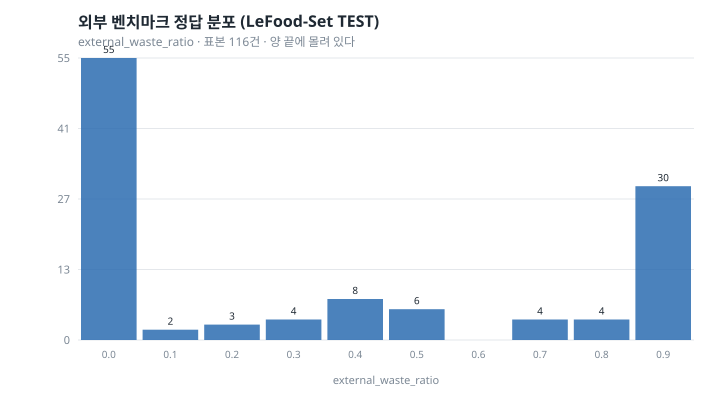
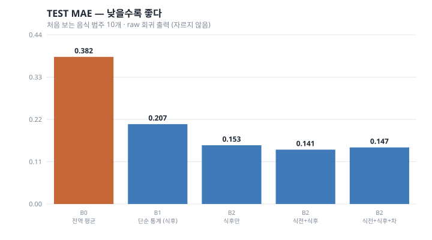
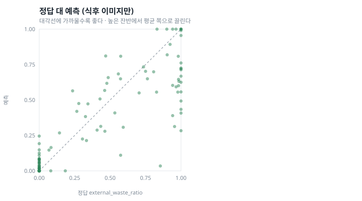

# W2 — External Mass-Ratio Benchmark

*밥플래너 AI-2. W1(`reports/waste_w1_problem_definition.md`)에 이어지는 문서.*

작성 시점: 2026-08-29
상태: **외부 벤치마크 1회 완료. 밥플래너 급식소 검증 아님. fine-tuning 없음**

> 데이터: **LeFood-Set: Leftovers Food Dataset**, Mendeley Data V1,
> doi:10.17632/cchsk79jkt.1, **CC BY 4.0**
> (<https://data.mendeley.com/datasets/cchsk79jkt/1>)

> **이 문서의 어떤 숫자도 밥플래너 급식소 성능이 아니다.**
> 인도네시아 병원 급식 사진으로 잰 값이고, 식판 구성·메뉴·촬영 조건이 모두
> 다르다. `This benchmark does not establish performance on Babplanner
> cafeteria images.`

---

## 1. Motivation

W1에서 확인한 것은 하나였다 — **밥플래너 현장 데이터가 0건이다.** 이미지도,
저울 정답도, 식전/식후 짝도 없다.

그런데 W1이 남긴 표현이 너무 넓었다. "학습 불가"는 **in-domain 학습**이
막혔다는 뜻이지 모든 학습이 불가능하다는 뜻이 아니다. 조건을 확인한 공개
데이터로 **같은 과제를 다른 도메인에서** 재 보는 일은 지금도 할 수 있다.

그래서 이 단계에서 처음으로 숫자를 만든다. 묻는 것은 셋이다.

**RQ-W2-1.** 식후 사진 한 장만으로 질량 기반 잔반 비율을 전역 평균보다
의미 있게 잘 예측할 수 있는가?

**RQ-W2-2.** 식전 사진을 더하면 얼마나 좋아지는가?

**RQ-W2-3.** 작은 데이터에서 연속 회귀와 순서형 중 어느 쪽이 안정적인가?

그리고 사전 등록한 가설:

> **H-W2.** before+after가 after-only보다 일관되게 좋다면, 운영 API의
> after-only 입력에는 **분모가 보이지 않는 정보 격차**가 있다.

이 가설이 중요한 이유는 실용적이다. 현재 서비스 계약
(`POST /internal/v1/ai/waste/analyze`)은 식후 사진 한 장만 받는다. 격차가
크다면 그 계약 자체가 성능의 상한을 정하고 있다는 뜻이 된다.

## 2. Dataset and License

**공식 배포처에서 조건을 다시 확인했다.** W1에서 `VERIFIED`였지만 내려받기
전에 한 번 더 봤다.

```
  이름      LeFood-Set: Leftovers Food Dataset
  출처      Mendeley Data, V1, 2025-01-17
  DOI       10.17632/cchsk79jkt.1
  라이선스  CC BY 4.0 (Creative Commons Attribution 4.0 International)
            http://creativecommons.org/licenses/by/4.0
  규모      1,048 이미지(524 짝) + data_original.xlsx, 50.2 MB
```

라이선스는 Mendeley Data 공개 API의 `data_licence` 필드에서 원문으로 읽었다.

> "You can share, copy and modify this dataset so long as you give
> appropriate credit, provide a link to the CC BY license, and indicate if
> changes were made…"

W1에서 걸어 둔 단서 하나를 정정한다. Elsevier 사이트 하단의 "All rights
reserved… AI training" 문구는 **사이트 공통 문구**이고, 같은 페이지가
"For all open access content, the Creative Commons licensing terms apply"
라고 명시한다. 데이터 레코드의 라이선스 필드가 CC BY 4.0이므로 그것을 따른다.

**원본은 커밋하지 않는다.** `research/waste_estimation/data/raw/` 에 받았고
`.gitignore`가 막는다. 저장소에 남는 것은 집계 수치와 분할 목록뿐이다.

### 실제 스키마 (파일에서 읽은 그대로)

```
  ID | Name of the food | Image Before Eaten | Weight Before Eaten (g)
     | Image After Eaten | Weight After Eaten (g)
     | Visual Estimation by Observer (1-7)
```

파일명 규약: `{음식범주}_{기록번호}_{원본사진번호}_{bef|aft}.JPG`

**참가자·회차 식별자가 없다.** 있는 것은 음식 범주뿐이다.

## 3. External Label Definition

계산식은 밥플래너 정답과 같다.

```
external_waste_ratio = after_mass_g / before_mass_g
```

**그런데 이름을 분리한다.** 같은 식으로 계산해도 다른 데이터의 값이고,
`waste_rate`라고 부르는 순간 이 숫자가 밥플래너 정답인 것처럼 읽힌다.
코드에서도 필드 이름이 `external_waste_ratio`이고, 그 사실을 테스트가 지킨다.

### 질량이 식기를 포함하지 않는다는 근거

공식 문서는 tare를 명시하지 않는다. 그래서 데이터로 확인했다.

```
  관찰자 등급 7 ("전부 먹음") 표본의 식후 질량이 1g 수준까지 내려간다
```

식기 무게가 포함되어 있다면 그 값이 접시 무게(수백 g)로 남아 있어야 한다.
즉 이미 음식만의 무게로 보인다. **이것은 관측에 근거한 판단이지 문서로
확인한 사실이 아니다.** 11절에 한계로 적는다.

### 라벨 생성 관문

W1에서 정한 규칙을 그대로 적용했다. 통과하지 못한 행은 **세어서 보고한다.**

| | 건수 |
|---|---:|
| 표 전체 행 | 678 |
| 이미지가 배포본에 없음 (`MISSING_IMAGE`) | **154** |
| 식후 > 식전 (`AFTER_EXCEEDS_BEFORE`) | **10** |
| 짝 불일치 / 파싱 실패 / 분모 0 | 0 |
| **사용 가능** | **514** |

**표에는 678행이 있는데 공개된 이미지는 524쌍뿐이다.** 표만 믿고 라벨을
만들었다면 이미지 없는 표본 154건이 학습 집합에 들어갔을 것이다. 이 관문이
이 단계에서 실제로 한 일 중 가장 값이 있었다.

### 정답 분포



```
  min 0.000   q25 0.000   median 0.184   q75 0.763   max 1.000   mean 0.367
  정확히 0인 표본   207 / 514  (40.3%)
  0.99 이상          54 / 514  (10.5%)
```

**양 끝에 몰려 있다.** 절반 가까이가 "전부 먹었다" 또는 "거의 그대로"다.
이 모양이 뒤의 결과를 상당 부분 설명한다.

## 4. Data Split

**분할 단위는 음식 범주다.** 참가자·회차 식별자가 데이터에 없고, 없는 그룹
정보를 발명하지 않는다. 파일명의 첫 필드가 음식 범주이며 그것이 지금 쓸 수
있는 가장 강한 묶음이다.

이 선택에는 부수 효과가 있고 그것이 오히려 유용하다 — **평가가 "한 번도 본
적 없는 음식에서도 되는가"를 묻게 된다.** RQ-W4와 같은 축이다.

| | 표본 | 음식 범주 |
|---|---:|---:|
| DEVELOPMENT | 398 | 24 |
| TEST | 116 | 10 |
| 누수 | **없음** | |

**TEST를 보기 전에 동결했다.**
`research/waste_estimation/experiments/w2_external/freeze.json`
sha256 `662626343482afa9…`

동결한 것: 데이터셋 버전·라벨 식·관문·분할·전처리·backbone 후보·ridge alpha
격자·교차검증 폴드 수·순서형 구간·주 지표·clip 정책·선택 규칙·H-W2 판정 조건.

## 5. Baselines

쉬운 것부터 올라간다. DEVELOPMENT 24개 범주에 대한 **그룹 5-fold 교차검증**
MAE다.

| | after-only | concat | concat_diff |
|---|---:|---:|---:|
| **B0** 전역 평균 | 0.3551 | | |
| **B1** 단순 통계(12개) | 0.2839 | 0.2507 | 0.2506 |
| **B2** mobilenet_v3_small | 0.1730 | 0.1808 | 0.1813 |
| **B2** resnet18 | **0.1585** | 0.1903 | 0.1939 |

동결한 선택 규칙(① CV MAE 최소 ② 0.005 이내면 |Bias| 작은 쪽 ③ 더 단순한 쪽)
을 적용한 결과:

```
  after        resnet18            alpha 100   CV MAE 0.1585
  concat       mobilenet_v3_small  alpha 100   CV MAE 0.1808
  concat_diff  mobilenet_v3_small  alpha 100   CV MAE 0.1851
```

**여기서 이미 예상과 다른 것이 보인다.** frozen 특징에서는 식전 사진을
더하면 오히려 나빠진다. B1(단순 통계)에서는 반대로 좋아진다. 9절에서 다룬다.

## 6. After-only Experiment

**TEST를 한 번만 돌렸다.** 116 표본, 처음 보는 음식 범주 10개.



| 모델 | 출력 | MAE | RMSE | Median AE | Bias |
|---|---|---:|---:|---:|---:|
| B0 전역 평균 | raw | **0.3820** | 0.4331 | 0.3600 | −0.0310 |
| B1 단순 통계 (식후) | raw | 0.2073 | 0.2605 | 0.1680 | +0.0244 |
| B1 단순 통계 (식후) | clipped | 0.2072 | 0.2604 | 0.1680 | +0.0245 |
| **B2 식후만 (resnet18)** | **raw** | **0.1526** | 0.2183 | 0.0813 | −0.0651 |
| B2 식후만 (resnet18) | clipped | 0.1400 | 0.2054 | 0.0813 | −0.0605 |

**RQ-W2-1의 답: 그렇다. 뚜렷하게.**

```
  전역 평균 대비   0.3820 -> 0.1526     절대 -0.2294,  상대 -60.0%
  단순 통계 대비   0.2073 -> 0.1526     절대 -0.0547,  상대 -26.4%
```

식후 사진 한 장에 **질량비에 대한 실재하는 신호가 있다.** 색과 밝기만 쓴
단순 통계조차 전역 평균을 크게 넘고, frozen 사전학습 특징은 그보다 더 낫다.

**raw와 clipped를 나란히 적는다.** 자르면 MAE가 0.1526에서 0.1400으로
내려가는데, 그 개선은 모델이 배운 것이 아니라 **정답이 0~1이라는 사실**에서
온다. 주 지표는 raw로 고정해 두었고 결과를 보고 바꾸지 않았다.

## 7. Before+After Reference Experiment

식전 사진을 더한 갈래다. **운영 API와 호환되지 않는다** — 지금 계약은
사진 한 장만 받는다. 정보 격차를 재기 위한 참조 실험이다.

결합은 임베딩 수준에서만 한다. Siamese 네트워크를 만들지 않았다 — 학습하는
부분이 없으므로 벡터 연산으로 충분하고, 구조를 먼저 넣으면 개선이 정보
때문인지 구조 때문인지 갈라 볼 수 없다.

| 모델 | 출력 | MAE | Bias |
|---|---|---:|---:|
| B2 식전+식후 (mobilenet) | raw | 0.1411 | −0.0156 |
| B2 식전+식후 (mobilenet) | clipped | 0.1203 | −0.0109 |
| B2 식전+식후+차 (mobilenet) | raw | 0.1469 | −0.0096 |
| B2 식전+식후+차 (mobilenet) | clipped | 0.1221 | −0.0023 |

**짝 갈래의 bias가 훨씬 작다** (−0.065 → −0.010). 식후만 보는 모델은 잔반을
체계적으로 **적게** 예측하는데, 식전 정보가 그 치우침을 줄인다.

## 8. Ordinal Comparison

순서형 구간은 **등간격 5구간**(0.2/0.4/0.6/0.8)으로 결과 보기 전에 동결했다.
개발 집합에서 최적화한 경계가 아니다.

두 가지를 비교한다. 같은 특징·같은 회귀기를 쓰고 **목표만** 바꾼다.

```
  T2   목표를 구간 번호로 두고 회귀 -> 반올림
  T3   연속값으로 회귀 -> 같은 구간으로 옮김
```

| 방식 | 입력 | class-index MAE | macro F1 | QWK |
|---|---|---:|---:|---:|
| T2 순서형 목표 | after | 0.526 | 0.445 | 0.822 |
| **T3 연속→구간** | after | **0.509** | **0.452** | **0.825** |
| T2 순서형 목표 | concat | 0.526 | 0.434 | 0.844 |
| **T3 연속→구간** | concat | **0.440** | **0.521** | **0.859** |
| T2 순서형 목표 | concat_diff | 0.552 | 0.420 | 0.836 |
| **T3 연속→구간** | concat_diff | **0.466** | **0.468** | **0.862** |

**RQ-W2-3의 답: 연속 회귀가 낫다.** 여섯 칸 전부에서 T3가 T2보다 좋거나
같다. 표본이 400건 수준인데도 그렇다.

해석은 단순하다. 목표를 구간으로 바꾸는 것은 **정보를 버리는 일**이다.
0.19와 0.21은 거의 같은 값인데 다른 구간이 되고, 0.21과 0.39는 다른 값인데
같은 구간이 된다. 그 손실이 "적은 데이터에서 안정적"이라는 이득보다 컸다.

W1에서 T3를 첫 baseline으로 고른 판단이 이 데이터에서는 맞았다.

## 9. Information Gap

**여기가 이 단계의 핵심이다. 그리고 예상과 다른 답이 나왔다.**

### 먼저, 잘못 잰 판을 정정한다

처음에는 갈래마다 DEVELOPMENT에서 고른 backbone을 그대로 써서 비교했다.

```
  after-only (resnet18)      MAE 0.1526
  concat     (mobilenet)     MAE 0.1411     dMAE +0.0115
  concat_diff(mobilenet)     MAE 0.1469     dMAE +0.0056
```

이 표는 **정보량과 backbone이 섞여 있다.** 짝이 좋아 보이지만 backbone이
다르므로 무엇 덕분인지 알 수 없다. 정보 격차를 재려면 같은 backbone 위에서
입력만 바꿔야 한다. 사전 등록 조건이 그것이었고, 처음 구현이 그 조건을
지키지 못했다.

### 같은 backbone 위에서 다시 (양수 = 짝이 낫다)

alpha는 각 (backbone, 입력)에 대해 DEVELOPMENT에서 고른 값 그대로다.

| backbone | 짝 방식 | DEV ΔMAE | TEST ΔMAE |
|---|---|---:|---:|
| mobilenet_v3_small | concat | **−0.0078** | **−0.0162** |
| mobilenet_v3_small | concat_diff | **−0.0083** | **−0.0181** |
| resnet18 | concat | **−0.0318** | +0.0030 |
| resnet18 | concat_diff | **−0.0353** | +0.0056 |

```
  DEV    4/4 에서 짝이 더 나쁘다
  TEST   2/4 에서 짝이 더 나쁘다, 2/4 에서 아주 조금 낫다 (+0.003, +0.006)
  범주별 TEST (concat_diff)   3/9 범주에서만 개선
```

### H-W2 판정: **지지되지 않는다**

사전에 정한 조건은 "여러 분할/그룹에서 **일관되게** 개선"이었다. 실제로는
DEVELOPMENT에서 네 조합 모두 나빠졌고, TEST에서도 backbone에 따라 부호가
갈리며, 범주 9개 중 3개에서만 좋아졌다. **한 분할에서 0.006 좋아진 것으로
구조적 정보 격차를 증명했다고 말하지 않는다.**

### 그렇다면 분모는 필요 없는가 — 아직 그렇게 말할 수 없다

이 결과를 "식전 사진이 쓸모없다"로 읽으면 안 된다. 세 가지가 섞여 있다.

**(1) 차원이 늘어난 대가.** frozen 임베딩을 이어 붙이면 특징이 512에서
1,024~1,536으로 늘어나는데 학습 표본은 398건 그대로다. ridge가 추정해야 할
계수가 두세 배가 된다. **정보를 더한 이득보다 차원의 대가가 컸을 수 있다.**
B1(12차원 통계)에서는 짝이 **좋아졌다**(0.2839 → 0.2506)는 것이 이 설명을
뒷받침한다. 차원이 작을 때는 짝이 도움이 됐다.

**(2) 이 데이터에서 분모가 이미 보인다.** LeFood-Set은 병원 급식이라 같은
음식의 제공량이 상당히 일정하다. 그러면 식후 사진만으로도 분모를 사실상
추정할 수 있고, 식전 사진이 더할 정보가 적다. 급식소도 표준 배식량이 있으니
같은 성질이 있을 수 있지만, **확인된 것은 아니다.**

**(3) frozen 특징이 "얼마나 남았는가"를 표현하도록 학습된 적이 없다.**
ImageNet 분류용 임베딩의 차(after − before)가 잔반량과 선형 관계일 이유가
없다. fine-tuning이나 분할을 쓰면 달라질 수 있다. W2는 frozen까지다.

**정확한 진술.** *이 데이터셋에서, frozen 임베딩 + ridge라는 설계 아래에서는,
식전 사진을 더해도 일관된 개선이 없었다.* 운영 API의 after-only 입력이
구조적 상한이라는 주장은 **이 실험으로 지지되지 않았고, 기각되지도 않았다.**

## 10. Failure Analysis



### 잔반 수준별 오차

구간 경계는 순서형과 같은 규칙으로 미리 정했다(0.2 / 0.8).

| 모델 | low (n=57) | medium (n=25) | high (n=34) |
|---|---:|---:|---:|
| B0 전역 평균 | 0.350 | 0.158 | 0.601 |
| **B2 식후만** | **0.059** | 0.158 | **0.305** |
| B2 식전+식후+차 | 0.106 | **0.137** | **0.224** |

평균 예측을 정답 평균과 나란히 보면 문제가 분명해진다.

```
  high 구간   정답 평균 0.961
              B2 식후만 예측 평균 0.704     (0.26 만큼 낮게)
              B2 짝      예측 평균 0.802     (0.16 만큼 낮게)
```

**평균으로 끌리는 회귀(regression to the mean)가 뚜렷하다.** 거의 손대지
않은 식판을 모델이 "70% 정도 남았다"고 말한다. 낮은 쪽에서는 오차가 0.059로
매우 작으므로, **오차가 한쪽에 몰려 있다.**

짝 갈래가 high 구간에서 확실히 낫다(0.305 → 0.224). 9절의 전체 평균에서는
드러나지 않던 차이다.

### 가장 큰 오차 (이미지 없이 기록)

| sample | 음식 | 정답 | 예측 | 오차 |
|---|---|---:|---:|---:|
| 320 | Telur Mata Sapi | 0.854 | 0.034 | **0.820** |
| 345 | Sambel Goreng Rempela | 1.000 | 0.283 | 0.717 |
| 236 | Ayam Bumbu Srundeng | 0.955 | 0.313 | 0.642 |
| 350 | Sambel Goreng Rempela | 1.000 | 0.407 | 0.593 |
| 353 | Sambel Goreng Rempela | 1.000 | 0.434 | 0.566 |

**다섯 건 모두 "거의 그대로 남긴 음식을 거의 다 먹었다고 예측"한 경우다.**
이 방향의 오차가 제품에서 더 나쁘다 — 남긴 사람에게 잘 먹었다고 말하는
쪽이기 때문이다.

### 음식 범주별 (TEST 10개 범주)

| 음식 | n | 정답 평균 | MAE |
|---|---:|---:|---:|
| Tempe goreng | 5 | 0.388 | 0.072 |
| bola bola daging | 6 | 0.138 | 0.073 |
| Ayam suwir | 5 | 0.219 | 0.081 |
| Perkedel Kentang | 21 | 0.160 | 0.103 |
| Rendang ayam | 18 | 0.462 | 0.126 |
| Telur Mata Sapi | 20 | 0.261 | 0.126 |
| Opor Ayam | 2 | 0.562 | 0.149 |
| Ayam bumbu laos | 16 | 0.696 | 0.189 |
| Ayam Bumbu Srundeng | 9 | 0.459 | 0.199 |
| **Sambel Goreng Rempela** | 14 | 0.583 | **0.317** |

**범주에 따라 4배 넘게 벌어진다** (0.072 ~ 0.317). 정답 평균이 높은 범주일수록
오차가 크다는 경향이 보이는데, 이는 위의 regression-to-mean과 같은 현상이다.

`Opor Ayam`은 표본이 2건이라 그 숫자로 아무 말도 하지 않는다.

## 11. Threats to Validity

1. **밥플래너 급식소가 아니다.** 인도네시아 병원 급식이고 식판 구성·메뉴·
   촬영 조건이 다르다. **이 결과를 급식소 성능이라고 말하지 않는다.**
2. **측정 절차가 다르다.** 우리 프로토콜은 가식부 중량을 tare를 빼고 재도록
   정해 두었다. LeFood-Set의 tare 처리는 문서로 확인하지 못했고, 관찰자 등급
   7에서 식후 질량이 1g까지 내려가는 것으로 추정했을 뿐이다.
3. **표본이 514건, TEST는 116건이다.** 범주별로 나누면 한 자리 수인 칸이
   있다. 그 칸의 숫자로 통계적 주장을 하지 않았다.
4. **그룹 메타데이터가 음식 범주뿐이다.** 참가자·회차가 없어 같은 사람이
   학습과 평가에 나뉘어 들어갔을 수 있다. 그 경우 평가가 실제보다 좋아진다.
5. **사전학습 backbone의 도메인이 다르다.** ImageNet 분류용 임베딩이고,
   "얼마나 남았는가"를 표현하도록 학습된 적이 없다.
6. **짝 갈래는 운영 API와 호환되지 않는다.** 현재 계약은 사진 한 장만 받는다.
7. **사람 기준선이 없다.** `HUMAN BASELINE: NOT MEASURED`. 사람이 사진만
   보고 추정한 값의 MAE를 재지 않았고, 자동으로 만들어 내지도 않았다. 그것이
   없으면 "모델이 충분히 좋은가"에 답할 수 없다.
8. **in-domain 검증이 없다.** 밥플래너 이미지로는 아무것도 재지 않았다.
9. **가중치 배포 적격성이 미해결이다.** torchvision 소프트웨어는
   BSD-3-Clause지만 ImageNet 사전학습 가중치의 상용 배포 조건은 별개다.
   연구·평가 용도로 썼고, **상용 배포 적격이라고 말하지 않는다.**
10. **selective prediction을 하지 않았다.** confidence를 만들어 내지 않았고,
    예측·오차 기록만 남겼다(`test_predictions.csv`). W3의 주제다.

## 12. Product Implications

**서비스는 그대로다.**

```
  WASTE_MODEL_MODE=fixture        유지. 교체하지 않았다
  FastAPI 경로에 모델 연결        하지 않았다 (테스트로 확인)
  API 계약                        변경 없음
```

외부 벤치마크 결과만으로 운영 분석기를 바꾸지 않는다. 그 판단에는 밥플래너
이미지에서의 검증이 필요하고, 그것은 아직 없다.

그래도 이 단계가 제품 결정에 주는 것이 셋 있다.

**(1) 이 문제는 풀 수 있는 축에 있다.** 식후 사진 한 장으로 전역 평균 대비
MAE를 60% 줄였다. "사진으로는 무리다"라는 결론이 아니었다. 파일럿 수집을
진행할 근거가 된다.

**(2) 식전 사진을 찍는 절차 변경을 지금 정당화할 수 없다.** 현장에서 한 장
더 찍는 부담은 확실한데, 이 실험에서 짝의 이득은 일관되지 않았다. 다만
**높은 잔반 구간에서는 이득이 뚜렷했다**(MAE 0.305 → 0.224). 그 구간이
운영에서 중요하다면 다시 검토할 값어치가 있다.

**(3) 오차가 한쪽에 몰려 있다.** 많이 남긴 식판을 적게 남겼다고 말하는
방향이다. 이 값으로 포인트가 나간다면 그 방향의 오차가 더 나쁘고, 선택적
예측(W3)이 바로 그 문제를 겨냥한다.

## 재현

```bat
:: 1. 데이터. 공식 출처에서 직접 받는다. 저장소에 커밋하지 않는다.
::    https://data.mendeley.com/datasets/cchsk79jkt/1  (CC BY 4.0)

:: 2. 라벨·분할·동결  (TEST를 보기 전에)
.venv-waste\Scripts\python.exe research\waste_estimation\scripts\w2_prepare.py

:: 3. 특징 추출 (CPU로 충분하다)
.venv-waste\Scripts\python.exe research\waste_estimation\scripts\w2_features.py

:: 4. 후보 선택 -> 그 다음에 TEST 1회
.venv-waste\Scripts\python.exe research\waste_estimation\scripts\w2_experiment.py --stage development
.venv-waste\Scripts\python.exe research\waste_estimation\scripts\w2_experiment.py --stage test

:: 5. 그림
.venv-waste\Scripts\python.exe research\waste_estimation\scripts\w2_charts.py

:: 6. 테스트
.venv\Scripts\python.exe -m pytest
```

환경: Python 3.12.1, torch 2.13.0+cpu, torchvision 0.28.0+cpu, numpy 2.5.2.
**GPU를 쓰지 않았다.** frozen 특징 추출이 이미지당 5~13 ms라 CPU로 충분하다.
