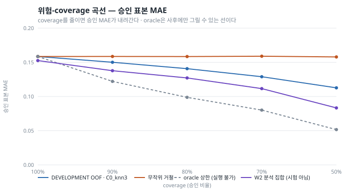
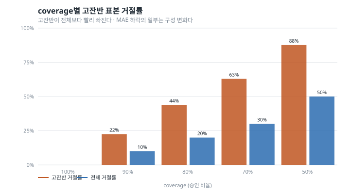

# W3 — Selective Prediction and Reliability

*밥플래너 AI-3. W2(`reports/waste_w2_external_benchmark.md`)에 이어지는 문서.*

작성 시점: 2026-08-29
상태: **DEVELOPMENT OOF에서 정책 동결 완료. 새 시험 집합 없음. fine-tuning 없음**

> **이 문서에는 새 테스트 결과가 없다.**
> W3에서 새로 확보한 unseen 집합은 없다. §10의 숫자는 W2에서 이미 결과를 본
> 116건에 동결 정책을 얹어 본 **사후 분석**이고, 일반화 근거가 아니다.

> **여기의 confidence는 확률이 아니다.**
> 신뢰 점수 0.05는 "95% 확률로 맞다"는 뜻이 아니다. 보정하지 않았고,
> 보정할 근거도 없다. 순위를 매기는 값일 뿐이다.

---

## 1. Motivation — 왜 "모르겠다"가 필요한가

W2가 남긴 숫자는 TEST MAE 0.1526이었다. 잔반률을 0~1로 재는 과제에서 평균
15%p씩 틀린다는 뜻이다. 급식소 운영자에게 "오늘 잔반 40%입니다"라고 말했을 때
실제가 25%거나 55%일 수 있다는 말이다.

이 상태에서 할 수 있는 선택은 둘이다. 모델을 더 좋게 만들거나, **틀릴 것 같은
때를 알아채고 답하지 않거나.** W3은 두 번째를 잰다.

두 번째가 먼저인 이유가 있다. 데이터가 398건이고 라벨은 외부 병원 급식이다.
이 조건에서 모델을 크게 개선할 여지는 크지 않다. 반면 "언제 틀리는지"는
데이터가 적어도 물을 수 있고, 제품에서 더 급한 질문이다. 조용히 틀린 숫자
하나가 대시보드에 올라가는 것보다, "이 사진은 판단 보류"가 낫다.

### Research Questions

| | 질문 |
|---|---|
| RQ-W3-1 | 추론 시점에 계산 가능한 신뢰 신호가 큰 오차를 낼 표본을 짚어내는가 |
| RQ-W3-2 | 일부를 거절하면 승인 표본 MAE가 실제로 내려가는가 |
| RQ-W3-3 | 그 하락이 단지 고잔반 표본을 버려서 생긴 것인가, 아니면 어려운 표본을 짚은 것인가 |
| RQ-W3-4 | 처음 보는 음식 범주에서도 이 이득이 유지될 만한가 |

### H-W3 (사전 등록)

> 임베딩 공간의 novelty와 모델 불일치 기반 신뢰 신호는 큰 오차 표본과 양의
> 상관을 가지며, coverage를 줄일 때 전역 무작위 거절보다 빠르게 승인 표본
> MAE를 낮춘다.

**판정: 지지된다 — 단, RQ-W3-3에 대해서는 부분적으로만.** §6~§8에서 다룬다.

---

## 2. W2 TEST는 더 이상 시험이 아니다

W2에서 그 116건의 결과를 이미 봤다. after-only가 짝보다 나은지, 어느 backbone이
나은지, 어느 잔반 수준에서 무너지는지를 전부 읽었다. 그 정보는 이미 내 판단에
들어와 있다.

그래서 W3에서 이 집합의 이름을 바꾼다.

| W2에서의 이름 | W3부터의 이름 | 허용되는 용도 |
|---|---|---|
| TEST (116건, 10범주) | **ANALYSIS (`W2_ANALYSIS`)** | 동결한 정책의 사후 관찰 |

금지되는 용도를 코드로 막았다. `w3_analysis.py`에는 신호를 고르는 분기도,
임계값을 다시 잡는 분기도 없다. 정책은 `freeze.json`에서 읽기만 한다.
`analysis_metadata.json`에는 `isFinalTest: false`, `isGeneralizationTest: false`가
박혀 있다.

한 번 본 집합을 다시 시험지라고 부르면, 그 뒤의 모든 숫자가 낙관 쪽으로
기울고 그 기울기는 측정되지 않는다. 그게 이 문서에서 가장 지키려는 선이다.

---

## 3. DEVELOPMENT OOF 프로토콜

방법을 만드는 재료는 DEVELOPMENT 398건뿐이다.

**왜 out-of-fold인가.** 자기 정답을 본 모델의 예측은 오차가 실제보다 작다.
신뢰 신호가 오차와 얼마나 붙어 있는지를 재는 게 목적인데, 오차 자체가
낙관적이면 관계도 낙관적으로 나온다.

그래서 표본마다 **그 표본의 음식 범주가 학습 fold에 없는 모델**이 예측을
만든다. 범주 단위 5-fold다. fold마다 학습/평가 범주 교집합이 비어 있는지
확인하고, 하나라도 겹치면 스크립트가 멈춘다.

```
DEVELOPMENT   398건 / 24범주
fold          5 (범주 단위, seed 20260401)
fold 간 범주 누수  0
OOF MAE       0.1585
```

**추정기를 다시 고르지 않았다.** W2가 DEVELOPMENT에서 고른 after-only 설정
(`resnet18`, ridge `alpha=100.0`)을 `development_selection.json`에서 읽어
그대로 썼다. W3의 주제는 추정기가 아니라 그 위에 얹는 신뢰 신호다. 여기서
alpha를 다시 돌리면 W3은 "W2를 조금 더 튜닝한 결과"가 되고, 신뢰 신호의
기여를 분리할 수 없게 된다.

OOF MAE 0.1585는 W2의 DEVELOPMENT CV 값과 같다. 같은 분할, 같은 설정이므로
같아야 맞다. ANALYSIS 집합의 0.1526보다 약간 높은데, 표본 398건과 116건의
차이 안에 들어가는 폭이다.

---

## 4. 신뢰 신호 후보

세 가지다. **전부 추론 시점에 계산할 수 있다.** 정답도, 잔차도 입력으로
들어가지 않는다 — 들어가면 신호가 아니라 정답을 우회해서 읽는 것이다.

| | 이름 | 계산 | 근거 |
|---|---|---|---|
| C0 | `C0_embedding_novelty` | 학습 fold 임베딩과의 코사인 거리, 최근접 k개 평균 | 학습 분포에서 멀면 예측이 외삽이다 |
| C1 | `C1_fold_disagreement` | 학습 표본만 부트스트랩한 ridge 5개의 예측 표준편차 | 학습 데이터를 조금 흔들었을 때 답이 바뀌면 근거가 얕다 |
| C2 | `C2_prediction_extremeness` | \|예측 − DEVELOPMENT 평균\| | **대조군.** "극단값이 위험하다"는 흔한 직관을 실제로 재 본다 |

C0의 참조 집합은 **학습 fold의 임베딩만**이다. 자기 자신도, 같은 범주의 다른
표본도 참조에 들어가지 않는다 — 범주 단위로 나눴으므로 구조적으로 그렇다.

C2를 후보에 넣은 이유는 그것이 좋을 것 같아서가 아니라, **틀린 직관을 재려면
재 봐야 하기 때문이다.** 결과는 §5에 있다.

결합 규칙은 사전에 정했다. 가장 좋은 C0 하나와 C1을 rank-normalize한 뒤 동일
가중으로 평균한다. **메타 모델을 학습하지 않는다.** 결합 가중치를 학습하면
그 가중치도 선택 대상이 되고, 398건에서 그걸 학습할 여유가 없다.

kNN의 k는 {3, 5, 10}만 본다. 부트스트랩 멤버는 5개(fold 수와 맞춤)로 고정.
대규모 sweep을 하지 않는다.

### 선택 규칙 (결과 보기 전에 고정)

```
Primary   AURC (위험-coverage 곡선 아래 면적, 낮을수록 좋다)
Tie       차이 0.002 이내면 더 단순한 쪽 (단일 신호 < 결합, k 작은 쪽)
```

AURC를 고른 이유는 **coverage 지점을 임의로 고르지 않아도 되기** 때문이다.
"80%에서의 위험"을 기준으로 삼으면 왜 80%인지를 설명해야 하는데, 그 숫자는
운영 정책이지 연구가 정할 값이 아니다.

보고할 coverage 지점도 결과 전에 고정했다: **100% / 90% / 80% / 70% / 50%**.

---

## 5. 오차와의 상관 (DEVELOPMENT OOF, n=398)

| 신호 | Spearman ρ (점수, 절대오차) | AURC |
|---|---:|---:|
| **C0_knn3** | **+0.432** | **0.1084** |
| C0_knn10 | +0.424 | 0.1091 |
| C0_knn5 | +0.425 | 0.1094 |
| combined (C0_knn3 + C1) | +0.397 | 0.1087 |
| C1_disagreement | +0.287 | 0.1236 |
| C2_extremeness | **−0.238** | 0.1838 |

**RQ-W3-1: 그렇다. 단, 관계는 중간 정도다.** ρ=+0.43은 순위가 대체로 같은
방향이라는 뜻이지, 개별 표본의 오차를 맞힌다는 뜻이 아니다. 그림 2를 보면
낮은 신뢰 점수 구간에도 오차 0.6짜리 점들이 있다.

**C2는 방향이 반대로 나왔다.** 평균에서 먼 예측일수록 오차가 *작다*.
잔반률 분포가 양 끝에 몰려 있기 때문이다(W2 §3) — 정답이 실제로 극단인
표본이 많고, 모델이 극단을 예측했다는 건 그 표본에서 뭔가를 읽어냈다는
신호에 가깝다. "극단값은 못 믿는다"는 직관은 이 데이터에서 틀렸다.

C2를 채택했다면 coverage를 줄일수록 MAE가 **올라갔을** 것이다(§6 표에서
0.1585 → 0.1987). 대조군을 넣지 않았으면 이걸 몰랐다.

### 사분위별 평균 절대 오차 (Q1 = 가장 믿을 만함)

| 신호 | Q1 | Q2 | Q3 | Q4 |
|---|---:|---:|---:|---:|
| C0_knn3 | 0.075 | 0.151 | 0.186 | 0.223 |
| C1_disagreement | 0.103 | 0.147 | 0.159 | 0.226 |
| C2_extremeness | 0.214 | 0.183 | 0.087 | 0.150 |

C0_knn3의 Q1과 Q4는 3배 차이가 난다. 단조 증가한다.

---

## 6. 위험-coverage 분석 (DEVELOPMENT OOF)



승인 표본 MAE. **coverage를 반드시 함께 읽는다.** coverage 없이 MAE만 보면
많이 거절할수록 좋은 모델이 되고, 그건 측정이 아니라 숨김이다.

| 신호 | 100% | 90% | 80% | 70% | 50% |
|---|---:|---:|---:|---:|---:|
| C0_knn3 | 0.1585 | 0.1501 | 0.1407 | 0.1289 | 0.1127 |
| C0_knn10 | 0.1585 | 0.1507 | 0.1424 | 0.1297 | 0.1054 |
| combined | 0.1585 | 0.1506 | 0.1392 | 0.1329 | 0.1127 |
| C1_disagreement | 0.1585 | 0.1521 | 0.1447 | 0.1339 | 0.1252 |
| C2_extremeness | 0.1585 | 0.1575 | 0.1605 | 0.1635 | 0.1987 |
| *무작위 거절* | 0.1585 | 0.1586 | 0.1584 | 0.1590 | 0.1579 |
| *oracle 상한* | 0.1585 | 0.1221 | 0.0988 | 0.0801 | 0.0516 |

**RQ-W3-2: 그렇다.** 80% coverage에서 0.1585 → 0.1407 (−11.2%),
50%에서 0.1127 (−28.9%).

---

## 7. 무작위·oracle 대조

두 선이 위 표의 해석을 잡아 준다.

**무작위 거절**(400회 반복 평균)은 모든 coverage에서 0.158 근처에 붙어 있다.
당연하다 — 무작위로 20%를 버리면 남은 표본의 오차 분포는 그대로다. 이 선이
평평하다는 건 **"거절하면 MAE가 내려간다"가 자동이 아니라는 확인**이다.
C0_knn3의 하락은 신호가 한 일이다.

**oracle 상한**은 정답을 보고 오차가 큰 순서로 버렸을 때다. 80%에서 0.0988.
**이 선은 실행할 수 없다.** 추론 시점에 오차를 알면 애초에 거절이 필요 없다.
그림에서 점선으로 두고 이름에 "실행 불가"를 적은 이유다.

세 선을 같이 놓으면 위치가 나온다. 80% coverage에서:

```
무작위 0.1584  ←  C0_knn3 0.1407  ←  oracle 0.0988
                  전체 여지의 약 30%를 회수
```

**신호가 이론적 여지의 3분의 1 정도를 가져온다.** 큰 성과는 아니지만
무작위와는 확실히 다르다.

---

## 8. 고잔반 하위집단 — MAE 하락의 정체

**RQ-W3-3이 이 문서에서 가장 불편한 질문이다.**

W2에서 이미 확인했듯 이 모델은 고잔반에서 무너진다. 그렇다면 신호가 하는 일이
"어려운 표본을 짚는 것"이 아니라 **"고잔반을 골라서 버리는 것"**일 수 있다.
그렇다면 MAE 하락은 실력이 아니라 구성 변화다.



DEVELOPMENT의 고잔반 표본은 89건(전체의 22%)이다. C0_knn3 기준:

| coverage | 전체 거절률 | 고잔반 거절률 | 승인된 고잔반 MAE |
|---:|---:|---:|---:|
| 100% | 0% | 0% | 0.250 |
| 80% | 20% | **44%** | **0.250** |

두 숫자가 답을 반씩 나눠 가진다.

- 고잔반이 **전체의 두 배 이상 빠른 속도로 거절된다.** 구성 변화가 실재한다.
- 그런데 승인된 고잔반의 MAE는 0.250에서 **하나도 안 내려갔다.** 고잔반
  안에서는 어려운 표본을 전혀 못 고른다.

### 잔반 수준 안에서의 상관

| 수준 | n | C0_knn3 ρ |
|---|---:|---:|
| low | 203 | +0.416 |
| medium | 106 | −0.028 |
| high | 89 | +0.098 |

신호는 **저잔반 구간에서만 작동한다.** 중간과 높은 구간에서는 사실상 무관하다.

### 수준을 통제한 선택 평가

구성 변화를 없애려면 **각 수준 안에서 같은 비율을 거절**하면 된다. 그러면
승인 집합의 잔반 수준 분포가 원래와 같다.

| | 100% | 90% | 80% | 70% | 50% |
|---|---:|---:|---:|---:|---:|
| C0_knn3 (전역 거절) | 0.1585 | 0.1501 | 0.1407 | 0.1289 | 0.1127 |
| C0_knn3 (수준 통제) | 0.1585 | 0.1493 | 0.1446 | 0.1438 | 0.1342 |

| coverage | 전역 하락 | 수준 통제 하락 | 통제 후 남는 비율 |
|---:|---:|---:|---:|
| 80% | −11.2% | −8.8% | 79% |
| 50% | −28.9% | −15.3% | 53% |

**RQ-W3-3에 대한 답: 둘 다다.**

80% coverage에서는 이득의 약 8할이 구성 변화를 통제하고도 남는다. 이 정도
운영 지점에서는 신호가 진짜로 어려운 표본을 짚고 있다고 말해도 된다.

하지만 50%까지 내려가면 절반은 "고잔반을 많이 버려서" 생긴 것이다. **공격적인
거절일수록 숫자가 좋아 보이는 이유의 절반은 실력이 아니다.** coverage 50%
숫자를 성능으로 인용하면 안 되는 이유다.

---

## 9. 동결한 정책

`research/waste_estimation/experiments/w3_selective/freeze.json`
SHA-256 `8740ebcafbb3a70561e443640b2e81796f9a377c91355fe33936987a1e3498ab`

```
backbone            resnet18 (IMAGENET1K_V1, frozen)
regressor           Ridge alpha=100.0     ← W2에서 가져옴, 재튜닝 없음
embedding 전처리    L2 정규화 후 코사인 거리
선택된 신호         C0_knn3
  kNN k             3
  참조 집합         DEVELOPMENT 임베딩 (분석 대상 표본은 제외)
결합 규칙           (미사용 — 단일 신호가 선택됨)
coverage 지점       100 / 90 / 80 / 70 / 50 %
선택 기준           AURC, tie margin 0.002, 동률이면 단순한 쪽
점수 방향           높을수록 덜 믿을 만함
판정                score <= threshold → APPROVED, 아니면 REJECTED
보정 여부           false
```

동결 임계값은 **DEVELOPMENT 점수 분포의 분위수**로 박아 뒀다.

| 목표 coverage | 임계값 |
|---:|---:|
| 90% | 0.1234 |
| 80% | 0.1129 |
| 70% | 0.1053 |
| 50% | 0.0919 |

이후 집합에서 분위수를 다시 잡으면 그 집합을 본 것이 된다. 그래서 숫자로
고정한다.

**선택 결과 메모.** AURC 상위 4개(C0_knn3 0.1084, combined 0.1087,
C0_knn10 0.1091, C0_knn5 0.1094)가 tie margin 0.002 안에 들어왔다. 사전에 정한
동률 규칙 — 단일 신호 우선, k 작은 쪽 — 에 따라 C0_knn3이 됐다. 결합 신호가
단일 신호를 이기지 못했다는 게 이 데이터의 결과다. C1을 섞으면 오히려 ρ가
+0.432에서 +0.397로 내려간다.

---

## 10. 동결 정책을 W2 분석 집합에 적용

> **이건 테스트가 아니다.** 이 116건은 W2에서 이미 결과를 본 집합이다. 아래
> 숫자는 "정한 정책이 이미 아는 집합에서 어떻게 보이는가"의 기록이고,
> 일반화 근거가 **아니다.** 새 unseen 집합은 W3에 없다.

예측은 W2가 남긴 `test_predictions.csv`의 `B2_after` 열을 그대로 썼다. 다시
학습하면 미세한 차이가 생기고, 그 차이는 이 단계가 만들어도 되는 것이 아니다.

```
W2_ANALYSIS   116건 / 10범주
전체 MAE      0.1526
Spearman      +0.607
AURC          0.0856
```

### 동결 임계값을 그대로 적용했을 때

| 목표 coverage | 임계값 | **실현 coverage** | 승인 MAE |
|---:|---:|---:|---:|
| 100% | 0.2027 | 100.0% (116) | 0.1526 |
| 90% | 0.1234 | 91.4% (106) | 0.1390 |
| 80% | 0.1129 | 80.2% (93) | 0.1272 |
| 70% | 0.1053 | 73.3% (85) | 0.1115 |
| 50% | 0.0919 | **62.9%** (73) | 0.1084 |

**실현 coverage가 목표와 어긋난다.** 90/80%에서는 거의 맞지만 50%에서는
62.9%가 나온다. 이유는 방법 안에 있다: DEVELOPMENT 분위수를 잡을 때 참조
집합은 학습 fold(약 318건)였고, 적용할 때 참조 집합은 DEVELOPMENT 전체
(398건)다. 참조가 커지면 최근접 3개까지의 거리가 짧아지고, 점수 분포가
왼쪽으로 밀린다.

**이건 결함이다.** 절대 임계값을 그대로 옮기면 실제 거절 비율을 제어하지
못한다. 실무에서는 배포 시점의 참조 집합으로 분위수를 다시 잡아야 하고 —
그건 여기서 하면 안 되는 일이다(그 집합을 보는 것이므로). 다음 단계에서
**별도의 보정용 집합**을 떼어 두는 것이 옳은 순서다.

미리 알아채지 못한 것을 그대로 적는다. 참조 집합 크기를 정책의 일부로
동결했어야 했다.

### 순위 기준 곡선 (DEVELOPMENT와 모양 비교용)

| | 100% | 90% | 80% | 70% | 50% |
|---|---:|---:|---:|---:|---:|
| C0_knn3 | 0.1526 | 0.1378 | 0.1272 | 0.1115 | 0.0833 |
| 무작위 | 0.1526 | 0.1525 | 0.1524 | 0.1527 | 0.1516 |
| oracle 상한 | 0.1526 | 0.1079 | 0.0827 | 0.0643 | 0.0417 |

모양은 DEVELOPMENT와 같다. ρ가 +0.607로 더 높지만 **이 숫자를 "더 잘 된다"로
읽지 않는다.** 116건이고, 범주 10개고, 이미 본 집합이다.

---

## 11. 사람 관찰자 메타데이터

LeFood-Set에는 사람 관찰자가 매긴 7단계 척도가 함께 들어 있다. Mendeley의
공식 설명에 정의가 있다.

| 단계 | 정의 (원문 요지) |
|---:|---|
| 1 | 전혀 먹지 않음 |
| 2 | 한 입 먹음 |
| 3 | 3/4 남음 |
| 4 | 1/2 남음 |
| 5 | 1/4 남음 |
| 6 | 한 입 남음 |
| 7 | 다 먹음 |

**이 척도를 숫자 잔반률로 변환하지 않았다.** 3·4·5단계는 분수라 변환할 수
있지만 1·2·6·7은 "한 입"처럼 질적 표현이다. 한 입이 몇 그램인지는 음식마다
다르고, 그 값을 내가 정하면 그건 데이터가 아니라 내 가정이다.

그래서 W3에서 이 열은 **신뢰 신호로도, 정답으로도 쓰지 않았다.** 남겨 두는
이유는 다음 단계에서 "사람 관찰자끼리도 얼마나 갈리는가"를 볼 수 있기
때문이다 — 사람이 갈리는 표본이라면 모델에게 거절을 요구하는 것도 무리다.

---

## 12. 실패 사례

동결 80% 임계에서, ANALYSIS 116건 중 절대 오차 0.30 이상이 **19건**이었다.

```
거절해서 걸러낸 것   9건
승인해서 놓친 것    10건
```

**절반을 놓친다.** 그리고 놓친 쪽이 더 나쁘다 — 거절된 오차는 사람에게
넘어가지만, 승인된 오차는 그대로 숫자가 되어 나간다.

가장 큰 놓침들 (이미지 없이 기록):

| 음식 | 정답 | 예측 | 오차 | 신뢰 점수 | 판정 |
|---|---:|---:|---:|---:|---|
| Telur Mata Sapi | 0.85 | 0.03 | 0.82 | 0.051 | APPROVED |
| Sambel Goreng Rempela Ati | 1.00 | 0.28 | 0.72 | 0.110 | APPROVED |
| Ayam Bumbu Srundeng | 0.95 | 0.31 | 0.64 | 0.083 | APPROVED |
| Sambel Goreng Rempela Ati | 1.00 | 0.41 | 0.59 | 0.106 | APPROVED |
| Telur Mata Sapi | 0.98 | 0.56 | 0.42 | 0.074 | APPROVED |

**전부 같은 실패다.** 정답은 거의 다 남긴 접시(0.85~1.00)인데 모델은 낮은
잔반을 말했고, 신호는 임계값 0.1129보다 한참 낮은 점수를 줬다 — 즉
"믿을 만하다"고 봤다.

이유는 §8과 같은 자리에 있다. 신호는 임베딩이 학습 분포에서 먼지를 볼 뿐,
**접시에 음식이 얼마나 남았는지를 보지 않는다.** 손대지 않은 접시는 학습에서
흔히 본 모습이므로 novelty가 낮다. 낮은 novelty가 낮은 오차를 뜻하지 않는
구간이 정확히 여기다.

제품 관점에서 이게 가장 위험한 칸이다. **자신 있게 틀린 낮은 숫자.**

---

## 13. Threats to Validity

1. **새 시험 집합이 없다.** W3의 모든 방법은 DEVELOPMENT 398건에서 나왔고,
   적용 대상은 이미 본 116건이다. 진짜 검증은 아직 없다.
2. **FLIC 데이터셋을 쓰지 못했다.** 논문의 Data Availability Statement가
   Google Drive 폴더를 가리키는데 **명시된 라이선스가 없다.** 논문 라이선스는
   데이터셋 라이선스가 아니다. UNVERIFIED로 두고 내려받지 않았다. 새 외부
   시험 집합을 만들 기회를 이 이유로 포기했다.
3. **절대 임계값이 옮겨지지 않는다.** §10에서 실현 coverage가 62.9%로 벗어났다.
   참조 집합 크기를 정책에 넣지 않은 설계 결함이다.
4. **신호가 저잔반에서만 작동한다.** 수준 내 상관이 low +0.416, medium −0.028,
   high +0.098이다. 고잔반은 오차가 큰 구간인데 거기서 식별력이 없다.
5. **구성 변화 기여가 크다.** coverage 50%에서 이득의 절반은 고잔반을 버려서
   생긴 것이다.
6. **범주가 24개뿐이다.** kNN novelty의 참조 다양성이 낮다. 실제 급식소는
   메뉴가 훨씬 다양하고, novelty 분포가 어떻게 변할지 모른다.
7. **점수는 보정되지 않았다.** 확률로 읽으면 안 된다. 보정하려면 별도 집합이
   필요하고 지금 없다.
8. **외부 데이터다.** 인도네시아 병원 급식이다. 밥플래너 급식소 성능이 아니다.
   W2의 경고가 그대로 유효하다.
9. **부트스트랩 멤버 5개는 적다.** C1의 표준편차 추정이 거칠다. 늘리지 않은
   이유는 후보 수를 줄이기로 한 사전 결정 때문이고, 그 결정이 C1에 불리하게
   작용했을 수 있다.

### RQ-W3-4에 대해 말할 수 있는 것

fold를 음식 범주로 나눴으므로 **모든 OOF 예측은 이미 "처음 보는 음식"에
대한 예측이다.** 그 조건에서 ρ=+0.432가 나왔다. n≥10인 14개 범주 중
**12개에서 상관이 양수**였다(음수 2개: Ikan Acar Kuning −0.113,
Tahu bumbu kecap −0.016 — 둘 다 0에 가깝다).

이건 "새 범주에서도 통할 만하다"는 **약한 근거**다. 강한 근거가 아닌 이유는
24개 범주가 전부 같은 병원의 같은 급식 체계에서 나왔기 때문이다. 한국 학교
급식으로 옮겼을 때 유지된다는 보장은 여기에 없다.

---

## 14. Product Implications

**지금 켤 수 있는 것.**

80% coverage 운영 지점을 쓰면, 승인 표본 MAE가 0.1585 → 0.1407로 내려가고,
그 이득의 8할은 구성 변화를 통제해도 남는다. 나머지 20%는 "판단 보류"로
사람에게 넘긴다. 5장 중 1장을 사람이 보는 건 급식소에서 감당할 만한 양이다.

**그런데 아직 켜면 안 되는 이유.**

§12가 결정적이다. 거의 다 남긴 접시를 "잔반 3%"라고 말하면서 신호는
"믿을 만함"을 줬다. 선택 예측이 이 실패를 못 막는다. 오히려 **APPROVED 딱지가
붙은 낮은 숫자는 더 믿기게 만든다.** 지금 켜면 신뢰도 표시가 잘못된 안심을
준다.

**그래서 순서는 이렇다.**

1. 밥플래너 급식소 사진으로 보정용 집합을 먼저 만든다. 임계값을 거기서
   잡는다. §10의 coverage 어긋남이 이걸 요구한다.
2. 고잔반 구간의 식별력을 따로 다룬다. 임베딩 novelty만으로는 안 된다 —
   §8의 수준 내 상관이 그렇게 말한다.
3. 그 전까지 API는 **fixture 그대로 둔다.** `WASTE_MODEL_MODE=fixture`를
   바꾸지 않았고, production wiring도 하지 않았다.

**UI에 쓰면 안 되는 문구.**

- "정확도 87%" — 이 숫자는 존재하지 않는다.
- "AI가 신뢰도 0.95로 판정" — 보정된 확률이 아니다.
- 신뢰 점수를 퍼센트로 바꿔서 보여 주는 것 — 순위 값이지 확률이 아니다.

쓸 수 있는 표현은 "판단 보류" / "확인 필요" 정도의 이진 상태다. 그리고 그
상태를 보여줄 때는 **몇 %가 보류됐는지를 함께** 보여야 한다. coverage 없는
신뢰도 표시는 숨김이다.

---

## 재현

```
.venv-waste\Scripts\python.exe research\waste_estimation\scripts\w3_oof.py
.venv-waste\Scripts\python.exe research\waste_estimation\scripts\w3_select.py
.venv-waste\Scripts\python.exe research\waste_estimation\scripts\w3_analysis.py
.venv-waste\Scripts\python.exe research\waste_estimation\scripts\w3_charts.py
```

산출물: `research/waste_estimation/experiments/w3_selective/`

| 파일 | 내용 |
|---|---|
| `oof_predictions.csv` | DEVELOPMENT 398건의 OOF 예측과 신호 값 |
| `reliability_scores.csv` | 후보별 Spearman, AURC |
| `reliability_quartiles.csv` | 후보별 사분위 오차 |
| `coverage_risk.csv` | 위험-coverage (무작위·oracle 포함) |
| `stratified_coverage_risk.csv` | 잔반 수준을 통제한 위험-coverage |
| `high_waste_selective.csv` | coverage별 고잔반 승인/거절 |
| `within_level_correlation.csv` | 잔반 수준 내 상관 |
| `category_reliability.csv` | 음식 범주별 상관 |
| `freeze.json` | 동결 정책 + SHA-256 |
| `selected_policy.yaml` | 선택 요약 |
| `analysis_metrics.csv` | 동결 임계값을 ANALYSIS에 적용한 결과 |
| `analysis_coverage_risk.csv` | ANALYSIS 곡선 |
| `analysis_failure_cases.csv` | ANALYSIS 표본별 판정 |
| `analysis_metadata.json` | `isFinalTest: false` |

원본 이미지, 임베딩, 가중치는 저장소에 들어가지 않는다.
