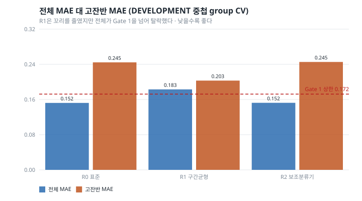
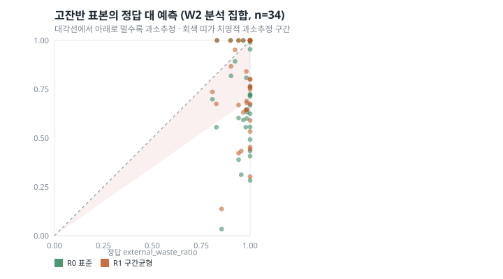
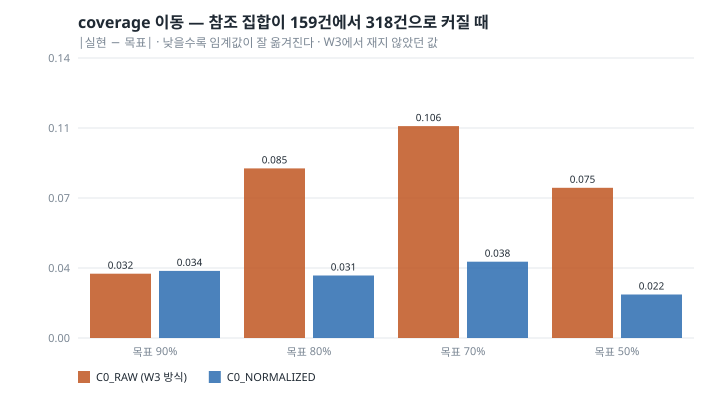

# W4 — Tail-Aware Waste Regression

*밥플래너 AI-4. W3(`reports/waste_w3_selective_prediction.md`)에 이어지는 문서.*

작성 시점: 2026-08-30
상태: **DEVELOPMENT 중첩 group CV 완료. 새 시험 집합 없음. 선택된 후보 = 기존 baseline**

> **이 문서에 새 테스트 결과는 없다.**
> §11의 숫자는 W2에서 결과를 이미 본 116건에 동결 정책을 한 번 얹은
> **POST-HOC ANALYSIS**다. FINAL TEST도, pristine validation도 아니다.

> **결론을 먼저 적는다.**
> 꼬리 인지 후보 두 개 중 어느 것도 사전에 정한 관문을 통과하지 못했다.
> 선택된 추정기는 **R0 — 아무것도 바꾸지 않은 기존 baseline**이다.
> 다만 실패한 방식이 서로 달랐고, 그 차이가 다음에 볼 자리를 좁힌다.

> **정정 (2026-08-31, W5에서).**
> 이 문서의 초판은 "꼬리 실패는 정보 부족이 아니라 목적함수 문제"라고 적었다.
> **현재 근거로는 너무 강한 문장이라 내렸다.** 확인된 것은 두 가지다 —
> (1) frozen 표현은 고잔반 표본을 **판별**하는 신호를 상당히 가지고 있고
> (AUROC 0.912), (2) 단순 재가중과 단순 보조 특징 결합으로는 꼬리 **크기**
> 회귀가 개선되지 않았다. 표현이 정확한 꼬리 크기 회귀에 **충분한** 정보를
> 담고 있는지는 W4가 보이지 않았다.
>
> 치명적 과소추정 비율의 집계도 두 가지로 나누어 다시 적었다(§6~§9).
> pooled(표본을 한 번씩)와 fold-macro(fold 비율의 평균)가 다르며, 초판은
> pooled 분자·분모에 macro 비율을 붙여 놓았다. 선택 결과는 어느 집계로 봐도
> 바뀌지 않는다 — R1은 Gate 1(전체 MAE)에서 탈락했고 R0·R2는 두 집계 모두
> 동일하다.

---

## 1. Motivation

W2와 W3이 같은 자리를 두 번 가리켰다.

```
W2   low MAE 0.059   high MAE 0.305
W3   고잔반 구간 안에서 선택적 예측이 아무것도 못 함 (0.250 -> 0.250)
W3   큰 오차 19건 중 10건이 APPROVED로 통과
```

대표 실패는 전부 같은 모양이다.

| 음식 | 정답 | W2 예측 |
|---|---:|---:|
| Telur Mata Sapi | 0.85 | 0.03 |
| Sambel Goreng Rempela Ati | 1.00 | 0.28 |
| Ayam Bumbu Srundeng | 0.95 | 0.31 |

**거의 다 남긴 식판을 거의 다 먹었다고 말한다.** 운영자에게 이 숫자가 그대로
가면 남은 음식이 그냥 지나간다.

---

## 2. 왜 선택적 예측으로는 부족했는가

W3의 답은 "틀릴 것 같으면 답하지 말자"였다. 그 자체는 작동했다 — 80%
coverage에서 전체 MAE가 0.1585에서 0.1407로 내려갔다.

그런데 **고잔반 구간 안에서는 아무 일도 일어나지 않았다.** 승인된 고잔반의
MAE가 0.250에서 0.250으로 그대로였다. 수준 내 상관은 low +0.416,
medium −0.028, **high +0.098**이었다.

신호가 보는 것은 "임베딩이 학습 분포에서 먼가"이지 "접시에 음식이 얼마나
남았는가"가 아니다. 손대지 않은 접시는 학습에서 흔히 본 모습이라 novelty가
낮다. **가장 위험한 오류가 정확히 신호의 사각지대에 있다.**

그래서 W4의 질문이 바뀐다. "언제 답하지 말까"가 아니라 **"애초에 왜 평균으로
수축하는가"** 다.

---

## 3. Research Questions

| | 질문 |
|---|---|
| RQ-W4-1 | 고잔반 과소추정은 정답 분포 불균형과 표준 회귀 목적함수의 평균 수축 때문인가 |
| RQ-W4-2 | 꼬리 인지 표본 가중치가 고잔반 MAE와 치명적 과소추정을 줄이는가 |
| RQ-W4-3 | "고잔반인가?"라는 보조 과제를 더하면 연속 회귀의 극단값 예측이 나아지는가 |
| RQ-W4-4 | kNN 신뢰 점수를 참조 분포로 정규화하면 coverage 이식 문제가 줄어드는가 |

### 사전 가설

| | 가설 | 판정 |
|---|---|---|
| H-W4-A | 구간 균형 가중치가 전체 MAE를 크게 해치지 않으면서 고잔반 과소추정을 줄인다 | **기각** (기전은 확인, 대가가 관문 초과) |
| H-W4-B | 고잔반 보조 분류기를 붙이면 치명적 오류가 더 줄어든다 | **기각** (분류기는 좋았고 회귀는 그대로) |
| H-W4-C | 참조 분포로 정규화하면 목표 coverage 이식이 안정적이다 | **지지** (DEVELOPMENT에서 명확, ANALYSIS에서 약함) |

---

## 4. 꼬리의 정의

**새로 만든 경계가 하나도 없다.** 전부 앞 단계에서 이미 쓰던 값이다.

```
구간          [0,0.2) [0.2,0.4) [0.4,0.6) [0.6,0.8) [0.8,1.0]   ← W2 ORDINAL_EDGES
고잔반         정답 >= 0.8                                       ← 위 구간의 마지막 칸
치명적 과소추정 정답 >= 0.8  그리고  정답 − 예측 >= 0.30          ← 0.30은 W3의 큰 오차 기준
```

이름은 코드와 보고서에서 같게 쓴다: `HIGH_WASTE_CATASTROPHIC_UNDERESTIMATION`.

두 조건을 모두 요구하는 이유가 있다. 큰 오차만 세면 저잔반을 높게 부른
헛경보도 같이 세어지고, 고잔반만 세면 잘 맞힌 것까지 들어간다. **제품이
무서워하는 칸은 이 둘의 교집합 하나다.**

> **경계 하나를 정정한다.** W2·W3의 `LEVEL_EDGES`는 `to_class_index` 규약상
> 정답이 정확히 0.8인 표본을 아래 칸(medium)에 넣어 high가 89건이었다. W4의
> 동결 규칙은 `>= 0.8`이라 90건이다. 차이는 정답이 정확히 0.8인 표본 **1건**
> 이다. W4의 표는 전부 `>= 0.8` 한 규칙으로만 계산했다 — 한 표에서 두 규칙을
> 섞으면 그 1건이 medium과 high에 동시에 세어진다.

---

## 5. Nested Group-CV

바깥 fold는 **W2·W3과 같은 분할**이다(범주 단위 5-fold, seed 42). 다르게
잡으면 이전 숫자와 나란히 놓을 수 없고, 개선처럼 보이는 것이 분할 차이일 수
있다.

```
DEVELOPMENT   398건 / 24범주 · 고잔반 90건 (22.6%)
바깥 fold     5 (범주 단위, seed 42)   → 방법 평가
안쪽 fold     4 (범주 단위, seed 20260830) → p_high OOF 생성 전용
바깥 fold 범주 누수  0
ANALYSIS      116건 / 10범주 — 이 단계에서 열지 않음
```

**안쪽 fold는 모델 선택에 쓰지 않는다.** R2의 학습 표본 `p_high`를 만드는
데만 쓴다. 여기가 이 단계에서 누수가 나기 가장 쉬운 자리다 — §8에서 다룬다.

ridge `alpha=100.0`은 W2가 고른 값 그대로다. **W4에서 하이퍼파라미터를 다시
탐색하지 않았다.** 질문이 목적함수와 보조 정보이지 정규화 세기가 아니기
때문이다. 여기서 alpha를 다시 돌리면 개선의 출처를 분리할 수 없게 된다.

---

## 6. R0 — 표준 회귀

W2가 고른 그대로다. frozen ResNet18(IMAGENET1K_V1) 식후 임베딩 + ridge
`alpha=100`. 표현을 이번 단계에서 바꾸지 않았다.

```
전체 MAE   0.1522 (fold 표준편차 0.013)
고잔반 MAE  0.2445 (0.073)
고잔반 Bias −0.1816        ← 음수 = 과소추정
치명적 과소추정  pooled 32/90 = 35.6%   fold-macro 31.4%
low 0.1041   medium 0.1864
```

고잔반 Bias가 −0.18이다. **오차가 큰 것이 아니라 방향이 한쪽이다.** 고잔반
표본 셋 중 하나꼴로 0.30 이상 낮게 말한다.

---

## 7. R1 — 구간 균형 회귀

각 학습 fold의 정답 분포에서 구간별 빈도 `n_b`를 세고 가중치를 준다.

```
w_b = (1/sqrt(n_b)) / mean(1/sqrt(n_b))
```

**완전한 역빈도가 아니라 역제곱근인 이유.** 가장 드문 구간이 가장 흔한
구간보다 수십 배 적다. 역빈도를 그대로 쓰면 표본 몇 개가 적합 전체를 끌고
가고, 그 몇 개가 흔들리면 모델도 같이 흔들린다. 제곱근은 방향은 같고 세기만
보수적이다. **후보를 하나로 사전 고정했다** — 결과를 보고 여러 식을 시험하지
않았다.

빈도는 **학습 fold의 정답에서만** 센다. 평가 fold 분포가 섞이면 그 순간
누수다. 평균 1 정규화는 alpha의 의미를 유지하기 위해서다 — 가중치 총합이
변하면 같은 alpha가 사실상 다른 정규화 세기가 되고, "가중치 효과"와 "정규화
효과"를 구분할 수 없다.

```
전체 MAE   0.1830 (0.013)    ← R0 대비 +0.0308
고잔반 MAE  0.2030 (0.059)    ← R0 대비 −0.0415
고잔반 Bias −0.1211           ← −0.18에서 −0.12로
치명적 과소추정  pooled 19/90 = 21.1%   fold-macro 27.7%  ← 32건에서 19건으로
low 0.1815   medium 0.1927   ← low가 0.1041에서 0.1815로
```

**기전은 실재한다.** 목적함수에 손을 대자 꼬리가 실제로 움직였다. 5개 fold 중
**4개**에서 고잔반 MAE가 개선됐고(평균 −0.0415, 최악 +0.0094), 한 fold만
좋아진 우연이 아니다.

**대가도 실재한다.** low MAE가 0.1041에서 0.1815로 74% 나빠졌다. 전체 Bias는
−0.008에서 **+0.078**로 부호가 뒤집혔다 — 이제 모든 것을 높게 부른다.
꼬리를 당겨 올린 만큼 나머지 전부를 같이 끌어올렸다.

---

## 8. R2 — 고잔반 보조 모델

임베딩이 "정답 >= 0.8인가"를 구분할 수 있는지 먼저 보고, 그 확률 `p_high`를
회귀기 입력에 붙인다.

분류기는 L2 정규화 로지스틱 회귀(`class_weight="balanced"`)다. **scikit-learn을
넣지 않았다** — 이 트랙은 W1부터 numpy 닫힌 해로만 baseline을 만들어 왔고,
보조 분류기 하나 때문에 무거운 의존성을 연구 환경에 들이면 그 경계가 무너진다.
정규화는 선택이 아니라 필수다: 512차원에 수백 표본이면 두 클래스가 거의 항상
완전 분리되고, 정규화가 없으면 확률이 0과 1로 붙어 stacking 입력으로서 아무
정보도 남지 않는다.

### 누수를 막은 자리

이 단계에서 가장 위험한 지점이다.

```
학습 표본의 p_high   바깥 학습 fold 안에서 다시 group OOF (안쪽 4-fold)
평가 표본의 p_high   바깥 학습 fold 전체로 적합한 분류기
```

자기 라벨로 학습한 분류기의 확률을 자기 특징에 붙이면, 회귀기는 임베딩이
아니라 **그 확률에 실린 정답**을 읽는다. 개발 성능만 좋아지고 새 표본에서
무너진다.

### 분류기는 잘 작동했다

```
recall     0.877   ← 주 지표. 고잔반을 놓치는 쪽이 제품 위험이다
precision  0.606
F1         0.705
AUROC      0.912
```

AUROC만 강조하지 않는다. 0.912는 보기 좋지만 제품이 묻는 것은 "고잔반 100건
중 몇 건을 잡았나"이고 그 답이 recall 0.877이다.

### 그런데 회귀는 전혀 움직이지 않았다

```
전체 MAE   0.1524   (R0 0.1522)
고잔반 MAE  0.2454   (R0 0.2445)
고잔반 Bias −0.1830  (R0 −0.1816)
치명적 과소추정 pooled 32/90 = 35.6%   fold-macro 31.4%  (R0와 동일)
```

5개 fold 중 고잔반 MAE가 개선된 fold는 **1개**뿐이다.

**이 결과가 W4에서 가장 많은 것을 말한다.** 표현은 고잔반을 **판별**하는
신호를 상당히 가지고 있다 — 분류기가 AUROC 0.912, recall 0.877로 보여 준다.
그런데 그 신호를 스칼라 하나로 다시 넣어 줘도 512차원 ridge의 출력은 바뀌지
않는다.

**여기서 말할 수 있는 것은 딱 여기까지다.** "판별할 수 있다"와 "크기를 정확히
맞힐 만큼의 정보가 있다"는 다른 문장이고, W4는 뒤의 것을 보이지 않았다.
0.85와 1.00을 둘 다 "고잔반"으로 옳게 분류하면서 둘 다 0.3이라고 말하는 것은
모순이 아니다. 확인된 것은 **단순 재가중(R1)과 단순 특징 결합(R2)이 꼬리
크기 예측을 고치기에 부족하다**는 것이다.

→ 사전에 적어 둔 **CASE C**에 해당한다: "분류기는 고잔반을 잘 잡지만 회귀
개선 없음 → 표현에는 극단 신호가 있으나 연속 매핑에 문제가 있다."

---

## 9. 선택 규칙과 판정

**결과를 보기 전에 봉했다.** `freeze.json`
SHA-256 `05426ff78705d3c3a125a44552747460105335c5951ec8b7fa1982c0960e97e6`

```
Gate 1   전체 MAE(바깥 fold 평균)가 R0보다 +0.02 넘게 나빠지면 탈락
Gate 2   통과 후보 중 고잔반 MAE가 가장 낮은 모델
Tie      고잔반 MAE 차이 0.01 이내이면 치명적 과소추정 비율이 낮은 쪽
Tie2     그래도 같으면 더 단순한 모델 (R0 < R1 < R2)
```



| 후보 | 전체 MAE | 고잔반 MAE | 고잔반 Bias | 치명적 (pooled) | 치명적 (macro) | Gate 1 |
|---|---:|---:|---:|---:|---:|:---:|
| R0_STANDARD | 0.1522 | 0.2445 | −0.1816 | 32/90 = 35.6% | 31.4% | 통과 |
| R1_BALANCED | **0.1830** | **0.2030** | −0.1211 | 19/90 = 21.1% | 27.7% | **탈락** (상한 0.1722) |
| R2_HIGH_AUX | 0.1524 | 0.2454 | −0.1830 | 32/90 = 35.6% | 31.4% | 통과 |

Gate 1을 통과한 둘 중 고잔반 MAE가 낮은 쪽은 R0(0.2445 < 0.2454)이고, 차이가
tie margin 0.01 이내라 치명적 비율을 봤는데 같았고(어느 집계로 봐도 동일),
그래서 더 단순한
쪽으로 **R0_STANDARD**가 선택됐다.

### 왜 전체 MAE 단독 기준이 아닌가

W2·W3에서 고잔반 과소추정이 제품적으로 더 위험하다는 것을 이미 관찰했다.
전체 MAE만 보면 그 실패가 저잔반 203건에 묻힌다 — W2에서 실제로 묻혀 있었다.
그래서 다중 목표 가드레일을 쓴다.

**그러나 전체 MAE를 버리지도 않는다.** Gate 1이 없으면 "전부 0.9라고 답하는
모델"이 고잔반 MAE 0.05로 이긴다. R1의 탈락은 그 가드레일이 실제로 작동한
결과다.

---

## 10. DEVELOPMENT 결과 요약

fold 단위 안정성 (R0 대비 고잔반 MAE):

| 후보 | 개선된 fold | 평균 변화 | 최악 fold |
|---|---:|---:|---:|
| R1_BALANCED | **4/5** | −0.0415 | +0.0094 |
| R2_HIGH_AUX | 1/5 | +0.0009 | +0.0040 |

R1의 개선은 한 fold의 우연이 아니다. R2의 무변화도 한 fold의 우연이 아니다.

**RQ-W4-1에 대한 답: 그렇다, 상당 부분.** 목적함수만 건드려도 고잔반 Bias가
−0.18에서 −0.12로, 치명적 과소추정이 32건에서 19건으로 움직였다. 표현을
바꾸지 않았고 데이터를 더 넣지도 않았다. 남은 것은 **불균형과 평균 수축이
원인의 일부**라는 것이다.

**RQ-W4-2에 대한 답: 줄이기는 하지만 값이 너무 비싸다.** 꼬리 −17%를 위해
저잔반 +74%를 냈다. 이 교환은 사전에 정한 관문을 통과하지 못한다.

**RQ-W4-3에 대한 답: 아니다.** 보조 정보를 특징으로 붙이는 방식으로는 안 된다.

---

## 11. Post-hoc W2 Analysis

> **이건 테스트가 아니다.** 이 116건은 W2에서 이미 결과를 본 집합이고 W3에서
> `W2_ANALYSIS`로 재분류했다. 선택은 §9에서 이미 끝났고 아래 어떤 숫자를 봐도
> 바뀌지 않는다. 동결 후 정확히 **한 번** 적용했다.

세 후보를 모두 적은 이유는 다시 고르기 위해서가 아니라 **DEVELOPMENT에서 본
맞교환이 여기서도 같은 모양인지** 보기 위해서다.

```
W2_ANALYSIS  116건 / 10범주 · 고잔반 34건
```

| 후보 | 전체 MAE | RMSE | Bias | 고잔반 MAE | 고잔반 Bias | 치명적 |
|---|---:|---:|---:|---:|---:|---:|
| **R0 (선택됨)** | **0.1526** | 0.2248 | −0.0651 | **0.3050** | −0.2567 | **16/34 (47.1%)** |
| R1 | 0.1765 | 0.2261 | +0.0072 | 0.2750 | −0.2046 | 13/34 (38.2%) |
| R2 | 0.1525 | 0.2247 | −0.0650 | 0.3049 | −0.2566 | 16/34 (47.1%) |

**맞교환이 그대로 재현된다.** R1은 전체 +0.024 / 꼬리 −0.030, R2는 소수점
네 자리까지 R0와 같다. DEVELOPMENT에서 내린 판단이 여기서 뒤집힐 근거는 없다.

분석 집합 분류기: recall 0.676, precision 0.742, F1 0.708, **AUROC 0.913**.
처음 보는 범주 10개에서도 AUROC가 유지된다 — 표현이 극단 신호를 가지고 있다는
§8의 결론이 여기서도 버틴다. recall이 0.877에서 0.676으로 떨어진 것은 임계값
0.5를 그대로 옮긴 결과이며, **분석 집합을 보고 임계값을 다시 잡지 않았다.**

---

## 12. 치명적 오류 분석



R0 → R1로 갈 때 치명적 과소추정 16건이 어떻게 움직였는지 (서술일 뿐 선택이
아니다):

```
회복      3건
그대로   13건
새로 생김 0건
```

새로 생긴 것이 0건인 점은 의미가 있다 — 가중치가 **저잔반을 고잔반으로
오인하게 만들지는 않았다.** 대가는 정확도이지 새로운 종류의 실패가 아니다.

### W2 대표 오류 3건

| 음식 | 정답 | R0 | R1 | R2 |
|---|---:|---:|---:|---:|
| Telur Mata Sapi | 0.85 | 0.03 | 0.14 | 0.03 |
| Sambel Goreng Rempela Ati | 1.00 | 0.28 | 0.30 | 0.28 |
| Ayam Bumbu Srundeng | 0.95 | 0.31 | 0.43 | 0.31 |

**셋 다 회복되지 않았다.** R1이 세 건 모두를 위로 밀긴 했지만(+0.11 / +0.02 /
+0.12) 여전히 치명적 과소추정 구간 안이다. 0.85를 0.14라고 말하는 것과 0.03이라
말하는 것 사이에 운영상 의미 있는 차이는 없다.

**이 세 표본 때문에 모델을 다시 바꾸지 않았다.** 기록만 한다.

---

## 13. 신뢰 임계값 이식

W3이 남긴 결함이다. 보정은 참조 ~318건으로, 적용은 참조 398건으로 했더니
목표 50% coverage가 62.9%로 실현됐다.

원인은 방법 안에 있다. **kNN 거리는 참조가 커지면 저절로 짧아진다.** 이웃이
많아지니 가장 가까운 셋도 더 가까워진다.

```
C0_RAW          raw 코사인 거리 (W3 그대로. 지우지 않는다)
C0_NORMALIZED   참조 집합 내부 leave-one-out kNN 거리 분포에 대한 경험적 백분위
```

백분위로 바꾸면 축척이 사라진다. 0.90은 "이 참조 집합 내부 거리의 90
백분위보다 멀다"는 뜻이고, 그 문장은 참조가 몇 건이든 같은 뜻이다. 참조 분포를
만들 때 **자기 자신을 이웃으로 세지 않는다** — 세면 거리 0이 섞여 분포가 왼쪽으로
밀리고 모든 점수가 부풀려진다.

### DEVELOPMENT 응력 시험 (참조 159건 → 318건)



같은 표본을 두 크기의 참조로 각각 재고, 작은 참조에서 잡은 임계값을 큰 참조
점수에 건다. 방법이 참조 크기에 흔들리지 않으면 실현 coverage가 목표에 붙는다.

| 방법 | 90% | 80% | 70% | 50% | 평균 drift |
|---|---:|---:|---:|---:|---:|
| C0_RAW | 93.0% | 88.5% | 80.6% | 57.5% | **0.074** |
| C0_NORMALIZED | 88.5% | 82.9% | 73.5% | 49.9% | **0.031** |

목표 80%에서 승인 MAE는 raw 0.1433 / normalized 0.1363이다. **drift가 절반
이하로 줄고 승인 MAE도 나빠지지 않았다** → 사전에 정한 채택 조건을 만족한다.
**C0_NORMALIZED 채택.**

### W2 분석 집합 (참조 398건, 보정은 OOF ~318건)

| 방법 | 90% | 80% | 70% | 50% | 평균 drift |
|---|---:|---:|---:|---:|---:|
| C0_RAW | 91.4% | 80.2% | 73.3% | **62.9%** | 0.044 |
| C0_NORMALIZED | 85.3% | 73.3% | 69.0% | **53.4%** | 0.040 |

**W3의 62.9%가 그대로 재현된다.** 정규화는 그 최악 지점을 12.9%p에서 6.7%p로
줄인다. 그런데 평균 drift는 0.044 → 0.040으로 거의 차이가 없다 — 80%와 90%에서는
오히려 raw가 더 정확하다.

**과장하지 않는다.** 여기서 참조 크기 변화는 1.25배(318→398)뿐이고,
DEVELOPMENT 응력 시험의 2배(159→318)보다 훨씬 작다. 대신 처음 보는 범주 10개
라는 **분포 이동**이 섞여 있고, 정규화는 그걸 고쳐 주지 않는다. 정규화가
고치는 것은 참조 **크기**의 영향 하나다.

**RQ-W4-4에 대한 답: 그렇다, 단 참조 크기 문제에 한해서.**

---

## 14. 꼬리 안에서의 신뢰 — 판정

W3의 결론이 새 측정에서도 유지되는지 본다.

| 방법 | 범위 | n | Spearman |
|---|---|---:|---:|
| C0_RAW | 전체 (DEV) | 398 | +0.432 |
| C0_RAW | **고잔반만 (DEV)** | 90 | **+0.083** |
| C0_NORMALIZED | 전체 (DEV) | 398 | +0.451 |
| C0_NORMALIZED | **고잔반만 (DEV)** | 90 | **+0.049** |
| C0_RAW | 고잔반만 (ANALYSIS) | 34 | **−0.030** |
| C0_NORMALIZED | 고잔반만 (ANALYSIS) | 34 | **−0.020** |

> ### **novelty 기반 거절은 고잔반 안전장치가 아니다.**

네 번 다르게 쟀고 네 번 다 0 근처다. 정규화해도, 새 집합에서도, 부호가
뒤집혀도 결론이 같다. 이 문장을 명확히 유지한다 — 선택적 예측을 "위험한 오류를
막아 준다"고 소개하면 안 된다. 막지 못한다.

전체 상관(+0.43~+0.61)만 보여 주고 이 표를 빼면 그게 거짓말이 된다.

---

## 15. Threats to Validity

1. **새 시험 집합이 없다.** W4의 모든 방법은 DEVELOPMENT 398건에서 나왔고,
   적용 대상은 이미 본 116건이다. 진짜 검증은 여전히 없다.
2. **외부 데이터다.** 인도네시아 병원 급식이다. 밥플래너 급식소 성능이 아니다.
3. **모든 후보 아이디어가 소비된 데이터에서 나왔다.** "고잔반이 문제다"라는
   출발점 자체가 W2 TEST 결과를 본 뒤에 생겼다. W4의 후보 설계는 그 관찰에
   의존하므로, 완전히 독립적인 사전 가설이 아니다.
4. **음식 범주가 유일한 그룹 키다.** 참가자·회차 식별자가 데이터에 없다.
   같은 사람의 다른 끼니가 학습과 평가에 갈릴 수 있다.
5. **frozen ImageNet 표현이다.** 급식 사진에 맞춰 학습된 적이 없다. §8의
   "정보는 있는데 매핑이 문제"라는 결론은 이 표현 안에서만 유효하다.
6. **LeFood 질량 의미가 불확실하다.** 식기 무게가 제외됐다는 근거는 간접적
   관찰(7단계 표본이 1 g에 도달)이다.
7. **고잔반 하위집단이 작다.** DEVELOPMENT 90건, ANALYSIS 34건이다. 치명적
   비율 47.1%는 16/34이라 표본 한둘에 크게 흔들린다.
8. **가중 목적함수는 정답 분포를 바꾼다.** R1이 최소화하는 것은 원래의 MAE가
   아니다. 그래서 R1의 전체 MAE 악화는 부작용이 아니라 정의상 예상된 것이고,
   Gate 1은 그 대가가 감당할 만한지만 묻는다.
9. **분류기 임계값 0.5를 고정했다.** 분석 집합에서 recall이 떨어진 것은 그
   때문일 수 있다. 다시 잡지 않은 것이 규칙이지만, 그래서 recall 0.676이
   이 방법의 최선은 아니다.
10. **사람 관찰자·제품 데이터가 없다.** 사람 기준선이 없어 "이 정도면 사람만
    한가"를 말할 수 없다.
11. **fold 수가 5, 범주가 24개다.** fold별 고잔반 수가 5~52건으로 크게 다르고
    (§8의 fold 4는 고잔반 5건), fold 평균이 그만큼 거칠다.

### 사람 관찰자 메타데이터

W3에서 이미 감사를 마쳤다. LeFood-Set의 7단계 척도는 Mendeley 공식 설명에
정의가 있고(1 = 전혀 안 먹음 … 7 = 다 먹음), 3·4·5는 분수이지만 1·2·6·7은
"한 입"처럼 질적 표현이다. **숫자 잔반률로 변환하지 않았고, 이번에도 모델
입력으로 쓰지 않았다.** 추론 시점에 존재하지 않는 값을 특징으로 쓰면 그
모델은 배포할 수 없다.

---

## 16. Product Implications

**바뀐 것은 없다. 그게 이번 결론이다.**

선택된 추정기는 R0 — W2가 고른 것 그대로다. 두 후보 모두 사전에 정한 관문을
통과하지 못했다. `WASTE_MODEL_MODE=fixture`를 그대로 두었고, FastAPI wiring도
하지 않았다. **밥플래너 현장 데이터는 여전히 0건이다.**

**그런데 아무것도 못 배운 것은 아니다.**

| 알게 된 것 | 근거 |
|---|---|
| 표현은 고잔반 **판별** 신호를 상당히 가지고 있다 | 분류기 AUROC 0.912 / recall 0.877 (§8) |
| 단순 재가중과 단순 특징 결합으로는 꼬리 **크기**가 안 고쳐진다 | R1은 관문 초과, R2는 무변화 (§7·§8) |
| 표현이 꼬리 크기에 **충분한지는 아직 모른다** | W4가 시험한 것은 두 가지 단순 방식뿐 |
| 단순 재가중으로는 값이 너무 비싸다 | 꼬리 −17%에 저잔반 +74% (§7) |
| 선택적 예측은 고잔반 안전장치가 아니다 | 네 번 측정, 전부 0 근처 (§14) |
| 신뢰 임계값은 참조 크기에 흔들린다 | drift 0.074 → 0.031, 정규화로 고쳐짐 (§13) |

**다음에 시도할 것은 재가중이 아니다.** 남은 후보는 둘이다 — 출력 구조가
부족한 것이거나(순서형 분포 후 기대값, 전문가 혼합 등), 표현 자체가 꼬리
크기를 담고 있지 않은 것이다. 출력 구조를 먼저 시험해야 둘을 가를 수 있다.
이건 W5의 질문이다.

**UI에 쓰면 안 되는 문구는 W3에서 적은 것 그대로 유효하다.** 여기에 하나를
더한다 — 신뢰 점수 백분위(0.90)도 **보정된 정확도 확률이 아니다.** "90%
확률로 틀린다"는 뜻이 전혀 아니다.

---

## 재현

```
.venv-waste\Scripts\python.exe research\waste_estimation\scripts\w4_freeze.py
.venv-waste\Scripts\python.exe research\waste_estimation\scripts\w4_experiment.py
.venv-waste\Scripts\python.exe research\waste_estimation\scripts\w4_reliability.py
.venv-waste\Scripts\python.exe research\waste_estimation\scripts\w4_analysis.py
.venv-waste\Scripts\python.exe research\waste_estimation\scripts\w4_charts.py
```

`w4_freeze.py`는 먼저 돌아야 하며, 이미 봉한 내용과 달라지면 **멈춘다.**

산출물: `research/waste_estimation/experiments/w4_tail/`

| 파일 | 내용 |
|---|---|
| `freeze.json` | 실험 전에 봉한 정의 + SHA-256 |
| `outer_fold_metrics.csv` | 바깥 fold별 후보 지표 |
| `candidate_summary.csv` | 후보별 fold 평균/표준편차 |
| `high_waste_metrics.csv` | fold별 고잔반 분류기 지표 |
| `fold_stability.csv` | R0 대비 개선 fold 수 |
| `development_predictions.csv` | 표본별 OOF 예측과 p_high |
| `selected_config.yaml` | 선택 결과 |
| `reliability_transport.csv` | fold별 raw/normalized coverage 이동 |
| `reliability_transport_summary.csv` | 목표 coverage별 평균 |
| `development_reliability.csv` | 표본별 OOF 신뢰 점수 (임계값 출처) |
| `tail_reliability.csv` | 전체 / 고잔반 내부 상관 |
| `reliability_decision.json` | 채택 판정 + 꼬리 안전장치 판정 |
| `analysis_metrics.csv` | POST-HOC ANALYSIS 지표 |
| `analysis_reliability_transport.csv` | 분석 집합 coverage 이동 |
| `analysis_tail_reliability.csv` | 분석 집합 상관 |
| `failure_cases.csv` | 표본별 예측과 치명 여부 이동 |
| `w2_error_recovery.csv` | W2 대표 오류 3건의 회복 여부 |
| `metadata.json` / `analysis_metadata.json` | `isFinalTest: false` |

원본 이미지, 임베딩, 가중치는 저장소에 들어가지 않는다.
