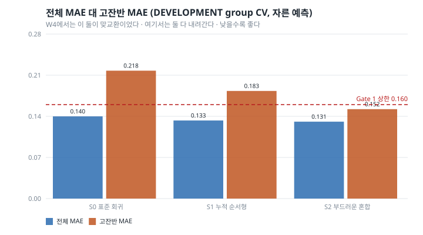
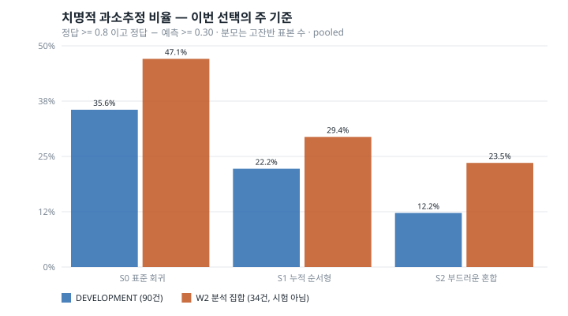
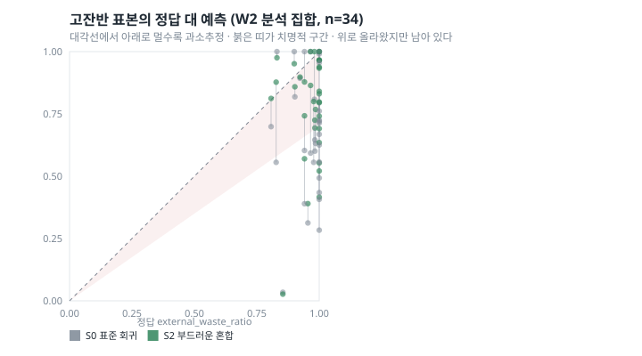

# W5 — Structured Output Heads for Extreme Waste

*밥플래너 AI-5. W4(`reports/waste_w4_tail_aware_regression.md`)에 이어지는 문서.*

작성 시점: 2026-08-31
상태: **structured-head development complete; pristine external validation pending**

> **이 문서에 새 테스트 결과는 없다.**
> §12의 숫자는 W2에서 결과를 이미 본 116건에 동결 구조를 한 번 얹은
> **POST-HOC FROZEN ANALYSIS**다. FINAL TEST도, pristine validation도 아니다.

> **결론을 먼저 적는다.**
> 출력 구조를 바꾸자 꼬리가 움직였다. 그것도 저잔반을 희생하지 않고서.
> 치명적 과소추정이 DEVELOPMENT에서 **32건 → 11건**, 분석 집합에서
> **16건 → 8건**으로 줄었고 **새로 생긴 치명적 오류는 0건**이다.
> W4에서 값이 너무 비쌌던 그 개선을, 목적함수가 아니라 출력 형태를 바꿔서
> 얻었다.
>
> 다만 **가장 큰 실패 3건은 하나도 회복되지 않았다.** §13에서 다룬다.

---

## 1. Motivation

W2부터 같은 실패가 반복됐다.

```
W2   high MAE 0.305                     저잔반의 5배
W3   고잔반 안에서 선택적 예측 무효      0.250 -> 0.250
W4   단순 재가중은 값이 너무 비쌌고      꼬리 −17%에 저잔반 +74%
W4   단순 특징 결합은 무변화             소수점 세 자리까지 동일
```

그런데 W4에서 하나가 분명해졌다. **표현은 고잔반을 판별할 줄 안다** —
분류기가 AUROC 0.912, recall 0.877을 냈다. 그 신호를 스칼라 하나로 512차원
ridge에 붙였을 때만 아무 일도 일어나지 않았다.

그렇다면 남은 의심은 **답을 내는 형태**다. 표현도, 정규화도, 분할도 그대로
두고 "어떤 모양으로 답하는가"만 바꿔 본다. 여기서도 안 되면 다음 용의자는
표현 자체다.

---

## 2. W4 결론 정정

W4 보고서 초판에 이렇게 썼다.

> "꼬리 실패는 정보 부족이 아니라 목적함수 문제다"

**현재 근거로는 너무 강한 문장이라 내렸다.** 확인된 것은 두 가지뿐이다.

1. frozen 표현은 고잔반 표본을 **판별**하는 신호를 상당히 가지고 있다
   (AUROC 0.912).
2. 단순 재가중(R1)과 단순 보조 특징 결합(R2)으로는 꼬리 **크기** 회귀가
   개선되지 않았다.

"판별할 수 있다"와 "크기를 맞힐 만큼의 정보가 있다"는 다른 문장이다. 0.85와
1.00을 둘 다 "고잔반"으로 옳게 분류하면서 둘 다 0.3이라고 말하는 것은
모순이 아니다. **표현이 정확한 꼬리 크기 회귀에 충분한지는 W4가 보이지
않았다.** W4 보고서에 정정 문단을 추가했고, 문장은 지우지 않고 내렸다고
적었다 — 무엇이 바뀌었는지가 남아야 한다.

### 치명적 과소추정 집계 정정

W4 초판은 `32/90 = 31.4%`라고 적었다. **두 집계를 섞은 분수다.**

| 집계 | 뜻 | R0 값 |
|---|---|---:|
| pooled | 고잔반 표본을 한 번씩 세고 나눈다 | 32/90 = **35.6%** |
| fold-macro | fold별 비율의 평균 | **31.4%** |

fold별 고잔반 수가 5~52건으로 크게 다르기 때문에 둘이 갈린다. macro는
고잔반 5건짜리 fold와 52건짜리 fold를 똑같이 취급한다.

**산술 오류가 아니라 표기 오류였다.** 코드는 두 값을 각각 옳게 계산하고
있었고, 보고서가 한쪽 분자·분모에 다른 쪽 비율을 붙였다. W4 산출물에
`catastrophicRatePooled` / `catastrophicRateMacro` 두 열을 모두 남기도록
고쳤다.

**W4의 선택 결과는 어느 집계로 봐도 바뀌지 않는다.** R1은 Gate 1(전체 MAE)
에서 탈락했고, R0와 R2는 두 집계 모두 정확히 같았다.

W5는 **pooled를 주 집계로** 사전 고정했다. 표본 하나가 한 번씩 세어지는
쪽이 "고잔반 100건 중 몇 건을 크게 놓쳤나"라는 질문에 곧바로 답한다.

---

## 3. Research Questions

| | 질문 | 답 |
|---|---|---|
| RQ-W5-1 | 누적 순서형 출력을 기대값으로 되돌리면 극단값 예측이 나아지는가 | **그렇다** |
| RQ-W5-2 | 게이트 + 두 전문가의 부드러운 혼합이 고잔반 과소추정을 줄이는가 | **그렇다, 더 많이** |
| RQ-W5-3 | 저잔반과 전체 MAE를 유지하면서 꼬리를 얻을 수 있는가 | **그렇다** (W4와 다른 점) |
| RQ-W5-4 | 구조도 실패하면 표현이 병목일 가능성이 커지는가 | 발동 안 함 — 다만 §13의 잔여 수축은 여전히 그쪽을 가리킨다 |

### 사전 가설과 판정

| | 가설 | 판정 |
|---|---|---|
| H-W5-A | 누적 순서형 기대값 머리가 치명적 과소추정을 줄인다 | **지지** (35.6% → 22.2%) |
| H-W5-B | 부드러운 혼합이 R1처럼 전부 밀어 올리지 않으면서 꼬리를 줄인다 | **지지** (35.6% → 12.2%, 전체 Bias 유지) |
| H-W5-C | 둘 다 실패하면 표현/입력 정보를 다음 후보로 본다 | **발동하지 않음** |

→ 사전에 적어 둔 **CASE B**가 주된 결과다: "high/non-high 매핑에는 별도의
회귀 함수가 필요하다. W4의 특징 결합은 너무 약했다." **CASE A**도 함께
성립한다.

---

## 4. 데이터 역할

```
DEVELOPMENT   398건 / 24 음식 범주 · 고잔반 90건
              구간 분포 [203, 29, 43, 33, 90]
ANALYSIS      116건 / 10 음식 범주 · 고잔반 34건  ← 이미 소비됨
밥플래너 현장  0건
```

새 시험 집합은 **없다.** 동일한 비율 의미와 VERIFIED 라이선스를 가진 공개
데이터셋을 이번에도 확보하지 못했고, 찾기 위해 범위를 늘리지 않았다.

---

## 5. 고정된 표현

**후보 간 표현 차이 0이다.**

```
식후 이미지만 · torchvision ResNet18 · IMAGENET1K_V1 · frozen embedding
W2 전처리 그대로 · fine-tuning 없음 · backbone 변경 없음 · 증강 없음
ridge alpha=100 (W2가 고른 값) · 분류기 alpha=100 (탐색 없음)
바깥 fold 5개, seed 42 — W4와 같은 분할, 후보마다 새로 만들지 않음
```

바뀌는 것이 출력 구조 하나뿐이라, 차이가 나면 출처가 거기밖에 없다.

### 예측 정책이 W2와 달라졌다

**주 지표를 자른 예측(bounded, `clip(ŷ, 0, 1)`) 기준으로 사전 고정했다.**

이유가 있다. S1은 구조상 [0,1] 안에서만 답한다 — 확률의 볼록결합이므로
범위를 벗어날 수 없다. raw로 재면 S1만 범위 밖 오차가 없어 유리해지고,
그러면 **구조가 아니라 범위를 비교**하게 된다. 제품 API도 [0,1]이다.

W2의 주 지표는 raw였다. 그래서 이 문서의 S0 숫자는 W4 표와 다르다.

| | W4 (raw) | W5 (bounded) |
|---|---:|---:|
| S0 전체 MAE | 0.1522 | 0.1399 |
| S0 고잔반 MAE | 0.2445 | 0.2177 |
| S0 고잔반 Bias | −0.1816 | −0.2084 |

자르면 MAE는 좋아지고 고잔반 Bias는 **더 음수가 된다** — 1을 넘던 예측이
1로 눌리면서 위쪽 오차만 사라지기 때문이다. 같은 모델의 같은 성능이고,
읽는 자가 다를 뿐이다. **단계를 넘나들며 숫자를 비교할 때는 같은 정책끼리만
비교한다.** raw 지표도 함께 기록해 두었다.

---

## 6. S0 — 표준 회귀 (baseline)

W2/W4가 쓰던 그대로. frozen 임베딩 + ridge `alpha=100`, 점 하나를 바로 낸다.

```
전체 MAE   0.1399      low 0.0879   medium 0.1850
고잔반 MAE  0.2177      고잔반 Bias −0.2084
치명적 과소추정  32/90 = 35.6% (pooled)   fold-macro 35.6%
p90 절대오차 0.3227
```

---

## 7. S1 — 누적 순서형 기대값

y를 바로 회귀하지 않고 네 개의 누적 확률로 표현한다.

```
P(y >= 0.2)   P(y >= 0.4)   P(y >= 0.6)   P(y >= 0.8)
```

임계값마다 독립된 L2 로지스틱 회귀(`class_weight="balanced"`)를 맞춘다.

### 단조 보정 — 규칙을 먼저 정했다

독립 분류기를 쓰므로 `P(y>=0.4) > P(y>=0.2)` 같은 위반이 생긴다. 확률로
성립하지 않고, 그대로 두면 구간 확률이 음수가 된다.

```
q'_1 = q_1
q'_t = min(q'_{t-1}, q_t)        ← 왼쪽에서 오른쪽으로 누적 최솟값
```

**오른쪽부터 최댓값을 끌고 오는 보정도 유효하지만 고르지 않았다.** 그
방식은 확률을 **올리는** 쪽이라 고잔반 확률을 낙관적으로 부풀린다. 이
단계의 관심사가 과소추정이므로 보수적인 쪽을 택했다. **결과를 보고 바꾸지
않았다.**

실제 보정된 위반은 fold별 16~273건이었다(fold 0이 273건으로 유독 많은데,
학습 표본이 187건으로 가장 적은 fold다).

### 구간 확률과 대표값

```
p_0 = 1 − q_1     p_b = q_b − q_{b+1}     p_4 = q_4      (모두 >= 0, 합 = 1)
ŷ = Σ p_b · r_b
```

대표값 `r_b`는 **학습 fold 정답의 구간별 평균**이다. 평가 fold 정답을 보지
않는다. 실제 값이 왜 중요한지는 숫자가 말한다.

| 구간 | 고정 중점 | 실제 학습 평균 |
|---|---:|---:|
| [0.0, 0.2) | 0.10 | **0.020** |
| [0.2, 0.4) | 0.30 | 0.305 |
| [0.4, 0.6) | 0.50 | 0.494 |
| [0.6, 0.8) | 0.70 | 0.700 |
| [0.8, 1.0] | 0.90 | **0.956** |

양 끝이 크게 다르다. 중점을 썼다면 마지막 칸이 0.9로 눌려 구조가 맞아도
기대값이 체계적으로 낮게 나왔을 것이다. 빈 구간이면 중점으로 되돌리는
규칙을 사전에 정했지만, **어느 fold에서도 빈 구간은 없었다**(최소 11건).

> **W2 T2와 같은 실험이 아니다.** W2 T2는 단일 순서형 클래스 예측이었다.
> S1은 전체 누적 분포를 만들고 기대값으로 되돌린다.

```
전체 MAE   0.1329      low 0.0859   medium 0.1871
고잔반 MAE  0.1832      고잔반 Bias −0.1782
치명적 과소추정  20/90 = 22.2% (pooled)
```

**전체도 저잔반도 나빠지지 않았다.** W4의 R1과 결정적으로 다른 점이다.

---

## 8. S2 — 부드러운 전문가 혼합

W4에서 게이트 신호는 좋았는데 그걸 **특징 하나로** 넣은 것이 문제였다.
이번에는 회귀 함수 자체를 나눈다.

```
frozen 임베딩
  ├─ 게이트 분류기 (y >= 0.8, class_weight=balanced)  →  g
  ├─ 저잔반 전문가  (학습 fold의 y < 0.8 표본만, Ridge alpha=100)
  └─ 고잔반 전문가  (학습 fold의 y >= 0.8 표본만, Ridge alpha=100)

ŷ = (1 − g) · y_low + g · y_high
```

**`g`를 보정된 확률이라고 부르지 않는다.** 게이트 점수일 뿐이고 0.7이
"70% 확률로 고잔반"이라는 뜻이 아니다.

**딱딱한 전환(`g > 0.5`면 고잔반 전문가)을 쓰지 않았다.** 경계에서 예측이
튀고 그 불연속이 새 실패를 만든다. 여기서 재려는 것은 혼합 구조이지 전환
규칙이 아니다.

전문가 학습 표본은 fold별로 저잔반 149~291건 / 고잔반 38~85건이었다. 사전에
정한 최소 10건을 모든 fold가 넘겼으므로 candidate failure 처리는 발동하지
않았다.

게이트 성능은 **W4의 R2 분류기와 정확히 같다** — 같은 분류기, 같은 분할이다.

```
recall 0.877   precision 0.606   F1 0.705   AUROC 0.912
```

**게이트가 좋아진 것이 아니다.** 달라진 것은 그 신호가 특징 한 칸이 아니라
**어느 회귀 함수를 쓸지**를 정한다는 점 하나다.

```
전체 MAE   0.1309      low 0.0945   medium 0.1911
고잔반 MAE  0.1522      고잔반 Bias −0.1375
치명적 과소추정  11/90 = 12.2% (pooled)
```

---

## 9. 선택 규칙

**결과를 보기 전에 봉했다.** `freeze.json`
SHA-256 `cbcebd037f6677e127372576a8dbc106818e0aeb9b1244bc8afe360b9b04c6e0`

```
Gate 1   전체 MAE(bounded, fold 평균)가 S0보다 +0.02 넘게 나빠지면 탈락
Gate 2   통과 후보 중 치명적 과소추정 비율(pooled)이 가장 낮은 모델
Tie      치명적 비율 차이 0.02 이내이면 고잔반 MAE가 낮은 쪽
Tie2     그래도 같으면 전체 MAE가 낮은 쪽
Tie3     그래도 같으면 더 단순한 모델 (S0 < S1 < S2)
```

### 왜 치명적 비율을 먼저 보는가

W2·W3·W4에서 제품적으로 가장 나쁜 오류를 반복 확인했다 — **거의 안 먹었는데
거의 다 먹었다고 예측**. W5의 목적은 그 안전성이다.

그래도 Gate 1을 앞에 둔다. 없으면 "전부 0.9라고 답하는 모델"이 이긴다.

---

## 10. DEVELOPMENT 결과



바깥 group CV 5-fold 평균, **자른 예측** 기준.

| 후보 | 전체 MAE | low | medium | 고잔반 MAE | 고잔반 Bias | 치명 (pooled) | p90 AE |
|---|---:|---:|---:|---:|---:|---:|---:|
| S0_STANDARD_RIDGE | 0.1399 | 0.0879 | 0.1850 | 0.2177 | −0.2084 | 32/90 = 35.6% | 0.3227 |
| S1_CUMULATIVE_ORDINAL | 0.1329 | 0.0859 | 0.1871 | 0.1832 | −0.1782 | 20/90 = 22.2% | 0.3128 |
| **S2_SOFT_MIXTURE** | **0.1309** | 0.0945 | 0.1911 | **0.1522** | **−0.1375** | **11/90 = 12.2%** | 0.3005 |

Gate 1 상한은 0.1599였고 **세 후보 모두 통과**했다 — 두 구조가 전체 MAE를
오히려 **낮췄기** 때문이다. 그래서 Gate 2(치명적 비율)로 바로 갈렸고
S2(12.2%)가 S1(22.2%)과 tie margin 0.02 밖이라 단독 선택됐다.

**선택: `S2_SOFT_HIGH_LOW_MIXTURE`.**

W4와 대비하면 이게 이번 단계의 핵심이다.

| | 꼬리 개선 | 저잔반 대가 | 전체 MAE |
|---|---|---|---|
| W4 R1 (재가중) | 치명 35.6% → 21.1% | low **+74%** | +0.031 (탈락) |
| W5 S2 (구조) | 치명 35.6% → **12.2%** | low +7.5% | **−0.009** |

같은 방향의 개선을, 훨씬 크게, 거의 공짜로 얻었다.

---

## 11. Fold 안정성

음식 범주가 24개뿐이다. **p-value를 억지로 만들지 않는다.** fold 단위
일관성으로만 말한다.

fold별 치명적 과소추정 (건수/고잔반 수):

| fold | S0 | S1 | S2 |
|---|---|---|---|
| 0 | 21/52 | 12/52 | **6/52** |
| 1 | 2/12 | 1/12 | 1/12 |
| 2 | 0/6 | 0/6 | 0/6 |
| 3 | 6/15 | 5/15 | **3/15** |
| 4 | 3/5 | 2/5 | **1/5** |

| 후보 | 고잔반 MAE 개선 | 치명 건수 개선 |
|---|---:|---:|
| S1 | 4/5 fold | 4/5 fold |
| S2 | 4/5 fold | 4/5 fold |

개선되지 않은 fold는 둘 다 fold 2인데, 그 fold는 S0부터 치명적 오류가 0건
이라 더 줄일 것이 없었다. **어느 fold에서도 나빠지지 않았다.** 한 fold가
끌고 간 결과가 아니다.

---

## 12. Post-hoc Frozen Analysis

> **이건 테스트가 아니다.** 이 116건은 W2에서 이미 결과를 본 집합이다.
> 선택은 §10에서 끝났고 아래 어떤 숫자를 봐도 바뀌지 않는다. 동결 후
> 정확히 **한 번** 적용했다.



`W2_ANALYSIS` 116건 / 10 미관측 범주, 자른 예측 기준.

| 후보 | 전체 MAE | RMSE | Bias | low | 고잔반 MAE | 고잔반 Bias | 치명 (pooled) |
|---|---:|---:|---:|---:|---:|---:|---:|
| S0_STANDARD_RIDGE | 0.1400 | 0.2220 | −0.0605 | 0.0417 | 0.2916 | −0.2702 | 16/34 = 47.1% |
| S1_CUMULATIVE_ORDINAL | 0.1248 | 0.1865 | −0.0216 | 0.0463 | 0.2283 | −0.2194 | 10/34 = 29.4% |
| **S2 (선택)** | **0.1174** | **0.1857** | **−0.0165** | 0.0414 | **0.2015** | **−0.1836** | **8/34 = 23.5%** |

**DEVELOPMENT에서 본 그림이 그대로 재현된다.** 순서도, 방향도, 크기도.
분석 집합의 게이트는 recall 0.676 / AUROC 0.913이었다 — recall이 떨어진 것은
임계값 0.5를 그대로 옮긴 결과이며 **분석 집합을 보고 다시 잡지 않았다.**

S2의 저잔반 MAE는 0.0417 → 0.0414로 사실상 그대로다. **W4 R1과 달리 모든
예측을 위로 밀어 올리지 않았다.**

---

## 13. 치명적 오류의 회복



S0 → S2 (분석 집합, 고잔반 34건):

```
RECOVERED                       8건
그대로                          8건
NEW_CATASTROPHIC_REGRESSION     0건
```

**새로 생긴 치명적 오류가 0건이다.** 구조를 바꿔서 다른 곳을 망가뜨리지
않았다는 뜻이고, 이게 W4 R1과의 실질적 차이다.

### 그런데 가장 큰 실패 3건은 그대로다

| 음식 | 정답 | S0 | 오차 | S2 | 오차 | 판정 |
|---|---:|---:|---:|---:|---:|---|
| Telur Mata Sapi | 0.85 | 0.03 | 0.82 | **0.03** | 0.83 | remaining |
| Sambel Goreng Rempela Ati | 1.00 | 0.28 | 0.72 | 0.42 | 0.58 | remaining |
| Ayam Bumbu Srundeng | 0.95 | 0.31 | 0.64 | 0.39 | 0.56 | remaining |

**Telur Mata Sapi는 조금도 움직이지 않았다.** 게이트가 이 표본을 고잔반으로
보지 않았다는 뜻이다 — 그러면 혼합은 저잔반 전문가의 답을 거의 그대로
내보낸다. 나머지 둘은 위로 밀렸지만 여전히 치명적 구간 안이다.

구조는 **게이트가 잡아 주는 표본**을 고친다. 게이트가 놓치면 아무것도 못
한다. 게이트 recall이 0.676(분석 집합)이라는 것은 고잔반 셋 중 하나는
구조의 도움을 전혀 못 받는다는 뜻이다.

**이 세 표본 때문에 모델을 다시 바꾸지 않았다.** 기록만 한다.

---

## 14. 분포 진단

구조가 단순히 분산만 키운 것인지 확인한다. 분산만 키우면 꼬리 지표는
좋아지고 나머지는 나빠지는데, §12에서 나머지가 나빠지지 않았다.

분석 집합 예측 분포 (자른 값):

| | min | q25 | median | q75 | max | 표준편차 |
|---|---:|---:|---:|---:|---:|---:|
| 정답 | 0.000 | 0.000 | 0.250 | **0.901** | 1.000 | **0.418** |
| S0 | 0.000 | 0.016 | 0.219 | 0.620 | 1.000 | 0.335 |
| S1 | 0.024 | 0.038 | 0.227 | 0.720 | 0.940 | 0.344 |
| S2 | 0.000 | 0.025 | 0.241 | **0.747** | 1.000 | 0.365 |

**넓어진 곳이 위쪽이다.** q25는 거의 그대로(0.016 → 0.025)이고 q75가
0.620에서 0.747로 올라갔다. 정답의 0.901에는 여전히 못 미친다.

### 방향성 보정 — 수축은 줄었지만 남아 있다

| 수준 | n | 평균 정답 | S0 평균 예측 | S2 평균 예측 |
|---|---:|---:|---:|---:|
| low | 57 | 0.010 | 0.042 | 0.047 |
| medium | 25 | 0.483 | 0.496 | 0.571 |
| **high** | 34 | **0.961** | 0.690 | **0.777** |

고잔반에서 평균 수축이 0.271에서 0.184로 줄었다. **3분의 1을 회수했다.**

그리고 **3분의 2는 남아 있다.** 정답 평균이 0.961인 집단을 0.777이라고
말하는 모델이다. 여기가 구조로 더 갈 수 없는 지점인지, 아니면 아직 시도하지
않은 구조가 있는지는 이 단계가 답하지 않는다.

S1은 max가 0.940에서 멈춘다. 구조상 마지막 구간 대표값(0.956)을 넘을 수
없기 때문이다 — 기대값 머리의 내재적 상한이고, 정답 1.0을 절대 맞힐 수 없다.
S2는 전문가가 직접 회귀하므로 그 상한이 없다.

---

## 15. Threats to Validity

1. **새 시험 집합이 없다.** 모든 방법이 DEVELOPMENT 398건에서 나왔고, 적용
   대상은 이미 본 116건이다. `structured-head development complete; pristine
   external validation pending`.
2. **후보 아이디어가 소비된 데이터에서 나왔다.** "고잔반이 문제다"라는
   출발점이 W2 TEST 결과를 본 뒤에 생겼다. W3·W4·W5의 후보 설계가 모두 그
   관찰에 의존한다. 완전히 독립적인 사전 가설이 아니다.
3. **외부 데이터다.** 인도네시아 병원 급식이다. 밥플래너 급식소 성능이 아니다.
4. **음식 범주가 유일한 그룹 키다.** 참가자·회차 식별자가 없다.
5. **frozen ImageNet 표현이다.** 급식 사진에 맞춰 학습된 적이 없다.
6. **고잔반 표본이 적다.** DEVELOPMENT 90건, 분석 집합 34건. 치명 23.5%는
   8/34이라 표본 한둘에 크게 흔들린다. fold 2·4는 고잔반이 6건·5건뿐이다.
7. **LeFood 질량 의미가 불확실하다.** 식기 무게 제외 근거가 간접적이다.
8. **S1은 정답을 내부적으로 이산화한다.** 구간 안의 변이를 버리고 대표값
   하나로 되돌리므로, 마지막 구간에서 0.80과 1.00을 구분할 수 없다. §14의
   max 0.940 상한이 그 결과다.
9. **S2의 게이트 점수는 보정되지 않았다.** 혼합 가중치로 쓰지만 확률이
   아니다. 그리고 게이트가 놓친 표본은 구조의 도움을 전혀 못 받는다(§13).
10. **식후 이미지만 쓴다.** 제품에서 식전 사진이 실제로 어떻게 들어올지,
    그 조건에서 이 결론이 유지되는지 in-domain에서 검증된 바 없다.
11. **예측 정책이 W2와 다르다.** 자른 예측이 주 지표다. 단계 간 숫자를
    비교할 때 같은 정책끼리만 비교해야 한다(§5).

### 사람 관찰자 보조 분석

W3에서 공식 7단계 semantics를 확인해 두었지만, 이번 단계에서는 **범위를
늘리지 않기 위해 생략했다.** 숫자 매핑은 여전히 하지 않으며, 추론 시점에
존재하지 않는 값이므로 모델 입력으로도 쓰지 않는다.

### 신뢰(reliability)는 이번 단계에서 동결

W3·W4에서 novelty 기반 거절이 고잔반 내부 안전장치가 **아님**을 네 번 재서
확인했다. W5에서는 신뢰 후보를 추가하지도, 재튜닝하지도 않았다. W4의 정규화
kNN coverage 이식 결과는 그대로 유지한다.

---

## 16. Product Implications

**그래도 fixture를 바꾸지 않았다.** `WASTE_MODEL_MODE=fixture` 그대로,
FastAPI wiring 없음. 밥플래너 현장 표본은 여전히 **0건**이다.

결과가 좋아진 것과 제품에 연결할 준비가 된 것은 다른 문제다. 이 숫자들은
전부 인도네시아 병원 급식 사진에서 나왔고, 그중 절반은 이미 결과를 본
집합에서 나왔다.

**그래도 이번엔 방향이 생겼다.**

| 알게 된 것 | 근거 |
|---|---|
| 꼬리 실패의 상당 부분은 **출력 형태**로 고칠 수 있다 | 치명 35.6% → 12.2%, 저잔반 유지 (§10) |
| 게이트 신호는 특징이 아니라 **경로**로 써야 한다 | 같은 분류기, W4는 무변화 / W5는 −24%p (§8) |
| 구조는 **게이트가 잡은 것만** 고친다 | 최대 실패 3건 그대로, recall 0.676 (§13) |
| 평균 수축의 3분의 2는 남아 있다 | 고잔반 정답 0.961 대 예측 0.777 (§14) |

**다음에 물어야 할 것.** 남은 수축이 여전히 구조 문제인지(게이트 recall을
올리거나, 분위 회귀처럼 구간 내부 변이를 살리는 머리), 아니면 frozen
ImageNet 표현이 "얼마나 남았는지"의 크기를 애초에 담고 있지 않은 것인지.
§13이 첫 번째 쪽을, §14의 잔여 0.184가 두 번째 쪽을 가리킨다. **분위 회귀는
이번 범위에 넣지 않았다** — S1/S2 결과를 보고 판단하기로 사전에 정했고, 이제
판단할 근거가 생겼다.

**UI 문구 제약은 그대로다.** 신뢰 점수도 게이트 점수도 보정된 확률이
아니다. 퍼센트로 바꿔 보여 주지 않는다.

---

## 재현

```
.venv-waste\Scripts\python.exe research\waste_estimation\scripts\w5_freeze.py
.venv-waste\Scripts\python.exe research\waste_estimation\scripts\w5_experiment.py
.venv-waste\Scripts\python.exe research\waste_estimation\scripts\w5_analysis.py
.venv-waste\Scripts\python.exe research\waste_estimation\scripts\w5_charts.py
```

`w5_freeze.py`는 먼저 돌아야 하며, 이미 봉한 내용과 달라지면 **멈춘다.**

산출물: `research/waste_estimation/experiments/w5_structured/`

| 파일 | 내용 |
|---|---|
| `freeze.json` | 실험 전에 봉한 정의 + SHA-256 |
| `candidate_metrics.csv` | 후보별 fold 평균 (bounded / raw 둘 다) |
| `fold_metrics.csv` | 바깥 fold별 지표 |
| `fold_stability.csv` | S0 대비 개선 fold 수 |
| `structure_diagnostics.csv` | 전문가 표본 수, 단조 위반 수, 구간 대표값 |
| `gate_metrics.csv` | fold별 게이트 지표 |
| `prediction_distribution.csv` | DEVELOPMENT 예측 분포 |
| `development_predictions.csv` | 표본별 예측 (raw / bounded) |
| `selected_config.yaml` | 선택 결과 |
| `analysis_metrics.csv` | POST-HOC FROZEN ANALYSIS 지표 |
| `catastrophic_recovery.csv` | 표본별 치명 여부 이동 |
| `w2_largest_failures.csv` | W2 대표 오류 3건 before/after |
| `directional_calibration.csv` | 수준별 평균 정답 대 평균 예측 |
| `analysis_prediction_distribution.csv` | 분석 집합 예측 분포 |
| `metadata.json` / `analysis_metadata.json` | `isFinalTest: false` |

원본 이미지, 임베딩, 가중치는 저장소에 들어가지 않는다.
