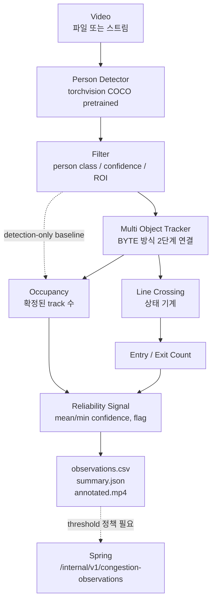

# AI-1. CCTV 기반 비식별 식당 혼잡도·이용 인원 분석

*CCTV-based Anonymous Occupancy and Entry Counting*

---

## 1. 문제 정의

급식소 운영에 두 가지 숫자가 필요하다.

**지금 붐비는가.** 앱에 혼잡도를 띄우려면 현재 그 공간에 몇 명이 있는지
알아야 한다.

**오늘 몇 명이 먹었는가.** 식수 예측(AI-3)을 학습하려면 정답이 필요한데,
그 정답이 지금 시스템 어디에도 쌓이지 않는다. 입구를 통과한 사람 수는 그
정답의 대리 지표가 될 수 있다.

두 숫자는 서로 다르고, **하나로 합치면 둘 다 틀린다.**

### Occupancy vs Entry Count

| | Occupancy | Entry Count |
|---|---|---|
| 세는 것 | 지금 그 공간에 있는 사람 | 입구 선을 IN 방향으로 넘은 사람 |
| 시간 축 | 순간값 | 누적값 |
| 쓰는 곳 | 실시간 혼잡도 | 한 끼 이용 인원의 대리 지표 |
| 값의 성질 | 오르내린다 | 단조 증가 |
| 필요한 것 | 프레임 하나 | 프레임 사이의 연결(추적) |

점심 시간에 300명이 다녀가도 한 순간의 occupancy는 40명일 수 있다. 40이
혼잡도이고 300이 이용 인원이다. 하나의 "인원 수" 열에 이 둘을 담으려는
순간부터 그 열은 아무것도 뜻하지 않게 된다.

이 저장소는 두 값을 별도 필드로 내보내고, 추적이 없을 때 entry는 0이 아니라
**빈 값**으로 낸다. 0은 "아무도 안 들어왔다"이고 빈 값은 "재지 않았다"이다.

## 2. 왜 식별이 아니라 계수인가

기술적으로는 사람을 알아보는 쪽이 계수에 유리하다. 같은 사람을 다시 알아볼
수 있으면 재입장을 정확히 처리하고, 가려졌다 나타난 사람도 놓치지 않는다.

그런데 이것은 학생이 밥 먹는 장면을 찍는 카메라다.

- 필요한 것은 "몇 명"이지 "누가"가 아니다. 신원은 목적에 기여하지 않는다.
- 얼굴 특징을 한 번 뽑아 두면, 그것을 다른 데 쓰지 않겠다는 약속만 남는다.
  약속은 코드 리뷰로 강제되지 않는다.
- 회원 정보와 연결되는 순간 이것은 출입 감시 시스템이 된다. 그것은 학교가
  동의한 것이 아니다.

그래서 **애초에 신원 정보를 만들지 않는다.** 만들지 않은 것은 유출되지 않고,
잘못 쓰이지 않고, 요구받아도 내줄 것이 없다.

`tests/test_cctv_privacy.py`가 얼굴 인식 라이브러리와 신원 필드가 코드에
들어오는지 매 실행마다 확인한다. 문서에만 적힌 약속은 조용히 깨진다.

## 3. 구조



점선 두 개가 중요하다. 위쪽은 추적을 건너뛰는 baseline A이고, 아래쪽은
**아직 연결되지 않은 구간**이다. 왜 연결하지 않았는지는 12절.

모듈은 이렇게 나뉜다.

| 파일 | 하는 일 | 무거운 의존성 |
|---|---|---|
| `geometry.py` | 정규화/픽셀 좌표, 상자, 선, ROI | 없음 |
| `detection.py` | Detection, detector 경계, 필터 | 없음 |
| `tracking.py` | BYTE 방식 추적 | 없음 |
| `crossing.py` | 선 통과 상태 기계 | 없음 |
| `reliability.py` | 신뢰 신호 | 없음 |
| `observations.py` | CSV 스키마 | 없음 |
| `windows.py` | 시간 창 통계 | 없음 |
| `summary.py` | summary.json | 없음 |
| `metrics.py` | 평가 지표 | 없음 |
| `groundtruth.py` | 정답 파일 스키마 | 없음 |
| `config.py` | 실험 설정 | pydantic |
| `pipeline.py` | 위를 엮는 흐름 | 없음 |
| `video.py` | 영상 읽기/쓰기 | opencv |
| `annotate.py` | 겹쳐 그리기 | opencv |
| `detectors/torchvision_detector.py` | 실제 추론 | torch, torchvision |

**계수 로직 전체가 torch 없이 돈다.** 단위 테스트가 가짜 detector로 pipeline을
끝까지 돌리는 이유다. 모델 설치 여부와 무관하게 "선을 넘었는가"의 정확성이
검증되어야 한다.

## 4. Detector

### 선택: torchvision `fasterrcnn_mobilenet_v3_large_fpn` (COCO pretrained)

detector를 처음부터 학습하지 않는다. 급식소 라벨 데이터가 하나도 없고,
사람 검출은 공개 pretrained 모델이 이미 잘 하는 일이다.

### 후보 비교

| 후보 | 라이선스 | 상용 | Python 3.12 | 판단 |
|---|---|---|---|---|
| **torchvision detection** | BSD-3-Clause | 가능 | 지원 | **채택** |
| Ultralytics YOLOv8 / YOLO11 | AGPL-3.0 (+ 유료 Enterprise) | Enterprise 필요 | 지원 | 제외 |
| YOLOX (Megvii) | Apache-2.0 | 가능 | 확인 필요 | 향후 후보 |
| RT-DETR (lyuwenyu) | Apache-2.0 | 가능 | 확인 필요 | 향후 후보 |
| RTMDet / MMDetection | Apache-2.0 | 가능 | mmcv 빌드 문제 | 보류 |

### 왜 torchvision인가

**라이선스가 결정적이었다.** 지금 사람 검출에서 가장 흔한 선택은 Ultralytics
YOLO 계열인데, 공식 저장소가 코드와 pretrained weight를 AGPL-3.0으로 배포하고,
상용 제품에 쓰려면 별도 Enterprise 라이선스를 사야 한다고 명시한다. 밥플래너는
서비스로 나갈 제품이다. 연구 단계에서 AGPL 모델로 숫자를 만들어 두면, 그
숫자를 제품의 근거로 쓸 수 없다. **나중에 버리게 될 결과는 처음부터 만들지
않는다.**

torchvision은 BSD-3-Clause이고 COCO pretrained weight도 같은 저장소에서
나온다. 상용 제약이 없다.

부수적인 이유도 맞는다. torch/torchvision은 AI-2(잔반 이미지)에서 어차피
필요하다. 두 트랙이 같은 스택을 쓰면 환경이 하나로 유지된다.

**성능은 양보했다.** torchvision이 보고하는 COCO box mAP는
`fasterrcnn_mobilenet_v3_large_fpn` 32.8, `ssdlite320_mobilenet_v3_large` 21.3,
`fasterrcnn_resnet50_fpn_v2` 46.7이다. 최신 YOLO 계열보다 낮다. 이것은 baseline을
낮게 잡은 대가이고, 개선의 여지가 그만큼 남아 있다는 뜻이기도 하다. detector
경계(`PersonDetector`)를 따로 둔 이유가 이것이다. Apache-2.0인 YOLOX나 RT-DETR로
갈아끼울 때 바꿀 파일은 `detectors/` 안의 하나다.

### 사람 클래스 번호를 코드에 박지 않는다

COCO에서 person은 보통 1이지만, 모델마다 클래스 목록의 배치가 다를 수 있다.
어댑터는 weight 메타데이터의 `categories`에서 `"person"`의 위치를 찾는다.
모델을 바꿨을 때 조용히 다른 클래스를 세는 것이 가장 찾기 어려운 종류의
버그다.

## 5. Tracker

### 선택: ByteTrack 방식 2단계 연결 (저장소 내 구현)

원 논문: Zhang et al., *ByteTrack: Multi-Object Tracking by Associating Every
Detection Box*, ECCV 2022. 공식 구현(ifzhang/ByteTrack)은 MIT.

### 왜 ByteTrack 계열인가

1. **외형 특징을 쓰지 않는다.** 상자의 위치만으로 프레임을 잇는다. 사람을
   식별하지 않겠다는 제약과 정확히 맞는다. DeepSORT 계열은 re-id embedding을
   쓰는데, 그것은 이 프로젝트가 하지 않기로 한 바로 그것이다.
2. **낮은 신뢰도 상자를 버리지 않는다.** 배식 줄에서 사람이 서로를 가리면
   신뢰도가 잠깐 떨어진다. 그때 track이 끊기면 같은 사람이 새 번호를 받고
   입장 인원이 부풀려진다. BYTE의 2단계 매칭이 정확히 이 상황을 위한 것이다.
3. **detector 출력만 있으면 되고 별도 학습이 필요 없다.** baseline에 맞다.
4. **실시간에 가깝다.** 서비스에 붙일 것이므로 중요하다.

### 원 구현과 다른 점

여기 있는 것은 공식 구현을 옮긴 것이 아니라 BYTE의 연결 규칙을 저장소 안에
다시 쓴 것이다. 두 군데를 의도적으로 단순화했다.

| | ByteTrack 원본 | 여기 |
|---|---|---|
| 운동 모델 | Kalman filter | 직전 프레임 이동량 등속 외삽 |
| 할당 | Hungarian 최적 할당 | IoU 내림차순 greedy |

둘 다 numpy/scipy 없이 표준 라이브러리로 돌리기 위한 선택이고, 계수 로직을
무거운 의존성 없이 그대로 단위 테스트할 수 있게 하려는 것이 목적이다.
**여기서 나온 수치를 ByteTrack 논문 성능으로 읽으면 안 된다.** 이 단순화가
얼마나 손해인지는 아직 재지 않았고, `reports/cctv_baseline.md`의 다음 실험
목록에 올려 두었다.

### 추적 파라미터가 하는 일

| 값 | 짧으면 | 길면 |
|---|---|---|
| `max_age` | 잠깐 가려진 사람이 새 번호 → 입장 인원 과대 | 나간 사람이 남음 → occupancy 과대 |
| `min_hits` | 1회성 오탐이 바로 인원에 포함 | 실제 입장이 늦게 잡힘 |

기본값(`max_age=30`, `min_hits=3`)은 30fps 기준 약 1초와 0.1초에 해당한다.
**정답 데이터로 검증한 값이 아니라 출발점이다.**

## 6. ROI

창밖을 지나가는 사람, 복도, 옆 매장이 프레임에 들어오면 식당 혼잡도가 아닌
것이 혼잡도에 섞인다. ROI는 그것을 자른다.

```yaml
roi:
  enabled: true
  x1: 0.0
  y1: 0.35
  x2: 1.0
  y2: 1.0
```

**0~1 정규화 좌표다.** 픽셀로 적으면 카메라를 1080p에서 720p로 바꾸는 순간
ROI가 엉뚱한 곳을 가리킨다.

**판정은 상자 전체가 아니라 한 점으로 한다.** 상자 전체가 ROI 안에 있기를
요구하면 경계에 반쯤 걸친 사람이 전부 빠지고, 조금이라도 겹치면 통과시키면
ROI가 사실상 넓어진다. 기본은 상자의 아래쪽 가운데(`BOTTOM_CENTER`), 즉 발이
닿는 지점이다. "그 공간에 있는가"에 가장 가깝다.

## 7. Line Crossing

입구에 선을 하나 긋고, IN 방향으로 넘은 사람을 센다.

```yaml
line:
  start: [0.10, 0.60]
  end:   [0.90, 0.60]
  in_direction: NEGATIVE
```

### 방향은 코드가 아니라 설정이 정한다

카메라를 반대편에 달면 IN과 OUT이 뒤집힌다. 그래서 방향을 하드코딩하지 않는다.

선을 `start → end`로 그으면, 그 진행 방향 기준으로 부호가 정해진다.

```
   화면 좌표계 (y가 아래로 증가)

            NEGATIVE  (y가 작은 쪽 = 화면 위쪽)
                 ↑
   start ●───────────────────● end      ← line: [0.1,0.6] → [0.9,0.6]
                 ↓
            POSITIVE  (y가 큰 쪽 = 화면 아래쪽)

   in_direction: NEGATIVE
     → 화면 아래에서 위로 넘어가면 ENTRY
     → 위에서 아래로 넘어가면 EXIT
```

**처음 자기 영상에 적용할 때 반드시 확인한다.** 사람이 들어오는데 `EXITED`가
오르면 방향이 뒤집힌 것이다. `in_direction`을 `POSITIVE`로 바꾸거나 `start`와
`end`를 맞바꾼다. `annotated.mp4`에 선과 방향이 그려져 있으니 눈으로 확인할
수 있다.

### 중복 계수를 막는 세 겹

이것이 이 모듈에서 가장 신경 쓴 부분이다. 사람이 선 근처에서 조금만 떨려도
`IN, IN, IN`이 연달아 찍힌다. 실제로는 한 번 들어간 것이다. 반대로 진짜
나갔다 다시 들어온 사람은 두 번 세야 한다. **이 둘을 가르는 것이 핵심이다.**

```
  1. 불감대 (band = 0.01)
     선에서 이보다 가까우면 ON_LINE. 확정된 쪽을 바꾸지 않는다.
     └ 선 바로 위의 미세 떨림을 통째로 무시한다.

  2. 이력 (min_confirm_distance = 0.03)
     band를 벗어나도 이 거리 이상 떨어져야 그쪽에 있다고 확정한다.
     └ 넘어갔다 얕게 되돌아오는 진동을 걸러낸다.

  3. 재계수 금지 구간 (cooldown_frames = 15)
     한 번 센 track은 이 동안 다시 세지 않는다.
     └ 이 시간이 지난 IN→OUT→IN은 실제 재방문으로 보고 두 번 센다.
```

track별 상태는 다음과 같다.

```
  확정된 쪽 없음  ──(min_confirm_distance 넘어 확정)──▶  POSITIVE 또는 NEGATIVE
                                                            │
                              반대쪽으로 확정 + cooldown 지남 │
                                                            ▼
                                                        사건 발생
```

**영상 시작 시점에 이미 안쪽에 있던 사람은 입장으로 세지 않는다.** 처음
확정되는 쪽은 사건이 아니다. 그러지 않으면 영상을 켜는 순간 식당 안 사람이
전부 "방금 들어온" 것이 된다.

track이 사라지면 그 상태도 지운다. 상태가 영상 밖으로 나가지 않는다.

## 8. Reliability

숫자 하나만 내보내면 받는 쪽은 그것을 항상 같은 무게로 받는다. 역광이라
사람이 반쯤만 잡히는 프레임과 잘 보이는 프레임이 같은 값으로 나가면 안 된다.

관측마다 다음을 같이 낸다.

| 필드 | |
|---|---|
| `mean_detection_confidence` | 이 프레임 상자들의 평균 신뢰도. 상자가 없으면 **빈 값** |
| `min_detection_confidence` | 최소 신뢰도 |
| `active_track_count` | 세고 있는 사람 수 |
| `reliability_flag` | `OK` / `LOW_CONFIDENCE` / `NO_DETECTION` / `CROWDED` |

`NO_DETECTION`은 낮은 신뢰도와 다르다. 빈 식당일 수도 있고 detector가 전부
놓친 것일 수도 있는데, **여기서는 그 둘을 구분할 수 없다.** 구분할 수 없다는
사실 자체를 값으로 남긴다.

상자가 없을 때 평균 신뢰도를 0.0으로 채우지 않는다. 0.0은 "신뢰도가 0이었다"로
읽히고, 그것은 "잴 것이 없었다"와 다르다. 나중에 평균을 내면 그 차이가 그대로
지표를 왜곡한다.

### confidence를 정확도로 읽지 마라

> **detector confidence 0.8은 "이 상자가 사람일 가능성에 대한 모델의 점수"이지
> "사람 수를 80% 맞혔다"가 아니다.**

실제로 이런 일이 일어난다.

- 두 사람이 겹쳐 한 상자로 잡혔다. 그 상자의 confidence는 높다. **모델은
  확신하고 개수는 틀렸다.**
- 사람이 아닌 것을 사람으로 잡았는데 confidence가 0.9다.
- 사람이 아예 안 잡혔다. **못 잡은 것에는 confidence 자체가 없다. 누락은 이
  신호로 절대 알 수 없다.**

그러니 `reliability_flag`는 "이 값이 틀렸다"가 아니라 "이 프레임은 조건이
나쁘니 자동으로 믿지 말고 사람이 확인할 후보로 두자"는 뜻이다. **이 flag와
실제 계수 오차 사이의 관계는 아직 측정하지 않았다.** 그것이 RQ3이다.

### 확장 지점

향후 "낮은 신뢰 구간은 백엔드 전송에서 보류한다"로 이어질 자리를 만들어 두었다.
지금은 flag를 계산해서 CSV와 요약에 담는 데까지만 하고, 실제 전송 차단은
구현하지 않았다. 무엇을 기준으로 보류할지가 아직 측정되지 않았기 때문이다.

## 9. 시간 창

프레임 하나의 occupancy는 생각보다 흔들린다. `windows.py`가 1/3/5초 창의
평균·중앙값·최댓값을 낸다.

**그렇지만 창 통계를 기본 결과로 두지 않는다.** 평활한 곡선은 언제나 더
그럴듯해 보인다. 원본을 감추고 평활값만 보여 주면 실제로 얼마나 흔들리는지가
보고서에서 사라진다. 기본 출력은 프레임별 원본이고, 창 통계는 `windows.csv`로
따로 나간다.

## 10. 평가 지표

### Occupancy

| | |
|---|---|
| 주 지표 | **MAE** — 단위가 사람 수 그대로다. "평균 1.8명 틀린다" |
| 보조 | RMSE — 큰 오차에 민감 |
| 보조 | bias = mean(예측 − 실제) — 부호가 있다 |

MAE가 같아도 계속 적게 세는 것과 많이 세는 것은 운영에서 완전히 다른 문제라
bias를 같이 본다.

**MAPE는 주 지표로 쓰지 않는다.** 식당은 비는 시간이 있고, 실제 인원이 0인
구간에서 MAPE는 정의되지 않거나 무한대로 튄다. 0을 빼고 계산하면 가장 쉬운
구간만 남는다. 어느 쪽이든 숫자가 실제보다 좋아 보인다.

### Entry Count

영상 하나에 대해 `|예측 − 실제|`. 영상이 여럿이면 그 평균(MAE across videos).

사건 단위 annotation이 충분해지면 precision / recall / F1으로 넘어갈 수 있다.
그 전에 그 숫자를 쓰면 정답이 없는데 있는 것처럼 된다.

### Tracking

ID switch, IDF1, HOTA는 이번 단계의 필수가 아니다. 추적은 여기서 목적이 아니라
entry counting의 수단이고, 이 지표들을 제대로 재려면 track 단위 annotation이
있는 데이터셋과 `TrackEval` 같은 의존성이 필요하다. **계수가 주 과제라는 점을
유지한다.** 추적 품질은 entry count 오차로 간접 평가한다.

### Runtime

서비스용이므로 `processing_fps`를 기록한다. `metadata.json`에 장치, 해상도,
패키지 버전이 같이 남는다. **이 숫자를 다른 환경의 일반 성능으로 옮겨 말하지
않는다.**

## 11. Domain Shift

포트폴리오에서 가장 중요한 부분이다. "잘 되는 영상에서 잘 된다"는 결과가
아니다.

평가 표본에 조건 태그를 붙여 조건별로 나눠 본다.

```
daylight / low-light / sparse / crowded / occlusion / far-distance / oblique-camera
```

`metrics.score_by_condition()`과 `render_condition_table()`이 다음 표를 만든다.

| Condition | Samples | Occupancy MAE | Entry Error |
|---|---:|---:|---:|
| (조건 annotation 없음) | 0 | N/A | N/A |

**지금은 비어 있고, 그것이 맞다.** 조건 태그는 데이터셋이 제공한 것이거나
사람이 직접 붙인 것이어야 한다. 조건을 모르는 표본에 "주간"이라고 적으면 표는
채워지지만 그 표는 거짓이다. 빈 태그를 넣으면 코드가 거부한다.

## 12. Spring 연동 계약

백엔드에 `POST /internal/v1/congestion-observations`가 있다. AI-1의 출력이
언젠가 여기로 간다.

| AI-1 출력 | Spring 필드 | 비고 |
|---|---|---|
| `occupancy_count` | `peopleCount` | 순간값. **entry count가 아니다** |
| 관측 시각 | `observedAt` | 프레임 시각을 절대 시각으로 환산 |
| (고정) | `source` = `CCTV_AI` | 값의 진실은 백엔드가 가진다 |
| `reliability_flag` | (없음) | 아래 참고 |
| `entries_total` | (없음) | 아래 참고 |

### 지금 연결하지 않는 이유 — congestion level

백엔드는 `COMFORTABLE / NORMAL / CROWDED / VERY_CROWDED` 같은 등급을 필요로
한다. 그런데 **`peopleCount`를 등급으로 바꾸는 임계값이 정해진 적이 없다.**

40명이 붐비는 것인지는 그 식당의 좌석 수에 달렸다. 100석짜리에서 40명은
한산하고 50석짜리에서는 붐빈다. 모델이 임계값을 정할 근거가 없다.

**연구 출력은 `people_count`까지다.** 등급 변환은 좌석 수 또는 운영 정책에
기반한 threshold policy가 정해진 뒤, 서비스 계층에서 한다. 모델 안에 임의
임계값을 넣으면 정해지지도 않은 정책이 모델 버전에 박혀 버린다.

### 아직 계약에 없는 것

`reliability_flag`와 `entries_total`을 받을 자리가 백엔드 계약에 없다. 둘 다
지금 늘리지 않는다. 신뢰 신호는 무엇을 기준으로 보류할지가 측정되지 않았고,
입장 인원은 그것이 실제 식수와 얼마나 맞는지 검증되지 않았다. **검증 전에
계약을 늘리면, 보내는 쪽은 쓰이고 있다고 믿고 받는 쪽은 무시한다.**

이 두 가지는 [Gap](#15-한계)에 기록해 둔다.

## 13. 시연

### 설치

핵심 로직은 추가 설치 없이 돌지만, 실제 영상을 처리하려면 다음이 필요하다.

    .venv\Scripts\python.exe -m pip install -e ".[cctv]"

`pyyaml`, `opencv-python`, `numpy`, `torch`, `torchvision`을 받는다. CUDA 빌드는
용량이 크다. GPU를 쓰지 않을 것이면 CPU 빌드로 충분하다.

### 실행

    .venv\Scripts\python.exe ^
      research\cctv_counting\scripts\run_video.py ^
      --input C:\path\to\your\video.mp4 ^
      --config research\cctv_counting\configs\demo.yaml ^
      --output-dir outputs\cctv_demo

**영상 경로는 반드시 직접 준다.** 이 도구는 저장소 어딘가에 있는 영상을
찾아서 알아서 쓰지 않는다. CCTV 영상에는 사람이 찍혀 있고, 어느 영상을
처리할지는 사람이 정해야 한다.

유용한 옵션:

    --device cpu          GPU 없이 돌린다
    --confidence 0.6      설정 파일의 임계값을 덮어쓴다
    --max-frames 300      앞부분만 빠르게 확인한다

### 만들어지는 것

```
outputs/cctv_demo/
  annotated.mp4       상자, 번호, 선, ROI, CURRENT/ENTERED/EXITED, 낮은 신뢰 표시
  observations.csv    프레임별 관측
  summary.json        영상 전체 요약
  metadata.json       설정, 모델, weight 이름, 장치, 패키지 버전, 실행 시각
  windows.csv         시간 창 통계 (설정에서 켰을 때)
```

**원본은 건드리지 않는다.** 출력 경로가 입력과 같으면 시작 전에 거부한다.

`metadata.json`이 재현을 담당한다. 이 파일 하나로 어떤 설정과 어떤 weight로
언제 돌린 결과인지 알 수 있다. 지금 pipeline에 난수는 없지만 `seed`도 같이
기록해 둔다.

### 평가

정답 파일을 채운 뒤:

    .venv\Scripts\python.exe ^
      research\cctv_counting\scripts\evaluate.py ^
      --video-id demo-01 ^
      --observations outputs\cctv_demo\observations.csv ^
      --occupancy-gt research\cctv_counting\datasets\annotations\occupancy_ground_truth.csv ^
      --crossing-gt research\cctv_counting\datasets\annotations\crossing_ground_truth.csv

정답이 비어 있으면 지표를 내지 않고 그렇다고 말한 뒤 0이 아닌 코드로 끝난다.
0건으로 계산한 MAE 0.0은 완벽한 성능처럼 보이지만 아무것도 재지 않은 것이다.

### Demo와 Benchmark를 섞지 않는다

| | Demo | Benchmark |
|---|---|---|
| 무엇 | 우리 영상에서 실제로 도는 모습 | 정답이 있는 데이터에서 정량 평가 |
| 결과 | "돌아간다" | MAE, 오차, FPS |
| 지금 | 실행 대기 (영상 미제공) | 미측정 |

시연 영상에서 나온 숫자는 성능이 아니다. 정답이 없기 때문이다. 보고서에서도
절을 나눠 둔다.

## 14. 개인정보

### 하지 않는 것

- 얼굴 검출, 얼굴 특징 추출, 얼굴 대조
- 같은 사람을 다른 영상 / 다른 날 / 다른 카메라에서 다시 알아보기
- 이름, 학번, 전화번호, 회원 번호와의 연결
- 성별, 나이 등 속성 추정

### 하는 것

- 익명 사람 상자
- 영상 한 세션 안에서만 유효한 임시 track 번호

### track_id의 경계

`track_id`는 프레임 사이를 잇는 포인터일 뿐이다. 다른 영상, 다른 날의 같은
번호는 같은 사람이 아니다.

- **파일로 나가지 않는다.** `observations.csv`에 `track_id` 열이 없다. 한 줄은
  한 프레임의 집계값이지 한 사람의 기록이 아니다. 번호를 시각과 함께 파일로
  남기는 순간 그것은 사람별 동선 기록이 된다.
- **영상 경계를 넘지 않는다.** `reset()`이 번호를 1부터 다시 시작한다.
- **끝난 번호의 상태는 지운다.** `LineCrossingCounter.forget()`.

### 검사

`tests/test_cctv_privacy.py`가 매 실행마다 확인한다.

- 얼굴 인식 / re-identification 라이브러리가 코드에 없는가
- 신원 필드 이름이 코드에 없는가
- CSV, 정답 파일, 요약 스키마에 식별 가능한 열이 없는가
- `summary.json`의 `video`가 전체 경로가 아니라 파일 이름인가 (경로에는 현장
  이름이나 사람 이름이 섞이곤 한다)

### 저장

원본 CCTV 영상과 `annotated.mp4`는 **저장소에 커밋하지 않는다.** `.gitignore`가
`*.mp4`, `outputs/`, `datasets/raw/`를 막는다. 원본의 보관 기간과 접근 권한은
이 저장소가 아니라 운영 정책에서 정한다.

## 15. 한계

**정량 성능이 없다.** 정답 데이터가 아직 없어서 MAE도 오차도 측정하지 않았다.
지금 있는 것은 "끝까지 도는 pipeline"이지 "얼마나 맞는지 아는 pipeline"이
아니다.

**실제 급식소 데이터가 하나도 없다.** 카메라 각도도 조명도 밀집도도 모른다.
공개 데이터로 잰 숫자가 현장에서 얼마나 유지될지는 domain shift 실험 전에는
알 수 없다.

**추적 단순화의 대가를 재지 않았다.** Kalman 대신 등속 외삽, Hungarian 대신
greedy를 썼는데, 이것이 얼마나 손해인지 모른다.

**밀집 상황이 가장 약할 것으로 보이나 확인되지 않았다.** 사람이 겹치면 상자가
합쳐져 적게 세일 것이라고 예상하지만, 관찰한 것이 아니라 예상이다. 실제로
돌려 보기 전까지는 실패 사례 목록에 적지 않는다.

**congestion level 임계값이 없다.** 12절.

**reliability flag와 실제 오차의 관계가 미측정이다.** RQ3.

## 16. 향후 Spring 연동

12절의 표대로 연결하되, 그 전에 다음이 필요하다.

1. 정답 데이터로 occupancy MAE와 entry count 오차를 측정한다.
2. 급식소별 좌석 수 또는 운영 기준으로 congestion level 임계값 정책을 정한다.
3. reliability flag가 실제 오차와 상관이 있는지 확인한다. 있으면 보류 기준을,
   없으면 다른 신호를 찾는다.
4. 위가 끝난 뒤 백엔드 계약에 `reliability` 필드를 추가할지 논의한다.

---

## 연구 질문

**RQ1.** 공개 pretrained detector와 tracker만으로, 식당/보행 영상에서
occupancy estimation과 entry counting을 어느 정도까지 할 수 있는가?
→ *pipeline 구현 완료. 정량 측정 대기.*

**RQ2.** 조명, 가림, 밀집도, 카메라 각도 같은 domain condition에 따라 계수
오차가 어떻게 변하는가?
→ *조건별 평가 코드 준비 완료. 조건 annotation이 붙은 데이터 필요.*

**RQ3.** detector/tracker의 confidence로 신뢰하기 어려운 관측을 식별할 수
있는가?
→ *신호 계산까지 구현. flag와 실제 오차의 상관은 미측정.*

RQ3는 이번 단계에서 논문 수준의 uncertainty calibration까지 가지 않는다.
최소한의 신뢰 신호를 만들어 두고, 그것이 쓸모 있는지를 다음 단계에서 잰다.

## 참고

- [데이터셋 후보 조사](datasets/README.md)
- [평가 절차](evaluation/README.md)
- [baseline 보고서](../../reports/cctv_baseline.md)
